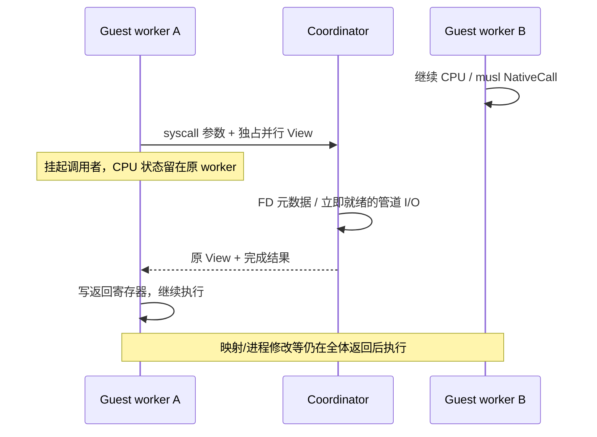

# CPU epoch 内的内核服务

从“任何普通 syscall 都暂停全部 CPU”逐步改为“调用者等待服务，其他 CPU 保持运行”。
这是一条协调器请求通道；VFS 仍由协调线程拥有，尚未让多个宿主线程同时修改 VFS。

## 三种执行边界

| 类别 | 当前执行位置 | 同步范围 |
| --- | --- | --- |
| 身份/时钟/getcpu、F_GETFD/F_GETFL、纯内存/字符串/解析/回调/allocator 快路径 | worker 内 | 同一个 guest 内存和原算法同步模型，无逐调用内核往返 |
| 普通 FD 的 lseek/fstat、立即可完成的 pipe/embedding stdio/guest Unix stream 字节 I/O、符合映射准入的普通文件标量/向量/定位 I/O 与 fsync/fdatasync | 协调器服务，epoch 保持 | 只挂起调用者，其他 worker 可以继续解释或执行原生函数 |
| 映射、进程生命周期、futex/信号、非 ALLOW 或 trace syscall、有共享写入能力的映射文件读取、活跃映射文件写入、共享宿主 backing、其他 socket/PTY、stateful Vulkan、需要 backing checkpoint 的 NativeCall | joined coordinator | 保留既有 checkpoint；后续按资源拆分 |

未启用 syscall trace 的任务可以请求 epoch 服务；安装 seccomp 的任务先在 worker
按不可变过滤器快照验证调用号、PC 和六个参数，仅 ALLOW 可以继续。协调器在
任何 I/O 效果前再次验证。过滤器安装/TSYNC 等权限变更仍等待全部 worker joined。
动态 proc/sysfs FD 元数据仍先 join，使用完整进程快照。
writable MAP_SHARED 脏字节尚需 join 才能写回 VFS backing，直接读写旧 backing 会失去
CPU/FD 一致性。private COW 不修改 inode，无共享写入能力的映射允许文件读取。
不能只因为某调用不改虚拟地址表就把它判为安全。

## 普通文件的保留对象准入

普通文件新增 read/write、readv/writev、pread/pwrite、preadv/pwritev、fsync/fdatasync
服务，全部复用 joined 路径的 Linux ABI、guest 访存预检、VFS 权限/配额/offset/append/
通知/持久化实现。没有另写一套文件操作，也没有增加宿主线程直接访问 Rc/RefCell。

FD 表版本只缓存候选位图；streams 和 files 同一次扫描构建，FD 修改时一起失效。
这个位图不是授权或映射缓存。每次实际服务按 OpenDescription 保留的 inode 再检查：

- 仅普通非 volatile 文件；动态 proc/sysfs/cgroup、设备、socket/PTY 和宿主共享 backing
  继续 join。SharedFile 还可能由显示/GPU 保留，不能仅因 guest 未 mmap 就视为独占。
- FileMapping 在所有 VM 中保留 FilePage。文件写入仍要求没有活跃映射；读取与 sync
  允许无共享写入能力的映射，private COW 写入不改变文件内容。MAP_SHARED + O_RDWR
  即使当前只有 PROT_READ，也仍按潜在 writer 保守判定。writer 判断缓存于 MappedData，
  在批量映射、next_page 与映射释放时失效，不逐次扫描大文件页表。映射消失后，原 FD
  无需重新打开就恢复写入服务资格。
- 硬链接、rename/unlink 和路径替换按实际对象判断；overlay 的只读旧描述符保留下层，
  下层映射仍阻止该描述符服务，copy-up 后的新上层可以独立服务。
- 有限 RLIMIT_FSIZE 的文件写入仍 join，保留原来的短写、EFBIG 与 SIGXFSZ 处理；
  不对已完成文件写入做“失败后回退重放”。pipe 的 EAGAIN/SIGPIPE 边界继续保留。

该方案允许未映射文件服务期间其他 CPU/native worker 前进；多个 VFS 请求仍由同一个
协调器依次处理；下述大块磁盘读取已拆分宿主提交/完成，写入和 sync 仍同步。结果和范围见[文件服务验证](../validation/epoch-files.md)。

## 大块磁盘读取的提交与完成

普通未映射磁盘文件的 read/readv/pread/preadv，在请求长度达到 16 KiB 时尝试异步。
小读取、内存文件、EOF/零长度、MappedData 与宿主共享 backing 沿用原路径；尤其不能
绕开 MappedData 的已缓存脏页读取，仅检查“现在没有 shared writer”还不足以直读磁盘。
单任务/单 CPU 的 joined 读取尚未异步化。

协调器使用原 Linux 标量访存预检、readv_parts 和 scatter，保留完整 arm64 64 位 offset、
1024 iovec、1 MiB transfer cap、短读和原有 errno。先验证全部目的地址，再提交任务。
后台任务只携带 offset/count 和 Arc<DiskBacking>；打开文件时沿用原 regular/O_NOFOLLOW/
metadata 检查。没有新增 guest 路径到宿主路径的转换，也没有传递 guest 页、借用或
VFS Rc/RefCell。DiskBacking 的 orphan flag 和 DiskStore 锁租约使用 Arc，保留匿名文件
和已 unlink 文件直到最后一个后台任务释放；VFS 与 Node 仍属于协调线程。

最多两个持久宿主 I/O 线程按需启动，不为每个 syscall 建线程。每个被调度 guest CPU
至多持有一个未答复请求，因此 pending、等待队列和已提交 job 数均受 CPU 数（最多 32）
约束，每个数据缓冲至多 1 MiB；不会无限预取。独立 OFD 的定位读取可并发；同一 OFD
的 offset 操作和同一 backing 的写入/sync 等待冲突读取完成。硬链接按 inode/backing
身份判断。独立 pipe/Unix stream 服务和其他 CPU/native 工作继续执行，不加 VFS 全局锁。

完成事件和 CPU/服务事件共用协调器 channel。协调器更新共享 OFD offset、atime/inotify，
再用调用者保留的 View 写回。stop、预算耗尽、取消、映射/进程变更前必须收完所有已提交
任务并回复结果，不能将其作为未执行 syscall 重放；尚未提交的等待请求可以 join。
线程创建/发送失败在原协调器执行一次该任务并返回完成，不丢失请求。

为减少每次提交成本，I/O worker 各保留至多 16 个已验证的只读宿主句柄，按
DiskBacking 的 Weak 身份查找，使用 pread 定位读取，命中不再重复 open/stat/seek。
缓存不保存 guest 权限、offset 或长度，实际准入与范围每次仍取协调器的当前状态。
同路径替换、overlay copy-up、关闭后重新打开 store 的新对象不能按路径/inode 数字命中
旧句柄。Weak 不延长对象路径或存储锁租约；不过宿主 FD 仍可短暂保留删除 inode 的块，
所以每次任务前清理已失效身份，空闲 250 ms 后释放全部句柄并进入无定时器阻塞等待。
最多两个 worker，总计最多 32 个缓存句柄；退出时也关闭，不为每个持久文件保留 FD。

完成后的独占 Vec 返回协调器池，保留最多两份、每份至多 1 MiB；再次提交时把所有权
移动给后台。保留已初始化长度，等长读取不再反复分配/清零。短读先 truncate 再 scatter，
扩长仍初始化新增部分；错误不输出旧内容，guest 写回失败后缓冲也可回收。标量目的地址
直接保存在请求里；向量继续使用原 Linux helper。pending 从逐请求 BTreeMap 节点改为
可复用空槽，槽位只在原完成事件已消费后再用，不会混淆并发/乱序完成。无 pending 且
无需大块读取准入的请求直接走原服务，避免多一次 process 查找。没有新增全局锁/原子
计数，或通过串行化多个文件来降低表面成本。验证见
[异步读取成本记录](../validation/disk-cost.md)。

CLI metrics 新增 disk_reads/disk_read_bytes，分别表示 epoch 内提交的后台读取数及其
成功读取字节，包含最终 guest 写回失败前已读取的字节；不是全部 guest read，也不是
磁盘物理吞吐。当前仍在公平/定时 checkpoint 前 drain 后台读取，所以冷盘长等待仍可能
延迟全局 checkpoint。写入涉及配额预留、append、部分写与持久化提交，尚未 offload；
fsync 的 manifest checkpoint 和磁盘元数据访问仍同步。验证见
[异步磁盘读取记录](../validation/async-disk.md)。

## 减少服务往返与宿主分配

F_GETFD/F_GETFL 直接读取 epoch 的不可变 FD flags 快照，并复用 Linux 的 flags ABI
转换函数。FD 表结构/CLOEXEC 修改使快照失效；共享 open description 的 F_SETFL 使用
revision，使独立 fork 表里的旧缓存也失效。worker 只持有 Arc/plain values，未持有
VFS 的 Rc。没有使用该 FD 快照缓存权限决定；seccomp 另用不可变程序逐调用求值，
非 ALLOW 和 trace 任务仍走原 syscall 路径。

每个 worker 复用一个回复 channel。唯一 sender 随请求发出，再随 View/结果返回，
等待时 worker 不保留额外 sender；意外丢弃请求会断开接收并报告 worker 故障，不能
永远等待。正常停止仍 drain 所有请求，已完成操作仍提交结果。每个请求的 Box 仍存在，
没有宣称整个通道零分配。

Kernel 保留一个受 MAX_WRITE 逻辑长度限制的写入 scratch Vec，供标量/向量/定位服务
复用；每次按本次长度重设并完整复制有效字节后才进行 I/O。小写入、EFAULT 和零长度
不会输出上一次的尾部；所有进程共用一份协调器缓冲，不为每个进程保留一份大块缓冲。
Linux 的 joined 路径与服务路径继续共享同一 helper，原生函数的算法/访存锁不变。

Guest AF_UNIX SOCK_STREAM 的 read/write/readv/writev 复用原 VFS byte API。EAGAIN 的
阻塞等待、SIGPIPE 仍 join；recvmsg/SCM_RIGHTS 安装、连接/accept/关闭、native bridge、
PTY job control、AF_INET 网络继续保留原边界。普通 read 丢弃 ancillary 的行为沿用原
byte API，不把它当成 recvmsg。成组改动与结果见[验证记录](../validation/epoch-batch.md)。

## 所有权与退出

- worker 把自己的 `View` 移交服务请求，收到回复后取回；不复制整个映射快照或重建
  TLB，不把 Process::memory、CPU placeholder 或 VFS 的 Rc/RefCell 发到其他线程。
  View 本来就是 Send/非 Sync；移动后仍独占其翻译缓存，共享的页字节继续使用 CPU 的
  同一并发访问协议。没有借用/页 guard 跨越请求等待。
- CPU 寄存器、解释器缓存、native registry 留在原 worker，回复后继续使用本次预算。
  其他 worker 不因这个请求收到 stop；普通 native entry 仍保持 worker 内连续执行。
- 服务复用 Linux 原有 read/write 和 FD ABI helper，只把内存参数泛化为 CpuMemory。
  协调器不通过串行 Memory 访问正在运行的快照字节，也不新增权限策略。
- EAGAIN 的阻塞路径、SIGPIPE、不可处理的 FD 类型在产生效果前请求 join，交还原来
  的等待/超时/信号实现。已经成功消费输入或输出字节的请求，即使 stop 已到，也必须
  回复“完成”，不能退回并重放同一个 syscall。
- 正常 drain、取消和 Pool::drop 都回复排队请求并归还 View，再 join worker。
  不能仅设置 stop 然后等待一个仍在等回复的 worker。意外 channel 断开按原来的 worker
  故障处理，不把可能已有的效果当作可重试操作。
- 全局指令预算保留：SVC 已退休一次，服务不再多算指令；工作在 stop 后返回结果再让出，
  未使用 credit 最终归还。reply 等待时间从 worker CPU elapsed 中扣除。

## 避免把诊断计数变成热路径同步

原先每个 native body 都有 active.fetch_add、peak.fetch_max、active.fetch_sub 三次
共享原子 RMW。现在普通生产执行关闭 CPU/native 并发峰值跟踪，CLI --metrics / runtime
profile_syscalls 才启用。worker 私有的函数/字节计数继续收集；原函数和 guest 内存的
锁、CAS、ARM 内存次序并不因此改变。未开启诊断时 peak 字段为 0，不代表没有多核。
诊断时，挂起等待服务的调用者不计入 active CPU；峰值也不是宿主 CPU 占用率。

read/write 服务的 FD bitmap 缓存在现有共享描述符表版本中，结构变化时失效；
fork/dup/close/CLOEXEC/detach 保留原语义。每次 dispatch 只复制一个小位图，避免扫描
所有 FD，也不为明显不支持的普通文件 I/O 多走一次请求/回复后才 join。

## 验证及后续

确定性测试在一个 syscall 请求被持有时让另一个 worker 完成原生内存操作；
另外覆盖 stop 与完成结果交错时不重放、输入预检不消费 pipe、阻塞/EAGAIN/SIGPIPE、
退出 drain、版本 bitmap 和精确 SVC 预算。固定原版静态 musl 程序同时执行原生 memset、
FD 查询/管道 I/O、mmap/munmap、dup/close，对照本机 C 语义输出，检查全部字节计数。
这不是完整 guest CPU oracle。测量和平台范围见[验证记录](../validation/epoch-services.md)。

下一步是映射文件/网络 I/O 的共享 backing 一致性与异步提交/完成，再拆分 VFS 元数据
读写同步。映射和进程操作需要按实际共享 VM/backing 缩小暂停集合；futex 需要地址级
compare/enqueue/wake 协调。Vulkan backend 还依赖协调器 Memory 和所属 VM/VFS 资源，
必须先拆分内存接口与对象所有权，才能把 stateful API 的同步缩到资源/队列范围。
不能用一把 VFS 全局锁替代这项拆分，也不能把 Rc/RefCell 直接标成 Send。
