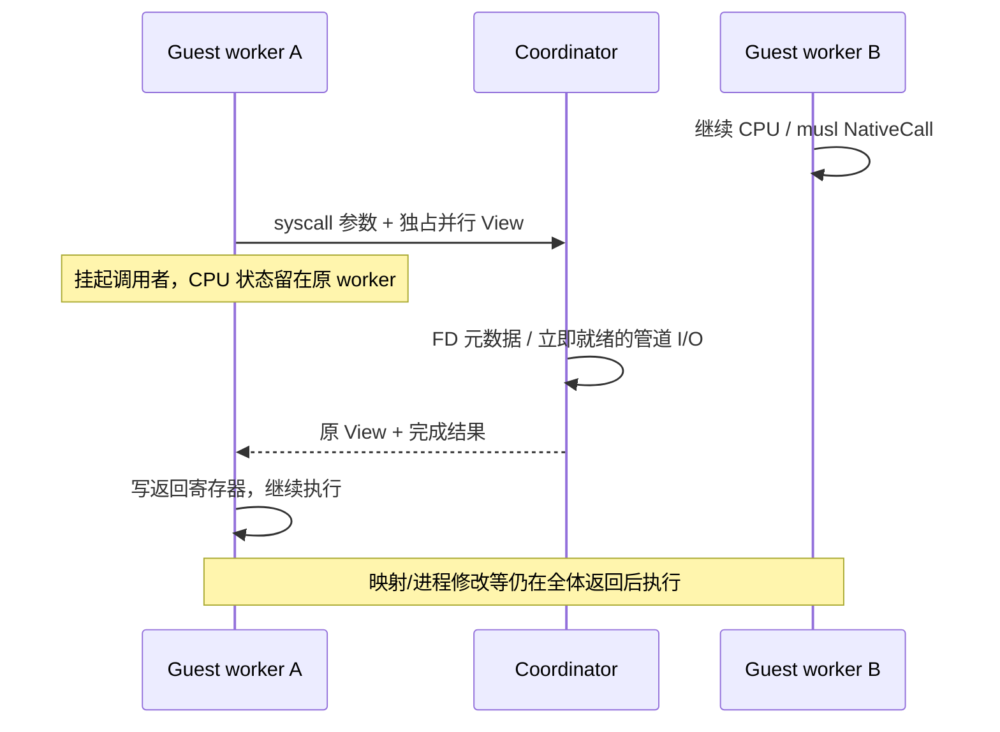

# CPU epoch 内的内核服务

从“任何普通 syscall 都暂停全部 CPU”逐步改为“调用者等待服务，其他 CPU 保持运行”。
这是一条协调器请求通道；VFS 仍由协调线程拥有，尚未让多个宿主线程同时修改 VFS。

## 三种执行边界

| 类别 | 当前执行位置 | 同步范围 |
| --- | --- | --- |
| 身份/时钟/getcpu、纯内存/字符串/解析/回调/allocator 快路径 | worker 内 | 同一个 guest 内存和原算法同步模型，无逐调用内核往返 |
| F_GETFD/F_GETFL、普通 FD 的 lseek/fstat、立即可完成的 pipe/embedding stdio read/write/readv/writev、无活跃映射的普通文件标量/向量/定位 I/O 与 fsync/fdatasync | 协调器服务，epoch 保持 | 只挂起调用者，其他 worker 可以继续解释或执行原生函数 |
| 映射、进程生命周期、futex/信号、filtered/trace syscall、映射文件/共享宿主 backing/套接字/PTY、stateful Vulkan、需要 backing checkpoint 的 NativeCall | joined coordinator | 保留既有 checkpoint；后续按资源拆分 |

只有 seccomp mode 0 且未启用 syscall trace 的任务请求 epoch 服务。
动态 proc/sysfs FD 元数据仍先 join，使用完整进程快照。
Mapped file 数据目前不在 I/O 服务名单：其 writable MAP_SHARED 脏字节
尚需 join 才能写回 VFS backing，直接读写旧 backing 会失去 CPU/FD 一致性。
不能只因为某调用不改虚拟地址表就把它判为安全。

## 普通文件的保留对象准入

普通文件新增 read/write、readv/writev、pread/pwrite、preadv/pwritev、fsync/fdatasync
服务，全部复用 joined 路径的 Linux ABI、guest 访存预检、VFS 权限/配额/offset/append/
通知/持久化实现。没有另写一套文件操作，也没有增加宿主线程直接访问 Rc/RefCell。

FD 表版本只缓存候选位图；streams 和 files 同一次扫描构建，FD 修改时一起失效。
这个位图不是授权或映射缓存。每次实际服务按 OpenDescription 保留的 inode 再检查：

- 仅普通非 volatile 文件；动态 proc/sysfs/cgroup、设备、socket/PTY 和宿主共享 backing
  继续 join。SharedFile 还可能由显示/GPU 保留，不能仅因 guest 未 mmap 就视为独占。
- FileMapping 在所有 VM 中保留 FilePage，任何活跃映射都使同一文件的 I/O join，
  包括只读/private 映射。此次不尝试放宽到“仅无可写映射”，避免引入更多准入分支。
  映射消失后，原 FD 无需重新打开就恢复服务资格。
- 硬链接、rename/unlink 和路径替换按实际对象判断；overlay 的只读旧描述符保留下层，
  下层映射仍阻止该描述符服务，copy-up 后的新上层可以独立服务。
- 有限 RLIMIT_FSIZE 的文件写入仍 join，保留原来的短写、EFBIG 与 SIGXFSZ 处理；
  不对已完成文件写入做“失败后回退重放”。pipe 的 EAGAIN/SIGPIPE 边界继续保留。

该方案允许未映射文件服务期间其他 CPU/native worker 前进；多个 VFS 请求仍由同一个
协调器依次处理，宿主磁盘 I/O 尚未异步化。结果和范围见[文件服务验证](../validation/epoch-files.md)。

## 所有权与退出

- worker 把自己的 `View` 移交服务请求，收到回复后取回；不复制整个映射快照或重建
  TLB，不把 Process::memory、CPU placeholder 或 VFS 的 Rc/RefCell 发到其他线程。
  View 本来就是 Send/非 Sync；移动后仍独占其翻译缓存，共享的页字节继续使用 CPU 的
  同一并发访问协议。没有借用/页 guard 跨越请求等待。
- CPU 寄存器、解释器缓存、native registry 留在原 worker，回复后继续使用本次预算。
  其他 worker 不因这个请求收到 stop；普通 native entry 仍保持 worker 内连续执行。
- 服务复用 Linux 原有 read/write 和 FD ABI helper，只把内存参数泛化为 CpuMemory。
  协调器不通过串行 Memory 访问正在运行的快照字节，也不新增权限策略。
- EAGAIN 的阻塞路径、SIGPIPE、不可处理的 FD 类型在产生效果前请求 join，交还原来
  的等待/超时/信号实现。已经成功消费输入或输出字节的请求，即使 stop 已到，也必须
  回复“完成”，不能退回并重放同一个 syscall。
- 正常 drain、取消和 Pool::drop 都回复排队请求并归还 View，再 join worker。
  不能仅设置 stop 然后等待一个仍在等回复的 worker。意外 channel 断开按原来的 worker
  故障处理，不把可能已有的效果当作可重试操作。
- 全局指令预算保留：SVC 已退休一次，服务不再多算指令；工作在 stop 后返回结果再让出，
  未使用 credit 最终归还。reply 等待时间从 worker CPU elapsed 中扣除。

## 避免把诊断计数变成热路径同步

原先每个 native body 都有 active.fetch_add、peak.fetch_max、active.fetch_sub 三次
共享原子 RMW。现在普通生产执行关闭 CPU/native 并发峰值跟踪，CLI --metrics / runtime
profile_syscalls 才启用。worker 私有的函数/字节计数继续收集；原函数和 guest 内存的
锁、CAS、ARM 内存次序并不因此改变。未开启诊断时 peak 字段为 0，不代表没有多核。
诊断时，挂起等待服务的调用者不计入 active CPU；峰值也不是宿主 CPU 占用率。

read/write 服务的 FD bitmap 缓存在现有共享描述符表版本中，结构变化时失效；
fork/dup/close/CLOEXEC/detach 保留原语义。每次 dispatch 只复制一个小位图，避免扫描
所有 FD，也不为明显不支持的普通文件 I/O 多走一次请求/回复后才 join。

## 验证及后续

确定性测试在一个 syscall 请求被持有时让另一个 worker 完成原生内存操作；
另外覆盖 stop 与完成结果交错时不重放、输入预检不消费 pipe、阻塞/EAGAIN/SIGPIPE、
退出 drain、版本 bitmap 和精确 SVC 预算。固定原版静态 musl 程序同时执行原生 memset、
FD 查询/管道 I/O、mmap/munmap、dup/close，对照本机 C 语义输出，检查全部字节计数。
这不是完整 guest CPU oracle。测量和平台范围见[验证记录](../validation/epoch-services.md)。

下一步是映射文件/网络 I/O 的共享 backing 一致性与异步提交/完成，再拆分 VFS 元数据
读写同步。映射和进程操作需要按实际共享 VM/backing 缩小暂停集合；futex 需要地址级
compare/enqueue/wake 协调。Vulkan backend 还依赖协调器 Memory 和所属 VM/VFS 资源，
必须先拆分内存接口与对象所有权，才能把 stateful API 的同步缩到资源/队列范围。
不能用一把 VFS 全局锁替代这项拆分，也不能把 Rc/RefCell 直接标成 Send。
