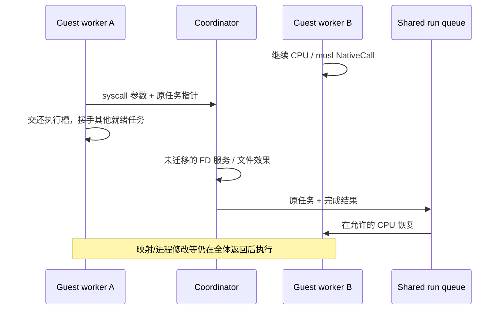

# CPU epoch 内的内核服务

从“任何普通 syscall 都暂停全部 CPU”逐步改为“调用者等待服务，其他 CPU 保持运行”。
仍需协调服务的路径使用下图；pipe/eventfd/timerfd/已连接 Unix stream、其 epoll、无临时
信号掩码的共享资源 ppoll、private/shared futex、符合准入的普通文件短调用，以及已连接
原生 TCP 的就绪标量/向量字节 I/O 已直接共享资源。
VFS 的命名空间/FD 表仍由协调角色拥有；普通文件字节、OFD
偏移、可变状态标志及活动元数据镜像可以共享，没有将整棵 VFS 加锁或标记为 Send。

## 三种执行边界

| 类别 | 当前执行位置 | 同步范围 |
| --- | --- | --- |
| 身份/时钟/getcpu、F_GETFD/F_GETFL、纯内存/字符串/解析/回调/allocator 快路径 | worker 内 | 同一个 guest 内存和原算法同步模型，无逐调用内核往返 |
| F_SETFL/FIONBIO 的 O_NONBLOCK/O_APPEND 状态修改 | worker 内 | OFD 的共享原子状态；固定访问位和 FD/CLOEXEC 仍保留原权限/生命周期边界 |
| 合格普通文件的 F_GETLK/F_SETLK | worker 内 | 每个 inode 的共享锁集合；冲突检查/提交同一事务；owner 与 worker 共用 flock ABI；F_SETLKW 阻塞/死锁仍保留原路径 |
| F_SETFD 与 close_range(CLOSE_RANGE_CLOEXEC) | worker 内 | 同一 Files 域的原子 CLOEXEC；fork、UNSHARE、exec 在原生命周期边界复制/脱离；创建/关闭/dup 仍 joined |
| pipe/eventfd/timerfd/已连接 Unix stream 标量/向量 I/O、只监听这些资源的 epoll | worker 内 | 原子/对象锁；阻塞交还执行槽，资源就绪直接入队；需要 SIGPIPE 或接收 FD 权限时保留 joined 路径 |
| timerfd_settime/gettime、无临时信号掩码且仅包含上述共享资源的 ppoll | worker 内 | 共用原 Linux ABI；到期/重新设置直接恢复任务，调用超时不结束整个 cohort；timerfd 创建和 FD 安装仍 joined |
| Unix stream 的 sendto/recvfrom/sendmsg/recvmsg 字节路径和 shutdown、pipe/Unix 的 FIONREAD | worker 内 | 共用原 Linux 预检、字节队列和就绪通知；MSG_DONTWAIT/WAITALL/PEEK/NOSIGNAL 按原语义处理 |
| private/shared FUTEX_WAIT/WAIT_BITSET/WAKE/WAKE_BITSET、REQUEUE/CMP_REQUEUE、sched_yield | worker 内 | 冻结的共享 backing key、原子比较/入队/迁移和共享就绪队列；阻塞/让出释放执行槽，cohort 内唤醒不结束整轮执行 |
| 普通 Plain 文件的 lseek/fstat、小块磁盘/内存文件 read/readv/pread/preadv，以及无增长覆盖 write/writev/pwrite/pwritev | worker 内 | 同一份文件字节和 OFD 偏移；对象锁、原子长度及活动元数据镜像；受限情形在产生效果前退到服务 |
| Vulkan NativeCall，包括资源、命令记录/提交、coherent transfer、编译与已认证的呈现 | 调用者 worker 内 | 共享的每 VM GPU context 独占对象图；竞争与编译等待交还执行槽，完成事件直接入队；设备 teardown 和未获 FD 授权的调用仍 joined |
| 无活动防火墙规则的已连接原生 TCP read/write/readv/writev | 调用者 worker 内 | 原 BSD 收发主体；宿主 FD 由原 socket 所有者持有，weak 能力不延迟关闭；真正阻塞或 SIGPIPE 需求仍 joined |
| guest PTY master/slave 的标量/向量读写、TCGETS/TIOCGWINSZ/FIONREAD，以及包含 PTY 的 ppoll/epoll | worker 内 | 同一个终端对象锁、共享 line discipline 与就绪通知；信号输入、作业控制、其余可变 ioctl 仍 joined |
| 其余普通 FD 的 lseek/fstat、embedding stdio/未准入 stream 字节 I/O、符合映射准入的文件 I/O 与 fsync/fdatasync | 协调器服务，epoch 保持 | 请求持有原任务/View，调用者交还宿主槽；完成直接排回共享队列 |
| 映射、进程生命周期、futex 唤醒未保留 View 的任务、信号、非 ALLOW 或 trace syscall、有共享写入能力的映射文件读取、活跃映射文件写入、共享宿主 backing、其他 socket、PTY 信号/控制操作、Vulkan 未获 FD 授权的认证/设备 teardown、需要 backing checkpoint 的普通 NativeCall | joined coordinator | 保留既有 checkpoint；后续按资源拆分 |

未启用 syscall trace 的任务可以请求 epoch 服务；安装 seccomp 的任务先在 worker
按不可变过滤器快照验证调用号、PC 和六个参数，仅 ALLOW 可以继续。协调器在
任何 I/O 效果前再次验证。过滤器安装/TSYNC 等权限变更仍等待全部 worker joined。
动态 proc/sysfs FD 元数据仍先 join，使用完整进程快照。
writable MAP_SHARED 脏字节尚需 join 才能写回 VFS backing，直接读写旧 backing 会失去
CPU/FD 一致性。private COW 不修改 inode，无共享写入能力的映射允许文件读取。
不能只因为某调用不改虚拟地址表就把它判为安全。

## 第一批共享资源已移出协调器

2026-10-22，匿名管道和 eventfd 通过保留的 Send/Sync 资源句柄由当前 worker 直接执行。
eventfd 的计数使用原子 RMW，读 acquire、写 release 保留实际通知的发布关系；readiness
版本使用 relaxed 原子。管道复用原来的队列、EOF、PIPE_BUF 和 backpressure 算法，锁只
覆盖同一个管道的数据不变量。VFS 的标量读写、poll、splice 及 native pipe relay 使用
同一份资源，不创建第二份字节队列，也不把 VFS 的 Rc/RefCell 声明成 Send。

FD 表只发布可复用的共享句柄快照；close/dup/exec 的表变更使缓存失效，fork 后共享
status flags 的更新也会失效。这个阶段 FD 变更仍发生在 joined 边界，快照没有宣称支持
并发 close/reuse 或 flags 修改。保留资源字节的寿命不等于额外打开一个管道端点。
这是第一批的历史边界；第十八批已改为共享可变 OFD 状态，不再因 status 更新让快照
全局失效，FD 表结构变更仍保留上述边界。

Linux 标量及向量的 guest 访存预检、复制、scatter 仍共用原 helper。eventfd 向量 I/O
按每个 iovec 的记录长度处理，保留已完成记录的短返回，不把短片段拼成一条记录。
worker 写入 scratch 在持久 worker 上保留，跨 dispatch 移交所有权，不反复分配/清零。
第一批在阻塞 EAGAIN 与 SIGPIPE 无效果时返回调度边界；第四批已将前者迁到运行队列。
SIGPIPE 仍保留 joined 信号路径；不再先请求一次失败的协调服务。
非阻塞 EAGAIN 和完成后的部分传输留在 worker 返回。没有新增轮询、消息总线或线程。

CLI 的 worker_direct_syscalls 单列这批 I/O，并计入 worker_syscalls。成功调用不再带着
约 6 KiB View 往返协调通道；计数由 worker 私有 Cell 维护，在 dispatch 完成时汇总。
原生计算继续留在同一个 worker，不额外套原生函数全局锁。结果及剩余集中路径见
[共享资源 I/O 验证](../validation/worker-local-io.md)。

## 共享 futex 等待与就绪通知

以下第二批迁移记录的后续已实现：private WAIT 与同 cohort 唤醒的执行槽交接见下一节。

2026-10-22 的第二批迁移取消了每轮 dispatch 扫描进程、重建 private waiter bitset 的
快照。Kernel 与 worker 共享持久 Futexes 表，按 VM/地址或共享 backing key 建立等待
队列，64 个哈希桶分别同步。WAIT 的比较与入队在同一桶锁内；当前 WAIT 仍由 joined
路径执行，没有将持有 Rc 的 Process、串行 Memory 或注册所有者传递到 worker。

每次等待有独立 ticket；wake、timeout、cancel 用 relaxed CAS 决定唯一状态变化。
这个原子只决定等待结果，队列由 Mutex 发布，不给普通 guest 字节添加屏障。
worker 上 ALLOW 的 private WAKE/WAKE_BITSET 直接修改相同队列并返回实际数量。
没有匹配项时继续运行；成功唤醒时将 ticket 放入共享 ready 队列，并设置已有 stop
标志。Done 事件唤醒原有调度器，不新增 RPC、轮询、服务线程或 host futex 等待。

当前仍需要一次全体调度边界才能让被唤醒任务运行；这一步没有宣称取消 epoch join。
返回的 wake 已完成，不能再次交给 joined syscall 执行。ready 队列在处理返回的
WAIT/REQUEUE/exit/signal 前提交，并校验 ticket 身份，PID 重用不会接收旧通知。
注册的最终所有者释放时立即取消、移出对应 key；停止状态可以保留等待，退出则释放
它。REQUEUE 仍 joined，但仅移动匹配队列的原 ticket，保留 bitset/deadline，不再遍历
全部进程。共享 key 的 wake、clear_tid 也复用同一表，当时仍走原执行边界；第十一批已迁移共享 key 与 requeue。

CLI worker_futex_wakes 计有效本地 private wake 调用（含返回 0），worker_futex_woken
计实际唤醒 ticket；两者都是 worker 私有计数，汇总时才合并。后续再将阻塞任务的
调度与 VM 映射租约拆开，使 worker 可接手新任务、只同步相关 VM。
范围和验收见[共享 futex 记录](../validation/shared-futex.md)。

## 执行 cohort 与共享运行队列

2026-10-22 第三批迁移将原来的“每个 worker 固定运行一个任务，futex 后整轮返回”改为
“一组冻结的 VM View 与任务由共享运行队列持有，已有 worker 在阻塞后接手其他任务”。
Kernel 在启动前准备所有 ready 任务，以及这些 VM 中未冻结的 futex 等待者；View 全部
准备完才调用原来的 private epoch 准入。运行期间不再创建/克隆 View，不访问协调器
Memory 的 guest 字节；任务保留 CPU、View、翻译缓存和不可变权限快照。它们固定在同一
个 Box 分配中，只有 Box 指针进出 ready/parked 队列，不逐次搬运约 7.5 KiB Work。

private WAIT/WAIT_BITSET 在执行 worker 上使用同一个 guest 内存模型读取比较字，并在
futex 桶锁内原子地比较/入队。相对、绝对、realtime 超时和 bitset/errno 与 joined 路径
复用同一个解析 helper。注册所有者改为有明确同步字段的 Arc，不包含 Rc/Process。
在发布 ticket 前绑定 cohort；WAKE 释放 futex 桶锁后直接通知运行队列，避免等待锁
顺序反转。wake 先于 park 时由 ticket 状态保留通知，park 后则直接重新入队。

等待任务释放宿主执行槽；同一宿主 worker 可以运行它的 waker，再继续被唤醒任务。
其他 CPU/native body 不暂停，也不请求协调器。sched_yield 直接排到队尾。空闲 worker
通过条件变量和最近的实际 futex deadline 休眠，stop 与通知受同一队列锁保护，避免
检查条件与入睡之间丢通知。队列锁仅覆盖调度状态，不覆盖 guest 解释或原生函数。
CPU affinity 保留原分配算法给出的首次槽位，防止 flexible 任务抢走 pinned 任务唯一
的执行槽；迁移时清除 exclusive reservation，并更新 getcpu 快照。

每个任务累计自己的预算、CPU 时间、每 CPU 用时、decode/native/syscall 指标；一次
SVC 只退休一次，阻塞后不能重放。未用的指令 credit 只在执行槽交还时退回。运行队列
不调用文件/GPU API；普通 native registry、scratch 仍随宿主 worker 复用。

低频/不支持的调用、映射修改、进程/权限/FD 变更、外部通知、会话预算和公平性边界仍
结束 cohort。每个已启动 worker 都确认停止，已提交磁盘读取收完，队列里保留的 View
全部释放之后才提交 backing 和执行 fork/exec/exit。取消、全体等待及请求异常同样走
这个所有权边界；异常请求已释放 View 时只返回 CPU/故障，不虚构一个替代 View。

所以专用协调角色还在，但 private futex 交接不再逐次经过它；旧的一任务 dispatch
入口仅用于测试，同一个 CPU 执行循环服务生产 cohort。验证及一次固定工作量对照见
[任务交接记录](../validation/task-handoff.md)。

## 阻塞 pipe/eventfd 与 epoll 直接交接

2026-10-22 第四批将 pipe/eventfd 的阻塞 read/write/readv/writev，以及仅监听这两类资源
的 epoll_pwait/epoll_pwait2（无临时 signal mask），接入同一运行队列。调用者保留执行 View
和已退休的 SVC，不占住宿主 worker 等回复；资源变化直接通知队列，当前 worker 或其他
允许的 worker 继续完成原调用。epoll 超时只唤醒 pending 调用做最终检查，不重放 SVC。

就绪/非阻塞字节 I/O 与已就绪/零超时 epoll 直接完成，不分配订阅或通知对象。实际需要
等待时，先订阅、再次执行资源检查，再 park；wake-before-park 由原子 fired 位保留。
通知不传消息、不创建协调/服务线程，也不访问 guest Memory。回调仅在管道数据锁和
订阅锁都释放后进入运行队列；队列只移动任务，不在锁内执行字节 I/O。

管道使用统一 guard 检测 io_epoch 的实际变化，释放锁后通知，原 VFS/splice/native relay
也复用同一机制。未订阅时仅检查标志。eventfd 的计数仍用原 acquire/release RMW；另用
订阅标志上的 RMW 握手发布资源变化。订阅 acquire RMW 若排在变化之后，随后重试可见
变化；排在之前，变化方看到 armed 并通知。不能用两个独立 relaxed 标志/计数加载替代
这个握手，否则 ARM 允许双方都没看到对方。通知位本身通过 release RMW 发布、在重试
前 acquire RMW 清除，覆盖任务已 running 时合并通知、随后再次检查资源的窗口。
这些同步只用于真正的等待/唤醒，没有给普通 guest 字节增加内存屏障。

每个 epoll 的公平游标、ET 世代与 ONESHOT armed 状态由 joined/worker 路径共享，
并发 waiter 不重复消费 ONESHOT。ctl 修改 watch 集后失效 FD 快照；DEL/MOD、FD 变更仍
joined。订阅保留共享资源的生命，不增加管道打开端点数；完成、取消和 cohort 结束后
移除订阅。全部 View 释放后才能提交内存、修改映射及处理生命周期。

启动 cohort 时也可接管既有 unfiltered/untraced 的共享资源 Blocked 调用（跨 VM 的管道
同样可接手），不先由协调器重试一次字节操作；trace/已有过滤器的旧等待保持原边界。
新调用仍逐次通过 Snapshot 的 immutable seccomp ALLOW 检查。此批之后第七批迁移已连接
Unix stream，第八批迁移 timerfd；其他 socket/PTY watch、临时 signal mask、共享 key
futex 及未准入的文件/GPU 服务仍需后续迁移。
worker_io_waits 统计实际 I/O park，worker_task_resumes 合并 futex/I/O 的重新就绪，
worker_direct_syscalls 包括完成的共享资源字节 I/O 与 epoll。

验证和固定工作量对照见[阻塞 I/O 交接](../validation/io-handoff.md)。专用协调角色仍在，
本轮只移除了上述等待/交接对它的依赖；单 CPU joined 执行路径沿用原实现。

## 文件服务等待与完成交接

2026-10-22 第五批取消生产 cohort 中 worker 的请求/回复通道等待。请求直接持有原
Box<Job>，CPU、View、快照与翻译缓存仍处于同一分配，不再将约 6 KiB View 放进信封
搬出/搬回。发送的请求是参数和原任务的持有者；元数据、权限及文件效果仍由原 VFS
所有者处理，未将整棵 VFS 声明成 Send。普通服务与磁盘异步完成共用这条交接路径。

发送前释放运行槽、登记 outstanding service；现有 worker 可以接手其他 ready 任务，
也可以在同一宿主槽继续原生函数。完成方将结果写到请求独占的 CPU，直接将原任务
排回共享队列，按 affinity 继续；不向某个宿主 worker 发回复，也不轮询完成邮箱。
production 不再创建 per-worker reply channel，旧的单任务请求/回复仅留在测试和已有
通信成本实验中。没有新建协调/服务线程；磁盘依然复用最多两个既有宿主 I/O 线程。

ready/running/service 数量受同一个队列锁保护：即使全部 worker 暂无工作，只要仍有
请求持有 View，就不能把 cohort 判为无工作并退出。完成、stop 与条件变量共用该锁。
stop 期间已完成操作仍提交结果；未执行请求返回原 syscall；异常丢弃则释放原 View、
报告 worker failure 并唤醒空闲执行槽。停止阶段等待所有执行槽与请求交还，不依赖
worker 阻塞收回复来间接保证 View 生命周期，再释放队列 View 和提交 guest 内存。

释放宿主槽后，guest 待处理请求数可以超过宿主 CPU 数。已提交磁盘读取因此显式限制
到配置 CPU 数（最多 32），只有它们拥有至多 1 MiB 字节缓冲。其他任务只持有原任务和
参数，完成通知到达时重新准入，不预读、不忙等。共享 OFD 的顺序 read/lseek，以及
同一 backing 的写入/sync，仍等待冲突读取完成；独立定位读取可以重叠。
worker_service_waits 统计这批实际服务交接，worker_task_resumes 包含完成后的重新就绪；
peak_disk_reads 单列磁盘在途峰值。等待时间不计入宿主 CPU 执行时间。

[服务交接验证](../validation/service-handoff.md)包含单宿主槽持有请求时原生调用继续、
多个请求并存、停止/异常/预算的确定性检查，以及六个真实 musl 读取者的 pinned/spread
验收。这一批没有宣称文件元数据或磁盘完成提交已经移出协调角色。

## 普通文件字节、OFD 与短调用直接共享

2026-10-22 第六批把未映射普通文件的内存/磁盘存储合为 Arc<PlainFile>。原 FileData 的
读写和扩容算法仍是唯一实现；新旧执行路径共用相同字节，建立快照不复制文件内容。
每个文件的 RwLock 保护可调整长度的 Vec 或磁盘对象；不同文件没有共用 VFS 数据锁。
文件长度单独用 relaxed AtomicU64 提供 stat/配额扫描，不用它发布字节，不给普通 guest
内存增加屏障。只读文件数据可以并发，写入只与同一对象的存取互斥。

每个 OpenDescription 保留 Arc<Mutex<FilePosition>>，dup/fork 继续共享一个 OFD。顺序
read/write 在同一偏移事务内完成实际传输和位置更新；pread/pwrite 不改变偏移。原 VFS
路径、lseek、锁的相对偏移和 proc fdinfo 都读同一个位置，不另维护 worker 副本。
volatile proc/cgroup 等伪文件和目录沿用原来的位置，不套用普通文件模型。

cohort 开始时按当前 FD/映射状态发布能力；同一个 FD 表、flags revision、FSETID 与
RLIMIT_FSIZE 策略共享一次数组。无候选文件时直接跳过，无额外文件锁或文件系统扫描。
快照只保留虚拟 stat 字段，不逐个对磁盘文件调用 host stat；实际 fstat 再读取当前
blocks、长度、mode 和时间。映射/挂载/权限/FD 变更仍要求结束 cohort，所以这些数组
不能跨 cohort 缓存，mmap 无需改变 FD 表版本也会重新判定。

worker 本地处理普通 Plain 文件的 lseek/fstat，以及标量、向量和定位读写。Linux 访存
预检、gather/scatter、完整 offset 和短传输语义共用原 helper。磁盘读取/覆盖小于
16 KiB 可直接执行；内存读取仍使用原 1 MiB transfer cap。增长、append、O_SYNC/
O_DSYNC、有限 RLIMIT_FSIZE 写入、活跃映射、SharedFile/GPU backing、overlay 下层及
有 inotify inode/父目录观察者的字节 I/O，在发生效果前保留原路径；没有将实际 guest
errno 当成竞态回退标记，也不会回放完成的部分传输。fsync/fdatasync 仍由原所有者同步
对象和 manifest；这不妨碍别的 worker 继续计算。

活动期间仅捕获 inode 的 mode/三项时间进入对象级镜像。worker 与原 VFS 的 atime、
setid 清除及修改时间使用同一镜像；stat 和 manifest 序列化也读取它。所有 worker/
请求返回后，FileEpoch 将镜像提交回这些 Node，再处理映射/生命周期变更。没有让
Rc/RefCell 跨线程；也不为普通解释执行或原生函数加全局锁。

大块磁盘读取仍交给现有异步 I/O 池。准备读取时登记对象 lease 和顺序 OFD 的 pending
状态；新 worker 写入或冲突偏移操作在产生效果前退到原等待路径。完成以实际读取量
更新同一偏移，释放 lease 后恢复相应服务。独立定位读取可重叠。每个 guest 执行宿主
worker 最多缓存 16 个按 backing Weak 身份验证的 host 句柄，读写使用 pread/pwrite；
缓存随宿主槽复用而非随 guest task 增长，cohort 结束清空。原异步池的句柄上限不变。

worker_file_syscalls 单列本地完成的文件调用，同时计入 worker_direct_syscalls 和
worker_syscalls；这是调用数量，不表示读写字节或磁盘物理吞吐。功能与固定工作量
对照见[普通文件 worker 路径](../validation/worker-files.md)。协调角色仍服务未迁移
资源并管理映射与生命周期，尚未完全删除。

## Unix stream、socket 字节 ABI 与共享就绪

2026-10-22 第七批将已连接 AF_UNIX stream 的双向字节队列、容量、半关闭/端点存活和
读写世代拆为 Arc<Resource>。每个 channel 的 Mutex 只覆盖这些共同不变量，不串行化
不同连接。原 LocalSocket 与 worker 使用同一份队列和同一个算法；FIONREAD 使用队列
事务内的 used 字节数，不再遍历所有 packet 求和。没有新建服务线程或消息总线。

guest FD 权限对象仍由原线程的 Rc ledger 拥有，队列只保留不可变 token。worker 可以
直接读取权限消息之前的纯字节前缀；一个调用若触及权限消息，会在消费队列和写入
guest 目的地址之前返回 Checkpoint。sendmsg 带控制区也保留原处理路径。这样无需将
Rc/RefCell 声明为 Send，不会跨线程增减 FD 引用，也不把权限释放或 FD 表安装异步
推迟。原 owning-cycle 拒绝与 LocalRights 的迭代释放仍有效，销毁 ledger 中的对象
之前释放字节锁和 ledger 借用，避免端点递归销毁锁住同一 channel。

read/write/readv/writev 与 sendto/recvfrom/sendmsg/recvmsg 的普通字节传输使用当前
worker。后四种调用复用原 Linux socket ABI 的 scalar、msghdr/iovec、地址/控制区预检
和 gather/scatter；控制区容量非零但没有收到权限时，recvmsg 可本地完成并写回长度 0。
MSG_PEEK 不消费，WAITALL 不在等待之前先消费前缀；DONTWAIT 和 FD 的 O_NONBLOCK 都能
直接返回 EAGAIN。需要发 SIGPIPE 的无效果 EPIPE 保留原信号路径，MSG_NOSIGNAL 则在
worker 返回 EPIPE。共享资源的内部 None 不作为 guest errno 返回。

实际阻塞先订阅、再次检查并交还执行槽；send/recv/shutdown/最后一个端点释放在字节锁
释放后通知同一共享运行队列。半关闭可以在 worker 完成，同时发布 EOF/可写状态变化。
仅监听 pipe/eventfd/这些 Unix stream 的 epoll 可复用原 ET/ONESHOT/公平游标，在当前
worker 等待和恢复，混合上述三种资源也允许。连接建立会失效 FD 快照，即使 FD 表本身
没有变化；最后关闭 socket description 同样失效其他 fork 表的 epoll 快照。保留
Arc 字节资源不等于保留 guest 打开的端点，不能延迟 EOF/HUP。

既有 Blocked send/recv 也可接入 cohort，仍仅限 unfiltered/untraced 的旧等待；新调用
按不可变 seccomp 快照准入。单 CPU 使用原 joined 路径。worker_socket_syscalls 单列
本地完成的 Unix 字节/查询/半关闭调用，包含在 worker_direct_syscalls 中；epoll 只计
入 direct 总数。各计数在任务私有状态累计，不逐次修改全局原子。

Unix bind/listen/connect/accept、SCM_RIGHTS、datagram/seqpacket 的直接 worker 执行、
FD 表变更、其他 socket/PTY/signal 资源，以及 native Wayland 的 host relay
pump 尚未移出原所有者边界。图形协议不需要权限传递的字节可以使用新队列；relay
pump 的调度仍保留。第八批继续迁移 timerfd，POSIX signal timer 仍由原所有者处理。
验证及结构计数见[Unix worker 路径](../validation/worker-unix.md)。

## timerfd、ppoll 与局部计时调度

2026-10-22 第八批将 timerfd 的 deadline、interval、pending 和 ET 世代移到同一个共享
对象。多字段更新由该 timer 的锁保护；原 VFS、worker read、poll 和 get/set 使用同一份
状态及原到期累计算法。get/set 共用 Linux ABI helper，先预检 guest 输出和输入，再
原子地取得旧值并替换计时设置。rearm/disarm 释放对象锁后通知等待者，重新计算缓存的
唤醒时间；没有建立宿主 timer 线程。epoll 可以混合 timer/pipe/eventfd/Unix，保留共享
ET/ONESHOT，已禁用 ONESHOT 的 timer 不继续缩短等待。

不含临时信号掩码的 ppoll 可在 worker 处理上述共享资源，也支持空数组纯超时。先验证
整个数组和输出范围，再查询资源；负 FD 忽略，未知 FD、epoll FD 或特殊资源在输出前
返回原路径，保留 POLLNVAL 等原语义。准备好的数组和共享句柄随 pending 调用保留，
不在每次唤醒后重读输入。FD/映射变更仍需 joined，不能并发替换这批快照。

pending 调用分别记录调用自身的 timeout 和资源的下次 deadline，运行队列等待较早者。
到期只重新检查、恢复相应任务；rearm/disarm 可以改变资源 deadline，不重置调用 timeout。
已退休 SVC 不重放。协调器不再为 worker 持有的计时等待扫描全 FD 表或设全体 cutoff；
owner 处理的 pselect/带掩码或特殊资源等待仍沿用旧 deadline 边界。POSIX timer、信号、
外部事件及原有宿主控制周期也保留。

队列用 relaxed 原子发布最近 deadline 和就绪任务的可用槽位提示，实际 Job 所有权仍由
原队列锁发布。执行中的 worker 在既有 CPU chunk/native 返回边界发现到期，或已前进
至少一次且有同槽 ready 任务、当前分配已运行 250 µs 时，将原 Box<Job> 排回本地队列。
这只交还执行槽，不通知协调器停下其他 CPU；长原生函数内部不会因此被抢占。没有
deadline 或同槽 ready 竞争时不新增宿主时钟查询，也不添加 guest 字节屏障或忙等总线。

worker_timer_syscalls 单列本地完成的 timerfd 读和 get/set，worker_poll_syscalls 单列
ppoll；均包含在 direct/worker 总数内，沿用任务私有计数。worker_task_yields 现在还包括
这类局部 deadline/公平性交接，不能只解释为 guest sched_yield 调用数。
验证及剩余集中边界见[计时等待记录](../validation/worker-waits.md)。

## GPU context 与外部 Vulkan 调用

2026-10-22 第九批将 Vulkan transport 从协调器的 Memory 泛化为 CpuMemory。原 backend
的 ABI、句柄验证、对象算法、驱动提交和 coherent shadow 算法保持同一实现；同步调用
可直接使用调用者的 View。CPU memory 新增同步页片段借用接口，Memory 复用原 chunk，
View 复用 CPU 的 frame guard、resident、dirty/code/reservation 更新，不给 GPU 另加
native backing 权限策略。普通页传输直接借用字节，不增加整段 staging，页 guard 不
跨越驱动执行或调用返回。原纯 native 函数的 backing checkpoint 准入没有变化。

GPU context 每 VM 一份，在准备 cohort 时按已启用的 accelerator capability 保留句柄。
context 独占整个 backend 对象图，Mutex 只同步同一个 context 的外部调用，不锁 VFS、
整个 session 或普通 native body。不同 context 可以并发。同 context 的 host body 仍串行；
第十批已将竞争等待接入共享运行队列，释放宿主执行槽，尚未细化成对象/队列锁。

Backend 本身仍然 !Send/!Sync，内部 Rc/RefCell 不改为通用跨线程类型。Context 的私有
OwnedBackend 信封通过受控 unsafe Send 移交完整、未泄漏内部引用的图，所有访问/析构
由 context 租约串行化：公共 backend API 不返回 Rc/Object/借用，compiler 线程只持有
Send 的参数及 Arc<Device>，UI frame 只持有 Arc image/device/fence，原 Rc dependencies
仍留在图内。Server/Display/Budget 自身已 Send/Sync。未来新增可逃逸引用、TLS 依赖或
回调时必须重新审计这个边界；不能给 Rc/RefCell 或任意 Backend 直接实现 Send/Sync。

worker 继续验证实际 HLT、可执行页身份和 profile/function，资源 ID 仍由原 backend
校验。同步完成只退休一次 HLT；memory fault 走原故障路径。第九批将操作 2/9、27/70、
110/111 留在 joined 路径；第十批已迁移编译与冻结 FD 能力允许的认证，设备/instance
teardown 和 native relay pump 仍保留原边界。Pending 不伪装成完成，也不重放已接受调用。

worker_gpu_calls 单列已尝试的 worker GPU 调用，包含返回 Vulkan 错误或 memory fault
的调用；不计入 syscall 总数。传输量在任务私有状态累计、归还时汇总，不逐次更新全局
原子。负 VkResult 诊断按任务/cohort 合并为次数和最后一次错误，归还时记录 pid、comm、
operation、PC 和 result，不为写 dmesg 再中断 GPU 调用。
边界与验收见 [GPU worker 验证](../validation/worker-gpu.md)。

## 普通文件的保留对象准入

以下是保留协调服务的准入；第六批符合条件的短调用先在 worker 完成。普通文件支持
read/write、readv/writev、pread/pwrite、preadv/pwritev、fsync/fdatasync
服务，全部复用 joined 路径的 Linux ABI、guest 访存预检、VFS 权限/配额/offset/append/
通知/持久化实现。没有另写一套文件操作，也没有增加宿主线程直接访问 Rc/RefCell。

FD 表版本只缓存候选位图；streams 和 files 同一次扫描构建，FD 修改时一起失效。
这个位图不是授权或映射缓存。每次实际服务按 OpenDescription 保留的 inode 再检查：

- 仅普通非 volatile 文件；动态 proc/sysfs/cgroup、设备、socket/PTY 和宿主共享 backing
  继续 join。SharedFile 还可能由显示/GPU 保留，不能仅因 guest 未 mmap 就视为独占。
- FileMapping 在所有 VM 中保留 FilePage。文件写入仍要求没有活跃映射；读取与 sync
  允许无共享写入能力的映射，private COW 写入不改变文件内容。MAP_SHARED + O_RDWR
  即使当前只有 PROT_READ，也仍按潜在 writer 保守判定。writer 判断缓存于 MappedData，
  在批量映射、next_page 与映射释放时失效，不逐次扫描大文件页表。映射消失后，原 FD
  无需重新打开就恢复写入服务资格。
- 硬链接、rename/unlink 和路径替换按实际对象判断；overlay 的只读旧描述符保留下层，
  下层映射仍阻止该描述符服务，copy-up 后的新上层可以独立服务。
- 有限 RLIMIT_FSIZE 的文件写入仍 join，保留原来的短写、EFBIG 与 SIGXFSZ 处理；
  不对已完成文件写入做“失败后回退重放”。SIGPIPE 保留冷路径；共享 pipe/eventfd 的 EAGAIN 已由运行队列处理。

该方案允许文件服务期间其他 CPU/native worker 前进；仍需服务的多个 VFS 请求由同一个
协调角色依次处理；下述大块磁盘读取已拆分宿主提交/完成。结果和范围见[文件服务验证](../validation/epoch-files.md)。

## 大块磁盘读取的提交与完成

普通未映射磁盘文件的 read/readv/pread/preadv，在请求长度达到 16 KiB 时尝试异步。
小读取/内存 Plain 文件已有第六批 worker 路径；其余 EOF/零长度、MappedData 与宿主共享
backing 沿用各自原路径。尤其不能
绕开 MappedData 的已缓存脏页读取，仅检查“现在没有 shared writer”还不足以直读磁盘。
单任务/单 CPU 的 joined 读取尚未异步化。

协调器使用原 Linux 标量访存预检、readv_parts 和 scatter，保留完整 arm64 64 位 offset、
1024 iovec、1 MiB transfer cap、短读和原有 errno。先验证全部目的地址，再提交任务。
后台任务只携带 offset/count 和 Arc<DiskBacking>；打开文件时沿用原 regular/O_NOFOLLOW/
metadata 检查。没有新增 guest 路径到宿主路径的转换，也没有传递 guest 页、借用或
VFS Rc/RefCell。DiskBacking 的 orphan flag 和 DiskStore 锁租约使用 Arc，保留匿名文件
和已 unlink 文件直到最后一个后台任务释放；VFS 与 Node 仍属于协调线程。

最多两个持久宿主 I/O 线程按需启动，不为每个 syscall 建线程。每个 guest 任务至多
持有一个请求；第五批交接后，显式限制已提交 job 数不超过配置 CPU 数（最多 32），
每个字节缓冲至多 1 MiB。其他等待请求只保留原任务/参数，数量受 cohort 任务数约束，
不分配读取缓冲，也不无限预取。独立 OFD 的定位读取可并发；同一 OFD
的 offset 操作和同一 backing 的写入/sync 等待冲突读取完成。硬链接按 inode/backing
身份判断。独立 pipe/Unix stream 服务和其他 CPU/native 工作继续执行，不加 VFS 全局锁。

完成事件和 CPU/服务事件共用协调器 channel。协调器更新共享 OFD offset、atime/inotify，
再用调用者保留的 View 写回。stop、预算耗尽、取消、映射/进程变更前必须收完所有已提交
任务并回复结果，不能将其作为未执行 syscall 重放；尚未提交的等待请求可以 join。
线程创建/发送失败在原协调器执行一次该任务并返回完成，不丢失请求。

为减少每次提交成本，I/O worker 各保留至多 16 个已验证的只读宿主句柄，按
DiskBacking 的 Weak 身份查找，使用 pread 定位读取，命中不再重复 open/stat/seek。
缓存不保存 guest 权限、offset 或长度，实际准入与范围每次仍取协调器的当前状态。
同路径替换、overlay copy-up、关闭后重新打开 store 的新对象不能按路径/inode 数字命中
旧句柄。Weak 不延长对象路径或存储锁租约；不过宿主 FD 仍可短暂保留删除 inode 的块，
所以每次任务前清理已失效身份，空闲 250 ms 后释放全部句柄并进入无定时器阻塞等待。
最多两个 worker，总计最多 32 个缓存句柄；退出时也关闭，不为每个持久文件保留 FD。

完成后的独占 Vec 返回协调器池，保留最多两份、每份至多 1 MiB；再次提交时把所有权
移动给后台。保留已初始化长度，等长读取不再反复分配/清零。短读先 truncate 再 scatter，
扩长仍初始化新增部分；错误不输出旧内容，guest 写回失败后缓冲也可回收。标量目的地址
直接保存在请求里；向量继续使用原 Linux helper。pending 从逐请求 BTreeMap 节点改为
可复用空槽，槽位只在原完成事件已消费后再用，不会混淆并发/乱序完成。无 pending 且
无需大块读取准入的请求直接走原服务，避免多一次 process 查找。没有新增全局锁/原子
计数，或通过串行化多个文件来降低表面成本。验证见
[异步读取成本记录](../validation/disk-cost.md)。

CLI metrics 新增 disk_reads/disk_read_bytes，分别表示 epoch 内提交的后台读取数及其
成功读取字节，包含最终 guest 写回失败前已读取的字节；不是全部 guest read，也不是
磁盘物理吞吐。当前仍在公平/定时 checkpoint 前 drain 后台读取，所以冷盘长等待仍可能
延迟全局 checkpoint。写入涉及配额预留、append、部分写与持久化提交，尚未 offload；
fsync 的 manifest checkpoint 和磁盘元数据访问仍同步。验证见
[异步磁盘读取记录](../validation/async-disk.md)。

## 减少服务往返与宿主分配

F_GETFD/F_GETFL 直接读取 epoch 的不可变 FD flags 快照，并复用 Linux 的 flags ABI
转换函数。FD 表结构/CLOEXEC 修改使快照失效；共享 open description 的 F_SETFL 使用
revision，使独立 fork 表里的旧缓存也失效。worker 只持有 Arc/plain values，未持有
VFS 的 Rc。没有使用该 FD 快照缓存权限决定；seccomp 另用不可变程序逐调用求值，
非 ALLOW 和 trace 任务仍走原 syscall 路径。
上述 revision/不可变 status 为当时实现；第十八批使用活的原子状态，只有 FD 表结构
及资源生命周期变化仍使对应能力缓存失效。

每个 worker 复用一个回复 channel。唯一 sender 随请求发出，再随 View/结果返回，
等待时 worker 不保留额外 sender；意外丢弃请求会断开接收并报告 worker 故障，不能
永远等待。正常停止仍 drain 所有请求，已完成操作仍提交结果。每个请求的 Box 仍存在，
没有宣称整个通道零分配。

Kernel 保留一个受 MAX_WRITE 逻辑长度限制的写入 scratch Vec，供标量/向量/定位服务
复用；每次按本次长度重设并完整复制有效字节后才进行 I/O。小写入、EFAULT 和零长度
不会输出上一次的尾部；所有进程共用一份协调器缓冲，不为每个进程保留一份大块缓冲。
Linux 的 joined 路径与服务路径继续共享同一 helper，原生函数的算法/访存锁不变。

Guest AF_UNIX SOCK_STREAM 的 read/write/readv/writev 复用原 VFS byte API。EAGAIN 的
阻塞等待、SIGPIPE 仍 join；recvmsg/SCM_RIGHTS 安装、连接/accept/关闭、native bridge、
PTY job control、AF_INET 网络继续保留原边界。普通 read 丢弃 ancillary 的行为沿用原
byte API，不把它当成 recvmsg。成组改动与结果见[验证记录](../validation/epoch-batch.md)。

## GPU 锁等待、编译完成与 Wayland 授权

2026-10-22 第十批将第九批剩余的 context 竞争和异步编译等待接回原共享工作队列。
worker 使用 try_lock；遇到竞争时订阅同一个 context 的就绪事件，再重试一次，仍忙才
交还任务和执行槽。租约先释放锁，再通知；订阅/重试沿用 pipe/eventfd 的 acquire/release
握手，不为 guest 普通访存添加屏障。无竞争同步调用不创建等待信号或订阅。

编译仍由已有的原生编译线程执行原算法；结果或通道断开在发布之后通知等待任务。
等待者订阅并检查结果后才 park，避免完成早于 park、panic 断开和 stop 交错时漏唤醒。
没有新增协调/资源服务线程，也没有为这条路径增加定时轮询。VFS 与 GPU 共用提取到
trames-shared 的原 readiness 实现，未复制第二套通知协议。

接受异步编译的 HLT 立即退休一次；job ID、原 PC、等待起点和原 View 随任务保留。
完成只更新返回值与 PC，不重交编译、不再退休 HLT。cohort 因映射/进程变更返回时，
下个 cohort 可以重新接管已接受的编译，即使只剩这一个等待者；这一类等待不再强制
1 ms 后结束整个 cohort。未开始的锁竞争调用可以在 stop 后保留 PC，预算按原规则归还。
仅开启 --metrics/profile_syscalls 时按 CPU chunk 记录 peer retirement，用于等待窗口
诊断；跨 cohort 的计数累积保留。它不包含手工退休的 native HLT，属于诊断下界。

Wayland 授权发布冻结 FD 表的能力快照：真正连接的 native socket，或持有同一共享文件
identity 且在服务器实时 wsi_connections 中仍有注册的 token。dup 保留身份；伪造 FD、
复制 token 字节的 memfd、旧 FD 数字重用均不能获得授权。新连接或新接收的 FD 未出现在
快照时，在 backend 或 guest 输出产生效果前回到原路径；native relay 的 pump 仍由所有者
执行。没有将 VFS 的 Rc/RefCell 发到 worker。

每 VM context 对象图仍独占租约；同 context 的 host body 仍串行，其他 CPU/context 可
继续执行。instance/device 销毁（op 2/9）、native relay 及映射/进程生命周期仍保留原边界。
普通单就绪任务和配置单 CPU 的 owner 执行不因此改成工作队列。范围与证据见
[GPU 等待交接验证](../validation/gpu-handoff.md)。

## 共享 futex 与原子 requeue

2026-10-22 第十一批将普通 private/shared WAIT、WAIT_BITSET、WAKE、WAKE_BITSET、
REQUEUE、CMP_REQUEUE 接入 worker。本次没有扩大 CPU/普通 native 的访存检查。
Memory 和 View 使用同一 shared-key 规则；冻结映射时只为 MAP_SHARED backing 保存
identity/offset 的稀疏索引，查 key 不调用 VFS 或 backing Rc，不复制页字节，也不扩大
每页 CPU descriptor。增量 unmap/remap/protect 与 backing 刷新一起维护索引；private
flag 仍直接使用 VM + VA，普通私有页没有索引项。未知 backing 沿用既有串行准入。

WAIT 沿用桶锁内比较/登记，WAKE 沿用 ticket 的原子认领；REQUEUE/CMP_REQUEUE 按桶号
锁住源和目标，将比较、唤醒与迁移放在同一次事务内。释放全部桶锁后才通知工作队列。
位集、超时、原任务和 epoch 目标随原 ticket 保留，不遍历进程表，不重新执行 SVC。
队列归属 key 从 Wait 移入同一个 Ticket，由对象锁保护这组字段；取消在取桶锁后复核
key，若已被迁移则重试目标桶，避免把失效 ticket 留在新队列。没有新线程或生产轮询。

所有者与 worker 共用 futex ABI helper；比较失败、参数/地址错误在队列副作用之前
返回。seccomp 仍仅允许 ALLOW 进入本地执行，trace 和权限变更保留 joined 边界。
worker_futex_requeues 记录成功本地调用（含零返回），worker_futex_woken 只统计真正
唤醒的 ticket，不把移动数当唤醒数。计数留在任务内部，返回时合并，不逐调用全局 RMW。

cohort 内共享或私有唤醒直接恢复任务；唤醒未保留 View 的其他 VM/停止任务仍发布到
原 ready 队列并结束当前 cohort，以便所有者处理冻结/信号/映射准入。PI、WAKE_OP 等
未准入操作仍走原路径，本轮不改变它们的支持状态。验证与单样本结构对照见
[worker futex 验证](../validation/worker-futex.md)。

## 所有权与退出

- worker 把自己的 `View` 移交服务请求，收到回复后取回；不复制整个映射快照或重建
  TLB，不把 Process::memory、CPU placeholder 或 VFS 的 Rc/RefCell 发到其他线程。
  View 本来就是 Send/非 Sync；移动后仍独占其翻译缓存，共享的页字节继续使用 CPU 的
  同一并发访问协议。没有借用/页 guard 跨越请求等待。
- CPU 寄存器、解释器缓存、native registry 留在原 worker，回复后继续使用本次预算。
  其他 worker 不因这个请求收到 stop；普通 native entry 仍保持 worker 内连续执行。
- 服务复用 Linux 原有 read/write 和 FD ABI helper，只把内存参数泛化为 CpuMemory。
  协调器不通过串行 Memory 访问正在运行的快照字节，也不新增权限策略。
- EAGAIN 的阻塞路径、SIGPIPE、不可处理的 FD 类型在产生效果前请求 join，交还原来
  的等待/超时/信号实现。已经成功消费输入或输出字节的请求，即使 stop 已到，也必须
  回复“完成”，不能退回并重放同一个 syscall。
- 正常 drain、取消和 Pool::drop 都回复排队请求并归还 View，再 join worker。
  不能仅设置 stop 然后等待一个仍在等回复的 worker。意外 channel 断开按原来的 worker
  故障处理，不把可能已有的效果当作可重试操作。
- 全局指令预算保留：SVC 已退休一次，服务不再多算指令；工作在 stop 后返回结果再让出，
  未使用 credit 最终归还。reply 等待时间从 worker CPU elapsed 中扣除。

## 避免把诊断计数变成热路径同步

原先每个 native body 都有 active.fetch_add、peak.fetch_max、active.fetch_sub 三次
共享原子 RMW。现在普通生产执行关闭 CPU/native 并发峰值跟踪，CLI --metrics / runtime
profile_syscalls 才启用。worker 私有的函数/字节计数继续收集；原函数和 guest 内存的
锁、CAS、ARM 内存次序并不因此改变。未开启诊断时 peak 字段为 0，不代表没有多核。
诊断时，挂起等待服务的调用者不计入 active CPU；峰值也不是宿主 CPU 占用率。

read/write 服务的 FD bitmap 缓存在现有共享描述符表版本中，结构变化时失效；
fork/dup/close/CLOEXEC/detach 保留原语义。每次 dispatch 只复制一个小位图，避免扫描
所有 FD，也不为明显不支持的普通文件 I/O 多走一次请求/回复后才 join。

## 验证及后续

确定性测试在一个 syscall 请求被持有时让另一个 worker 完成原生内存操作；
另外覆盖 stop 与完成结果交错时不重放、输入预检不消费 pipe、阻塞/EAGAIN/SIGPIPE、
退出 drain、版本 bitmap 和精确 SVC 预算。固定原版静态 musl 程序同时执行原生 memset、
FD 查询/管道 I/O、mmap/munmap、dup/close，对照本机 C 语义输出，检查全部字节计数。
这不是完整 guest CPU oracle。测量和平台范围见[验证记录](../validation/epoch-services.md)。

下一步是映射文件/网络 I/O 的共享 backing 一致性与异步提交/完成，再拆分 VFS 元数据
读写同步。映射和进程操作需要按实际共享 VM/backing 缩小暂停集合；futex 已按 key
同步 compare/enqueue/wake，十一批接通共享 key 与原子 requeue；接下来迁移其余阻塞
资源，并缩小跨 VM 唤醒未保留 View 任务时的边界。
第十批已接通 context 竞争、异步编译通知和冻结 FD 授权的本地交接；下一步迁移 native
relay、其余网络/PTY 和生命周期边界，再将 GPU 同步细化到对象/队列范围。
不能用一把 VFS 全局锁替代这项拆分，也不能把 Rc/RefCell 直接标成 Send。

## 后续选择：worker 本地执行与相互通信

2026-10-22 确认：原生函数优先留在执行 guest 的同一宿主线程，短 syscall 逐步采用
相同方式。共享状态按对象加锁或使用满足其不变量的原子操作，只在必要边界同步。
普通计算不因系统采用异步架构就额外发送请求、交给协调器或其他 worker 执行。

消息方案指现有 worker 之间的队列/总线，不创建新的协调线程或专门的资源服务线程。
等待回复的 worker 必须能够继续处理进入的请求；否则两个互相请求的 worker 就可能
死锁。新增协议应明确锁顺序和等待依赖，保留原算法已有的同步；不把整个 guest 调用
递归作为消息回调执行。
就绪通知、唤醒、映射失效和确实有所属线程的资源操作可以分别评估通信方式。

在调整生产所有权之前，先对照直接共享对象、worker 间消息、原版协调器通信。
手工探针与范围见[通信成本对照](../validation/coordination-cost.md)。探针没有修改生产
调度器或引入第二套解释器；消息实现只用于实验。尤其应把 RPC 传输与全体停止、提交
及重新派发分开计量，不能将微型计数操作的比例当成应用整体提速。

## PTY 字节与终端等待直接共享

2026-10-22 第十二批将 guest PTY 的 master/slave 字节 I/O 从 joined 协调器迁到
调用者 worker。Pty 的 devpts 节点、挂载、路径和 Rc FD 所有权仍由原所有者管理；
可保留的 Arc<PtyIo> 只包含 Terminal 和端点状态，不跨线程传递 VFS/Process。
同一 PTY 的 canonical/raw、echo、CRLF 转换、VMIN、队列容量和输出 backpressure
共用原 line discipline，一个对象锁保护这些关联状态，不锁其他终端或 guest 内存。

端点数、master 存活、packet 标志/状态用 relaxed 原子表达；它们不发布 guest 字节。
打开、关闭、FD flags、session/group、控制终端及 termios 修改仍在 joined 边界，
所以没有为普通 CPU/原生函数叠加新的屏障。保留数据资源不增加 guest 打开端点数；
最后一次 slave close 的 HUP/EIO，以及 master close 的 EOF/EIO 均读取原来的端点状态。

master/slave 的 read/write/readv/writev、FIONREAD、TCGETS、TIOCGWINSZ 留在 worker。
poll/ppoll/epoll 直接观察同一个队列和原 ET/ONESHOT 状态。Terminal guard 比较四项
队列世代和 EOF，实际变化后先解锁再通知，回调可立即重入同一个终端；真正阻塞时
先订阅再检查，释放执行槽并由现有 ready 队列恢复，没有新线程、轮询或协调器往返。
冻结的进程权限快照只含全局 session/group、控制终端 identity 和 SIGTTOU 忽略状态。

后台控制终端读、需 SIGTTOU 的写，仍在消费数据前回到原内核；写入 master 的可接受
前缀只要包含终端信号，就在改变输入、echo 和输出前整体回退。识别与原 input 使用
同一控制字符/ICRNL/IXON 优先级，Ctrl+C/Z 等仍由内核按会话/前台组派送，不重放已经
完成的部分传输。packet 的流控状态和 owner 输入也使用相同 master_write 算法；
FFI host terminal pump 只移除已接受输入，满队列保留剩余字节。

信号与可变 ioctl、TTY 生命周期，以及非 Unix-stream 网络后端仍未移出协调角色。
嵌入式旧 console 和宿主 UI pump 也仍保留原入口，没有宣称整个协调线程已移除。
普通 CPU 指令/访存没有新增检查。范围、单槽交接与结构对照见
[PTY 工作线程验证](../validation/worker-pty.md)。

## 单活跃进程保留直接 MMU

2026-10-22 的 build 35/36 CoreMark 配对发现：只因一个 unrelated blocked I/O waiter
就构建 cohort，会让单线程计算离开串行 Memory 的直接 MMU 路径。多终端 init 的控制
管道是实际例子，计算子进程已关闭其 FD，却被旧的成员计数强制迁到 parallel View。
同环境生产 FFI 中位数 782.045→685.407；修复后 788.621。它是执行路径的性能回退，
CPU crate 和 Release 参数没有变化。iPad 上的恢复仍待测量。

准入现在保留单活跃任务的串行路径，除非存在同 VM futex waiter、保留字节资源关联的
I/O peer，或待恢复 GPU。两个实际活跃任务仍照常并行；资源关系是保守调度提示，不是
权限或 FD 操作准入。Arc 身份比较包含管道/Unix/PTY 对端、计数器/定时器和 epoll 中的
字节资源，不给 guest 访存新增检查，不新增线程、轮询或普通访存屏障。

其他等待照常由原内核处理，不因为未加入 worker cohort 而丢事件；有关联的阻塞任务
仍可释放唯一宿主执行槽并由共享队列恢复。源码、IPA 构建输入核对、因果隔离与作用
范围见 [CoreMark build 35/36 验证](../validation/coremark-build35-36.md)。

## 已连接 TCP 的就绪字节 I/O

2026-10-22 第十三批接入已连接原生 TCP 的 read/write/readv/writev，IPv4/IPv6 均覆盖。
cohort 开始时从当前 FD、连接和防火墙状态生成独立 DirectNetwork 快照；不复用只按
FD revision 缓存的数组，因为 connect 完成或规则修改不一定改变 FD 表。只接纳已
Connected、无待处理连接错误、无 DNS endpoint、无活动防火墙 hook、走 Native 路径
的 TCP。虚拟网络栈、UDP、未连接/正在连接和有规则的连接保留原实现。

传输 capability 只含宿主 TCP 存储的 Weak 和 relaxed 原子流量计数，不包含 namespace/
VFS/Socket wrapper 的 Rc/RefCell，也没有全局网络锁或每 socket 字节锁。宿主 send 与
read/peek 主体从原 native 实现提取，新旧入口共用；BSD socket 负责真实并发收发。
已有 socket 所有者是宿主 FD 的强持有者，worker 在实际操作期间才短暂 upgrade。
旧快照不算一次打开，最后一次 guest close 的 FIN 不被能力或 FD 快照缓存延后。

原 Linux 标量和向量预检/gather/scatter 仍共用。已就绪结果、短传输、EOF 和非阻塞
EAGAIN 留在 worker。阻塞 EAGAIN 尚不能等待外部事件直接入队，因此无效果地请求
原 joined 路径处理 host epoll/kqueue 与 socket timeout；EPIPE 的 SIGPIPE 也沿用原
信号路径。没有订阅一个不会被宿主网络唤醒的 IoSignal，更没有加服务线程或轮询。

此批不处理 sendto/recvfrom/sendmsg/recvmsg、connect/accept/shutdown/options 或混合
网络 epoll/ppoll。后续先接通宿主就绪事件与共享队列，再扩展 UDP/消息及控制操作。
worker_socket_syscalls 现在合计 Unix 与这批 TCP 的本地完成（包括返回的 errno）。
单活跃进程的 serial MMU 准入不变，无 socket 时直接返回空网络能力，无新增逐指令
访存检查、锁或屏障。范围和前后对照见 [TCP 验证](../validation/worker-tcp.md)；
[总进度](coordinator-removal.md)区分已发包与开发中路径。

## 宿主 TCP 事件直接恢复 worker

2026-10-22 第十四批将上一批 TCP 的阻塞 EAGAIN 接到共享队列。原任务/View 继续
保留，已有执行线程中选一个空闲者等待 epoll/kqueue。其他 worker 仍可执行 CPU、
原生函数和 I/O；通知只更改队列，不在宿主事件回调里访问 guest Memory。

HostEvents 按 cohort 懒创建；无网络等待时不建立后端或唤醒 socket。空闲线程按真实
deadline 等待，队列改变和停止通过非阻塞、合并的 wake socket 中断等待。有可运行任务
时，只在一次调度边界做一次非阻塞事件分派，随后执行任务，保证单执行槽和所有槽忙碌
时也能推进；没有新增线程、定时轮询器或忙等消息总线。

每个 pending syscall 独立持有宿主 FD 的 duplicate 和一次性注册，多个读/写 waiter
不会覆盖彼此。单调 ID 区分取消和 FD 复用；按需 rearm，再检查原 BSD 收发操作，
最后才 park。就绪通知先于 park 时，由原 IoSignal 位保留。回调在 registry/队列锁
之外执行，取消会先删除注册再关闭 duplicate。FD/namespace 控制仍先停止并回收整个
cohort，因此这些 wait lease 在实际 guest close/namespace 修改前释放，不延迟 FIN；
普通 DirectNetwork 快照仍只有 Weak，不持有额外打开。

原 socket 读写 timeout 在 capability 中快照，pending 与 cohort 返回保留绝对截止时间，
不会每次重试延长。已迁移等待由队列管理，移除对应 owner 的 1 ms 网络扫描和 socket
deadline 全组 cutoff；未迁移的消息/UDP/控制等待维持原调度语义。仍保留正常 cohort
控制周期与映射/进程边界，不能称为已经完全移除协调器。

未增加普通 CPU/guest 访存屏障。保留单活跃进程的 MMU 准入保护，新增共享 TCP socket
身份关联，允许持有同一连接的活跃线程与 waiter 继续交接；无关 idle socket 不会强迫
独立 CPU 进入 parallel View。EPIPE/SIGPIPE、活动
防火墙、DNS/UDP、消息、connect/accept、网络 poll/epoll 和单任务串行等待仍沿用原路径。
验证与范围见 [TCP 事件等待](../validation/worker-tcp-waits.md)。

## 第十五批：短 io_uring 与完成等待

2026-10-23 将首批无链接的 NOP、标量/向量、SEND/RECV 和单次 POLL_ADD 接入 worker。
原 VFS/FileEpoch/DirectTcp 能力与 SharedPage 字节模型不变；ring 的 kernel 游标使用
对象级锁，实际数据/资源操作在锁外执行，已领取请求仍计入有界额度。GETEVENTS 使用
原资源、CQ 和宿主事件通知停放/恢复，不创建后台执行器或每请求 RPC。

cohort 回收后恢复原队列、OFD 和提交计数；下一 cohort 可接管适用的已阻塞 enter。
真实原生 ring 等待与相关 peer 在全部 guest 线程睡眠时也能继续事件驱动；默认单 CPU
计算的直接 MMU 准入条件保持。setup/register、固定/提供缓冲、链接、multishot、
EXT_ARG、计时/取消及 FD/映射变更暂留原入口。具体边界和验证见
[io_uring](io-uring.md)及[worker 记录](../validation/io-uring-worker.md)。

## 第十六批：固定资源、链接与排空

2026-10-23 将 FIXED_FILE、READ_FIXED/WRITE_FIXED、IO_LINK/HARDLINK、IO_DRAIN
和 ASYNC hint 接入同一 worker ring。pin/charge 用 Arc 保留原物理字节，不复制 VM；
关闭数字 FD 的固定普通文件复用原 FileEpoch 准入。ring 索引包括已经领取但尚未完成
的请求，数据操作在锁外；只有依赖/排空允许 issue 的资源才订阅外部就绪。

普通链接按原始请求长度处理短 I/O，硬链接继续；iovec 元数据导入一次。完成/取消
及时回收依赖状态，跨 cohort 保留 OFD/pin、已提交计数和终结结果。owner 交接按序号
恢复，未迁移 opcode 继续原路径。没有增加普通 CPU 访存查表/屏障或新的服务线程。
范围和证据见 [io_uring 固定资源与链接](../validation/io-uring-worker-registered.md)。

## 第十七批：提供缓冲、重复完成、计时/取消和 CQ 等待

2026-10-23 将经典/注册提供缓冲、RECV/POLL_ADD/TIMEOUT multishot、poll 更新/移除、
超时更新/移除、LINK_TIMEOUT、ASYNC_CANCEL 与 EXT_ARG 接入 worker。计时和提供缓冲
复用原解析/算法，控制状态在 ring 对象锁内更新，字节访问继续在锁外。缓冲组的在途
lease 防止重复分配槽；正在执行的取消返回 EALREADY。CQ 额度预留终结空间，64 次
推进预算及游标轮转保留公平性，背压请求不订阅立即就绪的宿主资源。

五类无需安装 FD/固定新页的 register 查询/卸载留在 worker。CQ 的 ppoll/epoll 使用
原 WatchState 和当前任务的 View，订阅 CQ/资源/host event 与真实 deadline；不能借
观察者 VA 执行另一个任务的后台请求。全体已睡眠的真实 ring 等待可在下一 cohort
接管，唤醒 ring 调用者后也先重新判断并行准入，不先运行 owner 串行 quantum。

17 个 opcode 已有 worker 路径，但创建/安装 FD、路径/网络控制、同步/增长/受限文件
服务及没有保留执行上下文的后台请求仍需要 FD/VM 生命周期检查点，协调器未完全
撤销。范围与定向证据见 [io_uring 异步路径](../validation/io-uring-worker-async.md)。

### 第十七批后续：复用等待订阅，审计剩余所有权

2026-10-23 将 enter 与 CQ poll 的资源订阅集中到 `direct/uring/wait.rs`。等待调用
保留原资源通知和宿主 one-shot，按 actor 内 OFD/方向去重；重试只在实际触发后
rearm，失去等待资格时删除订阅。不同 actor 仍有独立 one-shot；不新建服务线程。
初次 CQ poll 也按原 ring 身份去重，FD 别名不重复领取推进预算，单 ring 保留免分配入口。

这不是新增迁移批次，也不表示删除了 `Event::Service` 和生命周期 checkpoint。
后续重点是共享 FD/OFD、文件和 VM 生命周期所有权，并复用 owner/worker 的资源
算法；不以继续堆叠两份 opcode 实现代替架构改造。
定向检查与隔离成本数据见 [等待订阅复用](../validation/io-uring-wait-reuse.md)，
剩余依赖表见 [协调器拆分进度](coordinator-removal.md)。

## 第十八批：共享 OFD 状态控制

2026-10-23 将 O_NONBLOCK/O_APPEND 从 OpenDescription 的 RefCell 数据移为共享原子
状态。固定的访问/打开属性单独保留；F_SETFL 直接写整个可变字，FIONBIO 原子更新
非阻塞位而保留 append。不增加资源锁、全局 revision 失效或 guest 普通访存屏障。
owner、worker、dup/fork/SCM_RIGHTS 引用相同的状态，FD/CLOEXEC 表项仍独立。

冻结能力包含活状态：pipe/eventfd/timerfd/Unix/PTY 的 nonblocking、原生 TCP 的阻塞
判断和普通文件的 append 准入不需要重新捕获。既有阻塞字节调用在真实资源唤醒后的
EAGAIN 重试中也重读状态；修改标志本身不唤醒资源，poll 忽略 O_NONBLOCK。
append/持久化仍在产生效果前回到原文件服务，没有用共享标志越过配额和文件增长边界。

新 CLI 计数 worker_fd_syscalls 包含 worker 的 F_GETFD/F_GETFL/F_SETFL/FIONBIO，含错误
返回，不包含 dup/close 等表项变更。定向用例每个双核/四核运行精确完成 1280 次，
cohort 从约 771/772 次降到 3/4 次；它是固定的控制密集用例，不代表 Docker 或整个
系统的提速倍数。FD 创建、关闭、dup、CLOEXEC 及映射/进程/namespace 生命周期仍待迁移。
检查、原始数据及剩余边界见 [OFD 状态验证](../validation/worker-fd-status.md)。

## 第十九批：描述符元数据域与生命周期边界

2026-10-23 把 owner 表项与共享描述符元数据拆到 fd_table.rs / fd_status.rs。
FD 的 CLOEXEC 使用独立原子位，owner/worker/纯 CLOEXEC range 共用设置算法，
不用结构 map 的 revision 传播单字段更新。F_SETFD 和 range flags=4 留在 worker；
关闭/UNSHARE range 仍沿原生命周期路径，不能把标记成功当作已经关闭 FD。

fork 复制描述符标志、继续共享 OFD；CLONE_FILES 显式共享元数据域。只 unshare FS
不脱离 Files。成功 exec 先脱离表元数据再 close-exec，失败 exec 不提前脱离。
结构身份与元数据域分开，使 FileEpoch 和字节能力可以跨 fork 复用相同 OFD；
不会因为复制 CLOEXEC 而重建整个资源快照。

双核/四核的真实 guest 每次精确完成 448 次 worker FD 标志操作，cohort 从 195 次
降到 3/4 次。原生与 guest 的 clone 四组合、成功/失败 exec、range UNSHARE 结果一致。
这仍不是整个内核迁出：FD map/OFD 端点、锁释放、inode/网络、VM/task 还需共享所有权。
后续范围与完成判据见 [共享内核状态路线](shared-kernel-state.md)，定向证据见
[描述符元数据验证](../validation/worker-fd-table.md)。

## 第二十批：共享 inode 记录锁

2026-10-23 把 POSIX 锁集合从 Filesystem 的 owner map 拆到 inode 的 Arc/Mutex 对象。
范围归一化、冲突、拆分/合并与 flock ABI 由 owner/worker 共用，F_GETLK/F_SETLK 在
worker 直接完成，包含 EAGAIN 冲突结果，不进入字节 I/O 的阻塞等待入口。
close 按进程归属释放同一对象；exit 的弱引用注册表先解锁再逐 inode 清理。不同 inode
不持有共同资源锁；不增加服务线程、轮询总线或普通 guest 访存工作。

worker_fd_syscalls 在原 FD 标志控制外包含上述两类锁操作。两个进程 64 轮、576 次
调用在双核/四核配置的 cohort 从 577 降到 1。107 项受影响 Rust 检查与原 m6 两组
锁生命周期用例通过，详见 [文件锁验证](../validation/worker-record-locks.md)。
FD/OFD 表主体、F_SETLKW 等待/死锁图及其他最后关闭效果仍需继续共享。

### 第 20 批后续：拆分 pipe 端点与 inode 投影

真实 pipe 端点已为 Arc 对象，可在当前 worker 最后释放；readers/writers、FIFO 初始
等待世代和关闭通知共用原 pipe 算法。握手仅需清除一个 AtomicBool。非阻塞 ENXIO
检查和新端点计数在同一 pipe 事务内，通知在 pipe 解锁后发生。

普通字节/poll/标志快照与订阅不持有真实端点；原生剪贴板 relay 的端点和元数据
anchor 分离。没有新增 worker syscall，FD 表/完整 OFD 与 io_uring 的 owner 保留
引用仍待迁移；本项不另计批次，也不代表整个 close/dup 路径已经迁出。
111 项受影响 Rust 检查、1/2/4 CPU 的 FIFO/FD 域/uring ABI 通过；
见 [端点验证](../validation/shared-pipe-endpoint.md)。

### 第 20 批后续：移除 CLONE_FILES 协调传播

共享任务直接保留同一个 Files 表。删除协调器 FD 变化跟踪、逐任务复制和 files_id，
退出/exec 的文件表关闭由真实引用关系决定。共享 clone 不建立临时私有表，lookup
取得稳定 OFD，dup3 发布替换后才释放旧引用及 POSIX 锁。

表/OFD 仍有 owner Rc，因此结构调用和冻结 worker 能力仍待迁移。本次 327 项 Rust
检查及 FD/锁/FIFO/io_uring 的 1/2/4 CPU 验证通过；8 个 reader、96 个别名、1024 次
表项变更的单核中位数从 14.49 ms 降至 4.11 ms，四核仍被批次切换成本覆盖。
这不是应用总体加速比，见 [Files 表验证](../validation/shared-files-table.md)。

## 第二十一批：共享 inotify 队列与文件通知

2026-10-23 将 inotify 事件/字节/epoch、watch mask/one-shot/撤销合并到实例级共享
对象。read/readv/FIONREAD、poll/epoll 等待和 rm_watch 在 worker 完成；通知在资源
解锁后直接唤醒。被监视普通文件的短读和原位写不再单纯因为通知而请求 owner。
串行入口复用队列与完整记录算法，修正 readv 不能跨短 iovec 拆分事件的语义。

122 项不同的受影响 Rust 检查、宿主/guest 内存与磁盘 1/2/4 CPU、原 worker uring ABI
通过。64 轮负载的双核/四核服务请求降至 0；路径注册、FD/OFD 生命周期与文件服务
边界仍待继续迁移，见 [inotify 验证](../validation/worker-inotify.md)。

## 第二十二批：共享 FS 上下文，删除目录传播

CLONE_FS 的 cwd/root/mount 引用成为同一 owner 对象，删除 ResourceChanges.fs、
fs_id、调用前后比较及逐任务 share_context_from。FS 与 Files 的复制/共享独立选择，
umask 单字段以 relaxed 原子交换在 worker 执行；路径/inode 图仍不跨 worker 发送。
原生对照同时修正普通 exec 错误分离 FS 的旧行为，保留原 FD 表私有化。

134 项不同的受影响 Rust 检查、FS/exec/并发交换与 FD 域的 1/2/4 CPU 验证通过。
256 次交换的并行批次约 258 → 3–4；旧版和新版 service_requests 都为 0，减少的是
全体返回成本。见 [共享 FS 验证](../validation/shared-fs-context.md)。

## 第二十三批：共享 sighand，删除处理函数传播

CLONE_SIGHAND 直接共用处理函数表，fork 复制、成功 exec 私有化、SA_RESETHAND 原位
更新。删除 actions_id 与逐任务数组复制，通用 ResourceChanges 已移除；heap 同步
仍单独保留。act=NULL 的 rt_sigaction 在 worker 共用 ABI，读取完整记录后在锁外
写 guest 内存；处理函数修改的 pending/作业控制副作用仍在任务所有者入口。

134 项不同的受影响 Rust 检查及宿主/guest 内存与磁盘 1/2/4 CPU 验证通过。512 次
查询的双核/四核整组返回从约 513 次降至 3–4 次，service_requests 两版都为 0。
这项删除了共享表的协调传播，不代表完整 task/信号迁移，见
[共享信号表验证](../validation/shared-signal-actions.md)。

## 第二十四批：共享 VM 分配上下文，删除最后的资源传播

brk 和 mmap 搜索游标按实际 Memory identity 共享，fork 复制、成功 exec 新建，
Files/FS 的共享开关与 VM 独立。删除 sync_heap_context、share_heap_from 和每次
syscall 的快照比较，原 Files/FS/actions/heap 的逐任务传播至此全部退出生产路径。

brk(0) 在 worker 原子读取；修改映射仍受现有 VM 提交边界约束，不能把当前 break
当作页表同步信号。21 项受影响 Rust 检查和原生/guest 内存与磁盘 1/2/4 CPU 通过。
512 次查询约 514 → 3–4 个并行批次，见 [VM 分配验证](../validation/shared-vm-allocation.md)。

## 第二十五批：共享 flock 与 OFD 锁寿命

删除 Filesystem 全局 flock 表与每次全表失效引用扫描，使用 inode 内共享集合，
每个 OFD 具有共享锁租约。dup/fork 保持相同锁身份；最后 worker 租约释放直接解锁
并在对象锁外通知，普通文件缓存只有弱能力，不延长锁寿命。非阻塞 flock 和解锁
共用资源算法在 worker 执行；阻塞转换仍由 owner 调度，不先修改再回退。

40 项受影响 Rust 检查、原生及 guest 内存/磁盘 1/2/4 CPU 通过；O_PATH 拒绝行为
修正为 EBADF。640 次锁操作的并行批次约 643 → 3–4，单核没有测出改善。
完整 OFD/FD 生命周期仍未迁完，见 [flock 验证](../validation/shared-flock.md)。

## 阻塞 flock（第 26 批）

已接受的 flock 请求只将 inode 锁租约发送到 worker。资源冲突订阅共享 Readiness，
再次检查后 park；解锁直接通知原任务，继续已退休的 SVC，既不重新查 FD 也不发
Event::Service。停止时 IoCall 保留原请求，完整 OFD 在所有 View 返回、任何冷调用
执行前转为 Process 保留引用。下次批次直接采用该请求；完成或被信号打断时清理。
单活跃任务只与同 inode 的等待者构成例外，不让无关文件锁等待拖慢独立计算。

完整 OFD/Node 仍属于 owner，跨批次保留引用的最终析构仍在 join；此批并未完成
动态 close/dup 和共享 FD 表生命周期迁移。见 [验证](../validation/blocking-flock.md)。

## 共享文件关闭通知（第 27 批）

OFD 的通知寿命由 Arc<FileClose> 表达，内部只有共享 inode 通知目标和共享目录链接。
真实接受的操作可以保留该租约；文件/字节/poll 能力快照不保留它。IN_CLOSE 不再需要
回到 Node Rc 才能投递，新增 watch 和 rename/unlink 也不会把打开时的路径快照固化。
源对象/链接锁均在队列通知前释放。实际 FD 表的关闭/替换与完整 OFD 仍需 joined 边界。
验证见 [共享关闭通知](../validation/shared-close-notifications.md)。

## 共享 inotify 实例（第 28 批）

InotifyInstance 是 Arc 实际实例，注册索引只用弱共享 inode 通知身份。DirectFd
的 inotify 能力保留队列并弱引用实例；read/poll 不增加索引锁，rm_watch 则直接调用
实例的完整撤销逻辑，清掉索引和 inode 标记，owner 不再补做这一操作。新 watch
的路径解析/权限仍在 owner，下一步仍是完整 FD/OFD 的共享表和目标寿命。

## 共享原生端点与等待租约（第 29 批）

原生 Socket 的宿主 FD、配额和 epoll/kqueue 边沿观察器成为独立 Arc<Endpoint>，
不包含 namespace、规则或 DNS 的 Rc。配额以 relaxed 原子预留/回收；观察器
以 socket 对象锁串行采样，串行入口与 worker 保留同一事件世代，字节 I/O 不取该锁。
宿主等待所用 duplicate FD 通过 HostFd 持有实际端点租约，普通 I/O 和 io_uring
共用捕获入口；rearm 不重新分配租约或注册。取消先注销后关闭 duplicate，再在
注册锁之外释放最后端点，避免提前回收配额或把析构放到 reactor 锁里。现有 Arc
直接转为不透明保活引用，无额外堆分配或服务线程。

完整 OFD、guest FD 表、Socket 控制投影与 namespace 生命周期尚未迁出；这一步
准备实际跨 worker 关闭所需的资源寿命，不表示 close/dup 已不再 join。
结果见 [共享原生端点验证](../validation/shared-native-endpoint.md)。

## 共享 PTY 从端寿命（第 30 批）

PtyEnd 保留 owner 的 inode/mount 投影，实际从端由 Arc<PtySlaveEndpoint> 持有
PtyIo。别名/保留引用共享一个端点；独立打开有各自端点。最后租约析构只执行原有
从端计数递减与通知，可在 worker 完成，不依赖 owner 扫描或确认，不在通知中持有
terminal 锁。原普通字节和轮询能力不增加打开数。普通最终关闭先析构从端租约，
再丢弃元数据投影，保持原回调期间元数据仍存在的顺序。

主端的 devpts 删除、终端会话/组清理和 SIGHUP/SIGCONT 仍在原边界；没有把
整个 PtyEnd/Rc 图标成 Send，也没有扩大 io_uring 的终端准入。验证见
[共享从端](../validation/shared-pty-slave.md)。

## 共享可写映射引用（第 31 批）

每个实际 FileMapping 持有 inode/mount 的 WriteLease。共享 PageBacking 别名
不重复取得租约；显式保留的操作引用可在线程之间移动并直接释放。has_writers
变为一次 relaxed 原子读取，删除每页 writer 字段与 writers_cached/逐页扫描。
不同挂载对象使用各自计数，bind/namespace 克隆沿用原域划分，inode 共享所有映射。
无每页额外堆租约分配、普通 CPU 访存锁或新服务线程。

完整 Mapping 析构仍负责原回写和页面缓存移除，再释放写引用；保留引用不等同于
共享完整 inode/PageBacking。只读 remount、普通卸载与懒卸载树回收检查真实写引用，
无需 owner 扫描/缓存失效，结果见 [验证](../validation/shared-mapping-writers.md)。

## Unix pathname 共享身份（第 32 批）

Node::Content::Socket 仅持有可共享的弱身份，原 LocalSocket Rc 控制对象通过
guest 域内的弱解析索引寻找。身份最后关闭前用 relaxed 活跃位立即失效；读者
临时 Arc 不延长真实端点寿命。bind 插入失败自动撤销路由，硬链接/overlay 保留
同一身份，磁盘恢复为无绑定状态。普通字节调用不访问此索引。

控制索引仍在原所有者，跨 CLONE_NEWNET/setns 的 pathname 访问保持可达，
abstract 名称仍隔离。此步消除 inode 到 Unix Rc 图的直接依赖，不增加 worker
opcode，不移除完整 FD/连接控制的 join；见 [验证](../validation/shared-unix-binding.md)。

## FIFO 共享身份与元数据分离（第 33 批）

删除 Rc<RefCell<Pipe>> 包装，Node::Content::Fifo 中的 Pipe 为可共享值，只有
稳定编号与 Arc<PipeResource>。匿名 inode 元数据留在打开描述符/原生 relay 的
owner 投影；资源不反向拥有 Node，不延迟 unlink 后的 inode 删除。每条 pipe
省去一个包装分配，splice 用实际资源 Arc 判等；字节 I/O 与最后端点通知复用原实现。

补齐命名 FIFO 硬链接的既有 EPERM，保留原 inode/权限/manifest 事务；硬链接
与 overlay 共用通道，路径替换隔离，恢复只持久化 inode 而非缓冲。FD 安装/关闭、
路径/阻塞 open 与 splice 入口仍待迁出，结果见 [验证](../validation/shared-fifo-identity.md)。

## 映射实时状态与脏页元数据（第 34 批）

MappingState 按 mapped inode 共享身份/原子变更世代，保留 PlainFile/SharedFile
的真实长度能力；不采样长度、不保留 Node。普通 EOF 检查和变更世代不再借用
owner inode，overlay Lower/volatile 伪节点保留动态 owner 路径。每次写入仍使
页版本/映射域/全局 backing token 失效，修改时间只在页面 clean→dirty 时更新；
成功回写或截断后重新计时。CPU/native 共用路径，未新增 worker opcode/服务线程。

这不是完整 FilePage/映射控制共享化：首次脏写时间、实际页布局、回写、Node/Lower
和 VM/task 提交仍依赖原所有者。没有重新采用增加逐次布局锁的原型。定向检查、
复用边界及固定单核 mmap 耗时对比见 [验证](../validation/shared-mapped-state.md)。

## OFD 的 OOM/BPF 共享引用（第 35 批）

OomTask 的任务身份用 Arc/Weak 表示；线程组偏好由独立 Arc<AtomicU32> 保存，
将范围内的 score/minimum 打包为一个原子。特权设置一次 store，非特权设置以
CAS 复核 floor，fork 读取一致快照；使用 relaxed，不参与 guest 字节发布。
BPF Program 改为不可变 Arc，FD、cgroup attachment 与执行引用共用已验证指令，
弱注册表不保活。任意 worker 最后释放任务/程序引用即可观察失效/回收。

这移除完整 OFD 迁移的两项 Rc 依赖，未给 proc 权限、cgroup/程序注册表或
FD 安装新增 worker 准入，也未修改 CPU/native 访存。验证见
[共享 OFD 叶对象](../validation/shared-ofd-leaves.md)。

## 系统日志直接共享（第 36 批）

日志由 VFS、kmsg OFD 和 worker 共用同一个 Arc，资源内 Mutex 只覆盖日志记录
及游标状态，guest 输出在锁外写入。非阻塞 syslog 在当前 worker 执行，权限
能力在 epoch 内冻结，非 ALLOW 的 seccomp 仍交原路径处理。action 2 的阻塞
legacy stream 和 kmsg 描述符操作保留原等待/OFD 边界，未引入额外线程或轮询。
路由对照和验证见 [共享日志](../validation/shared-kernel-log.md)。

## 日志等待与 kmsg 共享游标（第 37 批）

syslog 能力并入 DirectSyscalls，legacy READ 接入原 PendingIo 订阅/重试/交还
执行槽协议；追加日志在锁外直接通知。kmsg 游标按打开对象共享，owner 和 worker
读写/seek 复用同一事务，poll/epoll 复用通知和事件世代。FD 安装/关闭及 epoll
注册仍保留原边界。单执行槽、取消、ET 和单活跃准入验证见
[日志等待](../validation/shared-log-waits.md)。

## UTS namespace 名字访问（第 38 批）

uname、sethostname 和 setdomainname 直接在 worker 使用共享 UTS 对象，复用
原 ABI 与 epoch 权限。名字读取/修改只锁此对象，拷贝 guest 内存时不持有锁；
对象身份及配额可跨 worker 保留/回收。unshare/setns、凭据与 FD 生命周期仍
使用原提交边界。验证与路由次数见 [共享 UTS](../validation/shared-uts.md)。

## 共享 PID namespace（第 39 批）

PID 身份和嵌套映射可跨 worker 共享，默认 namespace 无映射/注册表锁。
这次仅解除所有权依赖，没有增加 syscall 分支或迁出 fork/exit 提交，见
[PID namespace 验证](../validation/shared-pid-namespace.md)。
