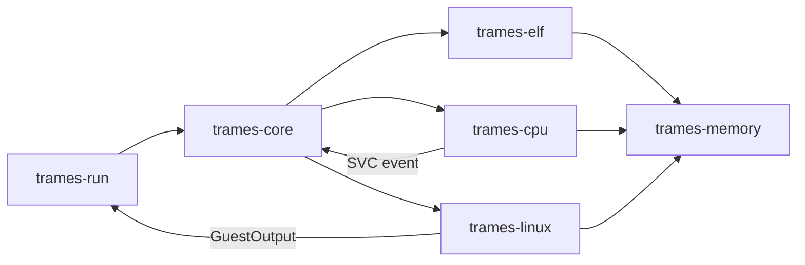

# M0 runtime architecture

The runtime executes guest instructions; it does not delegate execution to QEMU.
QEMU is used only as an independent test oracle. No code is generated into host
executable memory. At M0 all six crates forbade unsafe Rust; the current owner-directed
policy permits audited boundaries with explicit unsafe operations, described in
[dependency and boundary policy](../security/dependencies.md).

ELF parsing validates the complete program header table and PT_LOAD descriptors
before creating an address space. Loading uses temporary writable permissions,
copies file bytes, leaves zero-filled tails, and then applies ELF protections.
Only an aligned entry inside an executable segment is accepted. Section headers
are not used for loading.

Guest memory is a BTreeMap of zero-initialized 4 KiB pages. Addresses are integers
in a 48-bit domain, never host pointers. Reads, writes, and fetches have separate
permission checks. A complete range is checked before copying, preventing partial
cross-page writes on faults. Mapping and protection changes are similarly checked
before mutation. M0 does not yet implement mmap, brk, or copy-on-write.

The initial stack has argc, argv pointers, NULL, envp pointers, NULL, and
key/value auxv entries ending with AT_NULL. SP is aligned to 16 bytes. AT_PHDR,
AT_PHENT, and AT_PHNUM are provided only when the ELF program headers are mapped.
Other M0 entries include page size, entry, virtual UID/GID, AT_SECURE, and
AT_EXECFN. There is no AT_RANDOM yet; this stack is for the tested static programs,
not a promise of libc startup compatibility. The CLI supplies PATH and LANG;
it does not inherit host environment variables.

CPU state stores X0–X30, SP, PC, and NZCV. W-register writes clear the upper half.
Register 31 is selected as SP or ZR according to each instruction class. The
implemented subset is NOP, SVC #0, MOVN/MOVZ/MOVK, ADR/ADRP, ADD/SUB immediate and
shifted register, AND/ORR/EOR/ANDS and inverted shifted forms, B/BL, BR/BLR/RET,
CBZ/CBNZ, B.cond, unsigned-immediate integer LDR/STR (8/16/32/64-bit), and
32/64-bit integer LDR literal. Signed loads, SIMD, atomics, paired loads/stores,
logical immediates, and the rest of AArch64 remain unsupported.

Execution is bounded to at most 4096 instructions per internal slice. A slice
returns a syscall event, yield, or typed fault. The process loop tracks a total
instruction budget. Linux dispatch uses X8 for the syscall number and X0–X5 for
arguments, returning results in X0. M0 only allows stdout/stderr byte writes and
process exit; host syscalls are not forwarded from arbitrary guest numbers.
Partial output is returned as a short write without automatic retries.

C++ and Swift integration will use a documented, versioned C ABI with opaque
handles and POD data. M0 exposes Rust APIs only; an FFI contract and an iOS build
artifact have not been implemented or validated.
