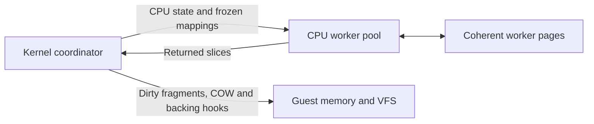

# Parallel AArch64 execution

Owner priority: introduce multicore before extending the memory/native hot paths.
This implementation keeps one cached Rust interpreter and no host JIT. Guest
threads/processes have independent architectural state; persistent host workers
can execute their instruction slices simultaneously. `--cpus auto|1..32` selects
the virtual CPU limit. Auto uses the host's reported available parallelism, capped
at 32. Workers start lazily; one ready guest retains the existing local path.

## Ownership and checkpoints

Linux, VFS, signals, timers, mapping changes, live backing objects and NativeCall
remain coordinator-owned. Neither Rc/RefCell objects nor native guest slice borrows
cross to workers. CPU/decode state travels with the guest task; translation caches
belong to each CPU-only memory view. No unsafe Send/Sync assertion is added.

The coordinator prepares ready tasks and immutable mapping metadata and dispatches
at most one guest per eligible virtual CPU. Each worker retains its CPU and view
and runs continuously across 16,384-instruction local interrupt polls. A full poll
does not send a message, wait for peers, or return to the scheduler. There is no
startup barrier. Syscalls, NativeCall, faults and explicit guest yields immediately
request a global stop; the coordinator collects every result before kernel work.
A timed checkpoint bounds host control and affinity fairness to 10 ms plus a local
poll and host scheduling delay (2 ms for an interactive terminal, 1 ms for blocked
socket work). Earlier sleep, futex, signal, poll and timer deadlines shorten that
interval. An unread expired timerfd cannot force repeated zero-length epochs.

A shared atomic counter reserves exact instruction credits at each local poll;
unused credits return to the counter. A pending native trap reserves one extra
credit, retired only after a committed coordinator return. Earlier polls and a
fault's retired prefix are accounted once. This includes instructions from peers
subsequently killed by another peer's exit_group or exec. Selection rotates between ready tasks. An affinity matching pass keeps queue
priority and can relocate an earlier flexible task to admit a pinned peer; pinned
spinners cannot permanently starve the flexible task that releases them. `sched_setaffinity` is enforced,
`getcpu` reports the assigned virtual CPU, and proc/sys CPU views report this same
topology. Virtual affinity does not pin a worker to a physical host core.

Immutable pages allow unlocked code/data reads. Mutable pages use independent
page-local transactions, not one global memory lock. Each shared backing page has
an opaque identity, so aliases, different virtual addresses and forked shared
mappings use one transaction domain. Private mappings remain independent COW
domains. Unsupported custom backing types retain local execution rather than
being declared thread-safe. Mappings and live EOF state cannot change mid-batch.

A batch containing only immutable executable pages reuses its frozen code epoch,
avoiding an unnecessary atomic counter load for every interpreted instruction.
Writable executable pages and shared executable aliases retain acquire checks
of the live code epoch and per-page versions.
Local CLONE_VM spaces without live backings borrow their owned inner memory once
per CPU slice; backed spaces retain individual access borrows to preserve callback
boundaries. No such borrow survives a syscall or NativeCall outcome.

Workers publish 64-byte dirty fragments through the original memory write paths
after they return; these paths retain COW, file write-through and executable
invalidation. Read-only aliases never consume a dirty writeback. Private file
snapshots refresh after backing mutations and retain live truncation/SIGBUS checks.
Coordinated data writes refresh only dirty frames while reusing mapping metadata;
mapping/executable/backing changes take the full validation path. Executable
worker writes and writes through shared non-executable aliases invalidate peer
code tokens. Cache tokens include the worker page's opaque identity and version,
including readonly file snapshots replaced after descriptor writes.

## AArch64 synchronization

- LSE/CAS/CASP and paired read-modify-write instructions execute as one checked
  transaction, including 128-bit pairs. Failed comparisons do not publish writes.
- LDXR/LDAXR/LDXP/LDAXP capture bytes and an opaque reservation token together.
  STXR/STLXR/STXP/STLXP check and write inside the same transaction. Reservations
  track 16-byte granules, detect ABA writes and distinguish replaced mappings and
  local/parallel views. Exception entry and CPU migration may clear the monitor;
  coordinated writes also invalidate it, even when final bytes are unchanged.
- Release operations use a host release fence before the store/transaction;
  acquire operations use an acquire fence after the read/transaction. RCpc loads
  conservatively receive acquire ordering. DMB/DSB domains/types, ISB and SB use a
  full host fence. Ordinary hints receive no invented memory barrier.
- Kernel futex compare+enqueue, wake and requeue run while every CPU is quiescent.
  Private keys use address-space/VA; shared keys use backing-page identity/offset,
  including across fork and mappings at different addresses. membarrier's supported
  modes use the joined checkpoint plus a full host fence.
- Host FP scopes stay on their executing thread, preserving each guest's FPCR/FPSR
  and restoring the worker's prior environment. FP/SIMD computation stays native.

The implementation permits a **stronger subset of ARM's allowed memory ordering**:
page-local transactions, RCpc-as-acquire and checkpoint synchronization can exclude
weak outcomes that physical hardware permits. It does not attempt to reproduce
every allowed ARM litmus outcome. It must never allow a forbidden synchronized
outcome. Future relaxed word/stripe paths need to preserve byte aliasing, mixed
access widths, 128-bit atomicity, monitor versions and Rust race freedom; simply
exposing concurrently mutable host slices or mapping barriers to no-ops is invalid.

## Performance boundaries

Parallel views stage mutable/undetached file pages and require additional host
memory beyond guest committed-page accounting. Guest limits remain 512 MiB per
address space and 1 GiB aggregate; VmRSS is not a measure of these host buffers.
Native operations, syscalls and backing writeback are initially serialized. Page
contention, metadata changes and short slices can limit or reverse speedups. A
single ready guest avoids worker queues and mutable-page locks; multicore mainly
helps genuinely parallel work rather than automatically shortening single-thread
Vim startup. App lifecycle control is checked between bounded batches.

Validation uses real musl pthread programs, LSE/LL-SC/pair stress, publication and
DMB tests, shared futexes, concurrent fork, file aliases/truncation, executable
tokens, Node SharedArrayBuffer/Atomics and independent host FP scopes. See
[measurements and exact-source evidence](../validation/multicore.md) and
[delivery tracker #11](https://github.com/kb5000/trames/issues/11).
The continuous-worker follow-up is tracked in
[#13](https://github.com/kb5000/trames/issues/13) and
[its separate validation record](../validation/continuous-workers.md).
