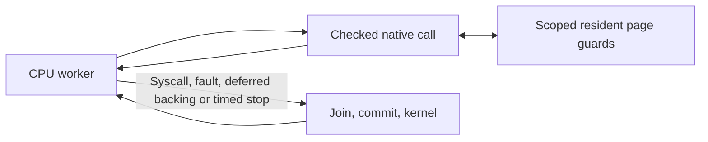

# NativeCall on persistent CPU workers

Implemented development follow-up to the coherent backing/bulk batch, tracked in
[Issue #16](https://github.com/kb5000/trames/issues/16). Persistent workers execute
the same checked native algorithms as coordinator Memory. Independent native
operations continue on their owning CPU without requesting a global stop. This
includes all 19 pure memory/string entries, integer/floating conversion and
guest-owned qsort/bsearch continuation steps. One cached interpreter remains;
there is no JIT, additional interpreter backend or separate native thread pool.
The delivered 0.13 IPA keeps its original runtime; group device updates later.

## Memory ownership

`NativeMemory: CpuMemory` provides scoped read fragments, alias-safe pair reads,
copy/fill, checked control reads and separate one-shot output/retryable-state
gates. Memory and parallel::View implement it; existing registry/string/parser/
callback algorithms are generic over this transport, with one implementation.
Guest addresses are checked virtual addresses, never cast to host pointers.

View borrows Arc-owned resident snapshot pages. Rc PageBacking, VFS, timestamps,
mapping/protection/EOF mutation and persistence stay on the coordinator. Anonymous
pages, resident shared backing and detached private pages support worker native
access. **Undetached private file mappings defer before guest writes**: their frozen
private snapshot cannot guarantee the latest bytes of a concurrently writable
file alias. A typed checkpoint returns the pending HLT to the joined coordinator,
where live reads/private detachment use the original backing path. Unsupported
custom backing retains local execution. This does not add dynamic worker-side
file COW or change the older CPU-view snapshot semantics.

Every write operation checks its full source/output range before effects.
Callback control reads use the native transport, and a resumed sort rechecks its
complete array before any cycle writes: a comparator may have changed mappings
through a syscall. Shared/read-only continuation state retains the original
fallback-before-progress or rejection rule. Numeric result frames permit checked
resident one-shot output, including a shared guest stack.

Mutable page guards end inside a call. Two-page reads/copies acquire locks in
stable physical identity order; aliases of the same page acquire one guard.
The [region-guard follow-up](region-memory.md) narrows mutable exclusion to the
actual touched 64-byte regions. CPU, native and atomic accesses use the same
audited byte-cell boundary, allowing disjoint regions of one page to overlap.
Virtual overlap uses directional fragments. Non-virtual physical aliases require
a bounded source snapshot; disjoint snapshots avoid that allocation and alias
table scan. Shared file aliases observe writes through one ConcurrentPage;
dirty/mtime/writeback hooks run after joined commit.

Native writes preserve dirty 64-byte fragments, reservation-granule versions and
executable epochs. Full-page writes use a lazy reservation epoch plus explicit
partial-granule bits, avoiding a redundant 2 KiB version-table store per 4 KiB
copy. This handles version wrap and preserves unaffected partial reservations.
Hierarchical per-region bases also compress full 64-byte writes, including
unaligned bulk-copy interiors, while retaining precise 16-byte reservations.
Adjacent dirty fragments commit as one run; clean holes remain unpublished.
Page locks permit stronger ARM outcomes without promising whole-call atomicity.
Ordinary unsynchronized guest races can still interleave between fragments.

Code authorization checks the exact five words and executable page tokens before
and after a cold observation. Unstable observations defer without entering the
body or populating the cache; warm entries still recheck tokens. Each worker owns
its registry/cache. Snapshot reuse also validates registry/code-domain identity,
so a resumed runtime and fork peers rejoin the same alias domain.

## Retirement and checkpoints

An authorized native call clears the guest exclusive monitor. A committed return
sets x0/value and x1/fallback, advances PC by four, and retires exactly one HLT.
An original-code fallback is a committed return and continues locally. A fault
keeps precise PC/arguments and refunds its HLT credit. A typed defer has no guest
write effects, reserves the pending HLT once and uses the coordinator path after
joining. Cold stub instability is revalidated with bounded coordinator retries.
Rejected entries retain pid/comm/module/function/PC logging on the coordinator.

Workers keep local instruction credits across native returns and refund unused
credits when an assignment ends. This removes shared budget claim/refund RMWs per
libc call without overspending the common session limit. Syscalls, mapping changes,
faults, explicit yields and timer/control/fairness deadlines still join workers.
Cancellation waits for a bounded native call to finish; fragments are not implicit
scheduler yields, and partially executed moves cannot restart.

Integer/floating parser host errno/FP scopes stay on the executing host thread.
Guest FPCR/FPSR, TLS, SP and callee-saved registers remain guest CPU state. Sorting
returns a guest comparison request; nested callbacks run as ordinary guest code.
No guest callback address becomes a host function pointer.

## Diagnostics and evidence

Worker-local metrics merge once at joined checkpoints. `worker_calls` counts
authorized worker body attempts and `checkpoint_retries` identifies typed defers;
attempts are not identical to retired HLTs. `peak_parallel_native_calls` records
observed body overlap with scoped atomic counters, without a global native or
metrics mutex. Short calls need not overlap in every host schedule. `worker_slices`
counts assignments, `worker_chunks` counts local CPU slices including native
returns, and `parallel_rounds` counts global checkpoints.

Worker elapsed CPU timing already includes its native body, so the coordinator
does not charge it twice. `cpu_seconds` is summed assignment elapsed including
lock waits, not host CPU occupancy. The benchmark separately records actual child
user/system CPU and host wall time, which include startup/rootfs import.

Deterministic tests hold one worker's data page while a peer completes native
work on a disjoint page, and require two simultaneous native scopes. Further
tests cover equivalence of all 19 entries, exact budgets/fault/fallback/defer,
unstable executable observations, aliases/COW/code epochs, opposite lock order
and reservation wrap. Real full-musl pthread tests mix every pure entry, FP/errno,
parsing, nested sorting/searching and shared stacks at 1/2/4 CPUs, with off/on and
persistent storage controls. Linux and Apple CI run native worker tests; Linux
also executes actual ARM64 binaries under the independent QEMU oracle.

[Validation and the occasional before/after batch](../validation/parallel-nativecalls.md)
retain fixed work, fingerprints, raw samples, native overlap and checkpoint
counts. Memory bandwidth, shared-page contention, short calls and kernel effects
still limit scaling. Development-host measurements do not establish iPad speed.
