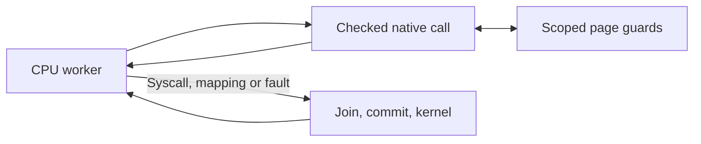

# Worker-side NativeCall: reviewed next implementation

Owner direction: inspect parallelism next, particularly NativeCall serialization.
This is a concrete implementation plan; worker-side NativeCall is not implemented
by the coherent backing/fallback batch. The delivered 0.13 IPA also retains joined
native execution. No new backend, JIT, host-native thread pool or copied guest
callback pointer is proposed.

## Actual bottleneck

`workers.rs` ends an assignment on every NativeCall, reserves one HLT retirement
credit and requests `Control.stop()`. `process.rs::parallel_round` joins peers,
commits their snapshots and calls `finish_slice`, which invokes the single
coordinator-owned native registry. Even independent memcpy operations therefore
stop each other. The persistent CPU workers already exist; scheduling a separate
native pool would add another round trip rather than remove this boundary.

The inspected native catalog has no required kernel effect: all 19 memory/string
entries use checked guest memory. Integer/floating parsers use bounded slices,
cursor-owned results and thread-local host errno/FP save/restore. qsort/bsearch
steps manipulate guest-owned continuation frames and return a guest comparison
request; they never call a guest address as a host callback. These operations can
ultimately run on the owning CPU worker. Actual guest syscalls, mapping changes,
signal delivery and VFS effects still require coordinator checkpoints.

## Shared engine and memory boundary

Introduce one checked NativeMemory contract, extending CpuMemory with scoped
read/write fragments, copy/fill and separate one-shot-output/retryable-state
preflight. Implement it for coordinator Memory and worker parallel::View.
Generalize the existing registry/strings/parser/callback algorithms over this
contract; do not create a second accelerator implementation.

View borrows only Arc-owned resident snapshot pages. Rc PageBacking, VFS, inode
timestamps and persistence remain on the coordinator. Preserve per-frame flags
for resident one-shot output and private/readable callback state; a view must not
erase the stricter continuation gate. Existing mapping/protection/EOF snapshots
stay valid while kernel mutation is prohibited; commit dirty fragments before
any kernel operation observes bytes. File aliases share ConcurrentPage identities
and observe worker writes immediately; backing dirty/mtime/writeback hooks run at
the next joined commit. Unknown backing or unsupported snapshot paths retain the
existing interpreter/coordinator path.

Mutable page guards cannot survive a call, CPU poll or returned event. When two
pages are needed, acquire locks in stable physical identity order; same-page
overlap uses one guard. Prevent nested read/write callbacks from deadlocking on
an alias. Copy uses directional fragments for virtual overlap and a bounded
source snapshot for non-virtual backing aliases; disjoint ranges should not pay
for a full snapshot. Preserve ConcurrentPage.changed, reservation-granule
versions, dirty-fragment masks and executable code epochs for every native write.
Page locks permit stronger ARM outcomes; this is not a global native lock or a
promise of whole-operation atomicity. Ordinary guest data races remain possible.

Stub validation needs a coherent exact five-word observation and page token
checks before/after concurrent code reads. An unstable observation must be
revalidated or deferred, never cached or silently accepted as a stable stub.
CPU instruction-cache invalidation and executable permissions remain mandatory.

## Worker event and budget accounting

Give each persistent worker its own registry/cache and call metrics. On a
supported NativeCall, clear the guest exclusive reservation, run the bounded
operation against View, set x0/value and x1/fallback, advance PC by four and retire
exactly one HLT. Continue on that worker without requesting a peer stop. Original
fallback is an ordinary committed return; its guest function continues locally.

Preserve the existing shared budget credit: an executed native HLT spends the
reserved instruction once; a native fault does not retire it and refunds the
credit. No peer may spend the same credit. Cancellation/fairness waits for the
bounded call to return; page fragments are not implicit scheduler yields and a
partially completed move must never restart. Unsupported stateful operations,
syscalls and faults request the normal checkpoint. Queue rejected-entry logging
for the coordinator, retaining pid/comm/module/function/PC and precise fault
addresses rather than transporting a VFS handle.

Return and merge worker metrics only at joined checkpoints, including calls,
per-function fallbacks, byte transport, body time and validation reuse. CPU
elapsed time already includes native body time; avoid charging it again on the
coordinator. Add worker-native call counts and observed peak overlap to distinguish
real concurrency from a nominal CPU count. Do not retain a metrics mutex inside
the hot path. Stable cache identity must include the address space and code tokens.

## Staged implementation and acceptance

1. Generalize the memory/native contract and validate Memory/View equivalence
   for existing pure functions, output gates, aliases, guards and code tokens.
2. Execute the 19 pure entries directly on CPU workers. Test exact budget,
   fallback/fault retirement, cancellation and peer progress during native work.
3. Generalize integer/float result transport and guest-owned callback steps;
   keep their bounds and continuation preflight unchanged. Validate per-thread
   host FP/errno restoration, nested guest callbacks, signals and shared stacks.
4. Run real musl pthread workloads mixing copy/fill/compare/parsing on independent
   buffers, overlapping shared memory and executable aliases. Check checksum,
   futex/atomics, COW, file truncation/writeback and public libc compatibility.
5. One occasional fixed-work 1/2/4 CPU before/after batch, plus one unchanged
   application. Report native overlap and global checkpoint counts as well as
   wall time, host CPU occupancy, byte transport and dispatch/stop/memory cost.
   Shared-page contention and memory bandwidth can limit scaling; no expected
   4x gain or development-host-to-iPad extrapolation. Run Linux/Apple CI and
   inspect the actual simulator report before a grouped device release.
