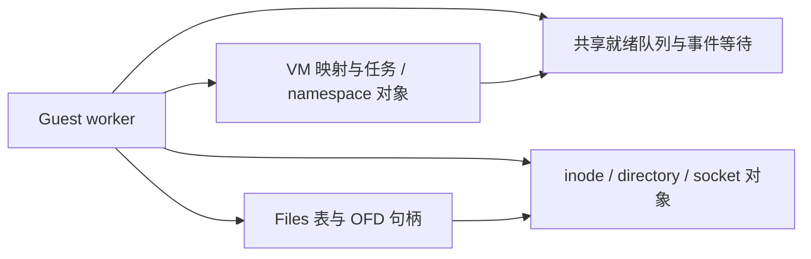

# 内核执行全部迁出协调器的路线

2026-10-23。普通内核执行可以继续迁到当前 guest worker；现有架构没有要求它必须
经过一个专用线程。但现在尚未具备完整的共享内核状态，不能通过删除 Event::Service
或把 VFS 套进一个全局锁来达到这个目标。目标是减少往返与暂停，同时复用资源算法。

## 当前与目标

第 19 批已将描述符元数据与结构身份分离：OFD status 和每个 FD 的 CLOEXEC 是共享
原子状态，F_SETFL/FIONBIO/F_SETFD/纯 CLOEXEC close_range 可以直接执行。fork 复制
描述符标志，CLONE_FILES 明确共享；unshare/exec 处理域的分离。未改变 OFD 集合时
仍共享文件/字节能力缓存，避免因为复制 CLOEXEC 而重复准备资源。

第 20 批已共享 inode 的 POSIX 范围锁；F_GETLK/F_SETLK 在 worker 共用原 ABI/算法，
关闭任意进程别名和退出释放访问相同对象。锁冲突检查与提交在一次 inode 事务完成；
阻塞锁等待/死锁图仍在原路径。此项仅解除 close 的一个依赖，尚未迁出完整 FD/OFD。

随后已将 pipe 的真实读写端计数/握手/最后关闭拆成 Arc<PipeEndpoint>，可由 worker
最后释放并直接通知另一端；owner inode 投影和普通字节快照不定义端点寿命。原生
剪贴板 relay 已使用该端点并保留元数据 anchor。FD 表和 io_uring 的完整 owner 保留
引用尚未迁完，不能据此认为真实 guest close/dup 已全部 worker 化。
见 [共享管道端点验证](../validation/shared-pipe-endpoint.md)。

随后已把 CLONE_FILES 收敛成一个实际的表对象，删除 FD 结构变更的逐任务传播、
每次 syscall 的 FD 版本跟踪、Process.files_id 和退出时的文件表共享扫描。
lookup 持有稳定 OFD 引用，dup3 先替换再释放旧对象，共享 clone 不再创建临时私有表。
见 [共享 Files 表验证](../validation/shared-files-table.md)。

第 21 批共享了 inotify 队列、watch mask/one-shot 消费和撤销；被监视文件的 worker
短读/原位写可以直接发送通知，读/poll 等待直接唤醒。路径注册与最后 OFD 关闭仍由
owner 元数据定义，弱队列能力不延长注册寿命。见 [inotify 验证](../validation/worker-inotify.md)。

第 22 批 CLONE_FS 直接共用目录/mount 引用，移除每次 syscall 的比较和逐任务传播、
Process.fs_id。umask 是共享原子，可在 worker 交换；普通 exec 保留 FS 共享，unshare
按实际域分离。目录对象仍为 owner Rc，见 [共享 FS 上下文](../validation/shared-fs-context.md)。

第 23 批把 CLONE_SIGHAND 的处理函数表收敛为共享对象，移除 actions_id 和逐任务数组
传播；fork 复制、成功 exec 私有化、SA_RESETHAND 直接更新共享记录。查询型 rt_sigaction
在 worker 共用原 ABI；修改仍需 pending 清理和作业控制状态提交。见
[共享信号表](../validation/shared-signal-actions.md)。通用 ResourceChanges 已删除。

第 24 批删除最后的 heap 快照比较和逐任务传播，分配上下文按实际 Memory identity
共享或复制；brk(0) 在 worker 读取共享原子值。mmap 游标与映射修改仍由 VM 所有者
提交，没有给普通访存加锁/屏障，见 [共享分配上下文](../validation/shared-vm-allocation.md)。
这些改动不等于 VM 映射主体或 task 生命周期已经共享。

第 25 批将 flock 从 Filesystem 全局 map 移到 inode 共享集合，OFD 锁租约最后释放
立即解锁并在对象锁外通知；弱能力不延长寿命。非阻塞 flock/解锁进入 worker，
阻塞等待和实际 FD close/dup 仍需迁移，见 [flock 验证](../validation/shared-flock.md)。

共享 Files 表、OFD 本体、路径/namespace、进程表和 Memory 映射主体仍有 Rc/RefCell 所有者。
这些对象才是后续迁移的主体；当前服务请求为 0 的测试不能证明它们已经共享。

目标结构如下，图中的 Files/OFD、inode、VM/task 共享所有权**尚未全部实现**：

正常调用直接取得实际共享对象，执行后在原 worker 返回。需要等待时交还执行槽，
沿已有事件/deadline 入队。对象修改使用对象级同步；单字段用原子，不增加全局服务
线程、轮询总线或普通 guest 访存屏障。UIKit 的主线程呈现/输入回调仍由平台事件
机制处理，不必因此把普通 guest syscall 或 NativeCall 送回内核所有者。

## 必须一起迁移的所有权

| 范围 | 当前阻碍 | 迁移要求及验收 |
| --- | --- | --- |
| Files 表 | CLONE_FILES 已共用单个 owner 表，稳定 lookup/替换及退出引用归属已实现；OFD 仍为 Rc，worker 能力仍冻结 | 将实际 OFD/端点迁为跨 worker 的共享所有权，再接动态查表/分配与等待中的原 OFD 引用；移除结构操作的全体 join |
| OFD 与实际端点 | pipe、原生宿主端点和 PTY 从端已为 Arc；完整 OFD、LocalSocket、native 控制投影、PTY 主端等仍有 owner 引用 | 把实际 endpoint/host FD lease 的寿命交给共享 OFD；普通能力快照不额外打开端点；最后关闭立即产生原 EOF/FIN/HUP，进行中的 I/O 可保留原对象 |
| close 的其他效果 | POSIX 范围集合、flock/OFD 锁寿命、文件关闭通知租约已共享；close 取得完整描述符、部分端点和 epoll weak watch 仍有 owner 数据 | 关闭任意相关 FD 释放本进程的 POSIX 锁；最后 OFD 关闭释放 flock、清理 watch/通知；不能仅移除一个共享 map 项而延迟效果 |
| inode/目录/存储 | 路径、权限、配额、rename/overlay 与 manifest 混在 owner FS | 拆成独立对象和稳定 ID，复用原数据/存储算法；资源 I/O 不持有整棵 VFS 的锁；多对象操作有明确锁顺序与回滚，append/增长/同步不越过原配额/映射规则 |
| socket/网络控制 | namespace、规则、连接和边沿 epoch 仍有 owner 状态 | 与 FD 端点寿命一起共享；复用原 TCP/UDP/虚拟网络算法与宿主 epoll/kqueue；边沿状态跨 worker/owner 保留，不能用反复注册 level-ready socket 伪装边沿 |
| 后台异步请求 | 有些提交者未保留可调度 View，CQ 观察者只有自己的 VA | 保留原提交 VM 的执行上下文/取消归属；观察者不使用自己的同址内存替别人执行；请求与 FD/VM 退出的清理共用生命周期协议 |
| VM 映射 | 分配上下文已按 VM 共享且 brk 查询在 worker；View 与权限/翻译/backing 在一个 cohort 内冻结 | 修改只与相关 VM/映射/backing 同步；保持硬 MMU、soft TLB、pin、COW、exclusive 与 native 字节模型，不在每条普通指令上加锁；无关 VM 继续执行 |
| task/namespace/信号 | sighand 表已共享且只读查询在 worker；pending、mask、进程表、credentials 与组退出仍由 Kernel 所有者维护 | 共享 task/组/namespace 句柄与权限世代；信号修改联动 pending/作业控制；fork/exec/exit/TSYNC 只暂停相关 VM/表/线程组；保留 waitpid、setxid、PID 可见性与退出唤醒 |

顺序上先完成 Files/OFD 和实际最后关闭，再接 inode/目录/网络控制，最后把 VM/task
生命周期提交的暂停范围从全体缩到相关对象。这些工作会交叉，不能以复制更多 worker
opcode 分支持续绕开所有权改造。整个 Memory/VFS/Rc 图不做 blanket unsafe Send。
受控 unsafe 保持在现有字节、映射或宿主接口边界，并明确实际的并发和编译器条件。

## 保留同步，撤掉中心往返

exec、fork 快照、映射更新、最后关闭和多对象操作依然需要同步。可以让发起 worker
取得相关对象/域的提交权，而不是让所有调用都经过一个中心线程。现在的 joined
边界先保留，等对应资源具备实际的共享所有权后逐项缩小；不先删边界再依赖偶然未崩溃。

单 CPU 的串行直接 MMU 入口继续复用相同资源算法。迁移完成不是强制单线程程序使用
parallel View，也不是为了统一入口而再次引入额外访存检查。

## 完成判据

- 生产普通 syscall/NativeCall 不再构造 Event::Service；未知 syscall 的错误/日志也可
  在当前 worker 完成，未支持功能保持明确错误。
- 创建、查找、dup/替换、关闭、exec、namespace 和映射变更都有实际的共享所有权；
  不保留靠下一次全局 join 才补做的 EOF/FIN/锁释放/结果提交。
- 不相关 VM/Files/线程组不因其他对象的普通调用暂停。必须同步的提交只影响相关域，
  等待释放宿主执行槽，没有忙转或新增服务线程。
- owner 与 worker 的文件、socket、计时、缓冲、权限与取消主体共用实现；避免长期
  维护两套资源引擎。旧服务/恢复分支在没有生产调用者后删除，历史验证保留。
- 用真实 guest 的并发 close/reuse、dup/SCM_RIGHTS、EOF/FIN、进程锁、fork/exec/unshare、
  映射与 pin 冲突验证语义，再看 Docker/浏览器等实际 workload 的 checkpoint、CPU
  时间和延迟；不能仅凭 service_requests=0 或 opcode 数宣称全部完成。

当前证据见 [FD 表元数据迁移](../validation/worker-fd-table.md) 与
[共享文件锁](../validation/worker-record-locks.md)，总体进度见
[协调器拆分进度](coordinator-removal.md)。此文件是后续设计和验收要求，不是已完成清单。

第 26 批补充：flock 等待已使用共享 inode 通知和保留请求，worker 等待无需协调往返。
完整 OFD 保留/最终析构目前仍在 owner 生命周期边界，下一步应把该保留关系与
动态 FD 查找/关闭统一，而不是给更多等待操作复制数字 FD 重试分支。

第 27 批补充：inotify 的 inode 监视目标和目录链接记录成为独立共享对象，
FileClose 最后引用可以直接在 worker 发通知，且不会在通知期间持有注册/链接锁。
Node 元数据释放只发布最终删除状态；仍在进行的真实关闭租约先通知 CLOSE，再让
共享事件对象发 DELETE_SELF/IGNORED。目录显式删除仍立即撤销监视。
完整 Node/OFD 和 descriptor table 尚未因此变为跨线程对象。

第 28 批补充：inotify 实例的注册索引改为弱 Source 身份，队列、索引、最终关闭皆
已具备跨 worker 所有权。普通能力只保留队列与弱实例路由，显式撤销立即删除索引；
最终真实实例引用可在释放线程注销监视。路径查找仍使用 owner VFS，完整匿名 OFD、
FD 表结构与 epoll 的目标身份还需要后续统一，不能只凭这一种实例已共享就移除 join。

第 29 批补充：原生宿主端点与配额/边沿事件状态可由 worker 持有和最后释放。
普通 capability 不保活；已经接受的宿主等待按注册保留同一资源，取消先关 duplicate，
再在 registry 锁外析构资源。连接/规则/DNS、guest namespace 的 Socket 控制计数
及完整 OFD 仍由 owner 管理；仅宿主 transport 配额已迁出，不能将其等同于整个
网络 namespace 的共享化。见 [端点验证](../validation/shared-native-endpoint.md)。

第 30 批补充：PTY 从端引用寿命独立于 owner 端点投影；最后从端在 worker 释放时
直接更新共享计数/唤醒主端，dup/fork 不重复增加打开数，字节/轮询能力不保活。
主端仍会改 devpts 目录并触发进程组信号，尚未提供跨 worker 主端关闭租约；
后续要同时迁移目录和 task/作业控制的可见效果，不能把这些动作延迟到全体 join。

第 31 批补充：inode/mount 的可写映射引用共享为原子计数，移除 owner 逐页扫描
及 bool 缓存失效；保留的写引用阻止错误放行文件 I/O、只读 remount/普通卸载，
并使懒卸载树保留到最后释放。引用本身不发布字节，不替代实际页、inode/路径
或 VM 提交所有权；完整 FileMapping/Node/挂载路径仍包含 owner 引用。

继续迁移 PTY 主端前，必须处理 devpts 节点与 inotify 删除寿命的一致性。仅把
目录索引改为共享、把 Node 强引用留作缓存，会延迟 DELETE_SELF/IGNORED；
元数据缓存不能成为实际 inode 寿命的额外持有者。Node 内容还涉及 Unix 端点、
FIFO、overlay lower 与映射页的引用，需要按这些对象逐步拆开，避免整体 unsafe Send。

第 32 批先拆掉 Node 到 LocalSocket 控制图的直接弱 Rc 引用，改为共享弱绑定身份。
真实 socket 关闭立即失效，读者保留身份不延长端点寿命；路径替换和磁盘恢复不误连
旧/新端点。原所有者解析表按 guest 克隆域共享，pathname 跨网络 namespace 语义
保留，abstract 仍隔离。解析表和完整 Unix 控制/SCM_RIGHTS 仍需迁移，不能把这一
步理解为 bind/connect/close 已脱离协调；见 [验证](../validation/shared-unix-binding.md)。

第 33 批再拆掉 FIFO 的 Rc/RefCell 包装及共享资源到匿名 inode 元数据的引用。
Pipe 现在仅含稳定编号与 Arc 字节资源；元数据由打开描述符/relay 的 owner 投影
保留，实际端点仍决定最后关闭。硬链接和 overlay 别名共享资源，目录节点与共享
资源不会互相保活；普通 FIFO 硬链接的既有 EPERM 缺口也已补齐。Node 内容中的
Unix/FIFO 这两条直接控制图依赖至此拆开，但 FileData::Lower、映射页、完整
OFD、目录/VM/task 所有权仍未全部共享，见 [验证](../validation/shared-fifo-identity.md)。

后续 FilePage 共享原型的功能检查通过，但直接在存储布局增加 RwLock 使串行
mmap 微基准慢约 26%–27%，已恢复第 33 批实现。继续共享 inode 前，应先让串行
CPU/native 使用可失效的稳定页能力；不能简单让每次访存进入对象锁。overlay 的
下层引用仍须跟随原文件的映射/截断及 inode 删除寿命，不能静态截取 PlainFile。
证据与后续约束见 [原型记录](../validation/shared-file-page-experiment.md)。

第 34 批共享 MappingState（稳定身份、原子变更世代与实际存储长度能力）。普通
文件/memfd 的 EOF 检查及变更世代不再进入 Node；不会将下层/伪节点的可变内容
误当成稳定存储。页的首次脏写仍更新 owner 修改时间，成功回写/截断后重新计时；
同一脏页后续写入仅更新字节及失效世代，CPU/native 共用算法。普通匿名访存没有
新分支或屏障，FilePage 仍保留原 RefCell 布局，并未恢复已拒绝的 RwLock 原型。
这一步减少后续 inode 共享化必须迁移的热调用；实际页布局、首写元数据、
回写/Node/overlay 和 FD/VM 生命周期仍须继续迁移，见
[共享映射状态验证](../validation/shared-mapped-state.md)。

第 35 批移除 OFD 的 OomTask 弱 Rc 与 BPF Program 强 Rc：任务弱身份和偏好
共享域明确分离，最后任务引用可在 worker 析构，不因同组线程/已打开 proc FD
保活；score/minimum 原子更新不能使用过期权限下限。验证后的不可变 BPF 程序
由描述符、附加与执行引用共享，最后引用在任意 worker 释放，注册表仍为弱引用。
这两类叶对象已具备跨线程所有权；proc/credentials、BPF registry/attach 结构、
完整 OFD/任务表没有因此迁出，见 [验证](../validation/shared-ofd-leaves.md)。

第 36 批将会话日志变为 Arc 资源，有限记录/stream/clear 状态按对象同步，
OFD 不再持有日志 Rc。worker 直接执行非阻塞 syslog，复用原 ABI 和 epoch 权限；
输出前完整校验、读取并清空为同一日志事务。action 2 阻塞等待、kmsg 描述符游标
及动态 FD 仍待迁移，见 [共享日志验证](../validation/shared-kernel-log.md)。

第 37 批进一步共享 kmsg 的实际打开游标与日志等待源；legacy syslog 和 kmsg
读写/seek/poll/epoll 在 worker 使用同一资源事务，append 直接通知运行队列。
处理 ET、跨 FD 表最后关闭失效及单活跃任务准入；FD 表/安装/dup/close 的结构
寿命仍在 owner，见 [日志等待验证](../validation/shared-log-waits.md)。

第 38 批共享 UTS 实际身份、名字与配额，proc 快照为弱 Arc，worker 可最后
释放；uname 和名字设置直接复用原 ABI，权限只在 epoch 内冻结，名字保持
实时共享。unshare/setns、FD 安装及其他 namespace 图仍待迁移，见
[共享 UTS](../validation/shared-uts.md)。

第 39 批共享 PID namespace 的实际身份与映射，默认转换仍直通；祖先分配和
init 死亡按对象同步，弱快照及最后引用支持 worker 生命周期。fork/exit 与存活
集合裁剪仍须任务提交边界，见 [验证](../validation/shared-pid-namespace.md)。

## Actual shared OFD and membership foundation, 2026-10-25

The common OFD allocation now owns inode identity, file position, status,
flock initialization, pipe endpoints and close notifications through Arc.
Owner-only socket/PTY/namespace/mount controls remain explicit projections.
OpenHandle and weak watches distinguish actual shared OFDs from those controls;
creating a temporary shared projection does not send a close notification.
No manual Send/Sync implementation is used.

The authoritative files_struct membership is now an object-local mutex map.
Shared slots own their OFD directly; excluded slots retain an opaque identity
and a separate owner control index. That index does not pin shared OFDs.
CLONE_FILES retains one membership object, fork copies membership/CLOEXEC, and
the final Linux owner drains membership even if an execution map remains.
Lookup retains the original OFD. Replacement/removal returns retired leases,
so process-lock release, final close and notification callbacks occur after
releasing the membership lock.

Live flag operations resolve admitted membership and therefore follow numeric
FD reuse. An accepted OFD lease still identifies the original object. Excluded
owner slots retain their frozen epoch capabilities and structural join rule.
Membership revisions invalidate owner caches without cloning borrowed RefCells.
Snapshot sizing/filling uses one membership snapshot; paired flags/direct
resources return together even when another worker edits the table.

This foundation admits complete pipe ends and mountless nonvolatile file
shapes. Normal pathname-opened files still retain owner mount controls and are
excluded. Root/mount identity must be shared before admitting those complete
OFDs. Worker syscall close/dup has not been enabled: pending reads/poll, epoll
watch liveness and checkpoint handoff must retain the original accepted object
before dynamic mutation is allowed in the execution loop. No throughput or
completed FD migration is claimed by the table API alone.

Native Apple ARM64 validation passes 290 VFS, 172 Core and 121 Linux tests, with
five existing manual cases ignored. The new checks exercise four simultaneous
membership editors, owner enumeration, numeric reuse, original accepted leases,
final pipe EOF/inode release, process-lock release and final flock release on a
worker. Scoped strict Clippy and Release CLI build pass. Six original guest
mmap/persistence/scheduler cases pass on the candidate; the unchanged baseline
results are reused. Three alternated mapped-byte samples give CPU median ratios
1.012 (file) and 1.003 (memfd). This unpinned pilot has no confidence interval and
is not an FD throughput or whole-product speedup measurement. Exact source and
binary hashes are in [the foundation record](../validation/shared-fd-foundation-summary.json).

The next checkpoint admits unfiltered worker dup/F_DUPFD and dup3 only into an
empty slot. Close and replacement still join. Filtered structural calls stay
joined so fallback cannot evaluate BPF twice. Owner dup/close use the same
membership algorithms. Borrowed metadata enumeration holds one table guard,
without allocating an intermediate descriptor map or cloning every OFD; callers
must not re-enter descriptor lookup or resource I/O through that guard.

Scoped validation passes 290 VFS, 173 Core and 122 Linux tests (five manual cases
ignored), plus strict Clippy. One Darwin TCP timeout-setup test failed with
EINVAL and passed unchanged on its isolated retry. The shared-files guest
fixture passes at one, two and four CPUs. Two/four-CPU pilots reduce cohort
joins and admit more FD syscalls, but a single-CPU pilot still regresses in host
syscall time. The joined scheduler currently retries blocked readers after
unrelated syscalls. Event-driven original-OFD waits and final comparative
measurement remain required; these pilots do not establish a release speedup.

Shared pipe byte calls now retain the complete original OFD at acceptance.
PendingIo, cohort checkpoint metadata and the joined task carry that authority
across numeric close/reuse. Subscribe-then-retry uses the existing pipe events;
the joined scheduler skips a blocked retry until its signal fires. Epoch
handoff re-arms subscriptions against the destination queue. Completion, caught
signals, exec and exit release the wait; stop/continue preserves it. The joined
SIGPIPE path uses the original endpoint after a worker checkpoint. Joined wake
targets only cover guest-owned pipes, whose changing guest CPU/worker already
returns control to this kernel; host resources keep their existing event path.

Focused tests cover old/new pipe isolation, final endpoint release, actual
owner-to-worker rearming, stop/continue, caught signals, exit and original-OFD
SIGPIPE. The affected Core and Linux suites pass (178 and 124 tests);
unchanged 290-test VFS evidence is reused.
Strict Clippy and the native Release build pass. Five alternated samples of the
unchanged shared-files ELF at 1/2/4 CPUs reduce the single-CPU syscall handling
count from 12,763 to 1,615, while keeping parallel_rounds=0. Timed-region medians
are approximately 1.86/1.26 ms (baseline/candidate) at one CPU and 20.1/10.8 ms,
21.4/11.0 ms at two/four CPUs. These are short, unpinned whole-branch pilots,
not isolated causality or whole-application acceptance. Poll/epoll authority,
ordinary pathname mount lifetime and worker removal/replacement remain open.
Source, runner and ELF hashes and every pilot sample are in the
[retained-byte record](../validation/shared-fd-retained-byte-summary.json).

Filesystem namespace data now has a retained Arc and an object-local RwLock,
separate from the owner-only overlay controller. FsHandle keeps both views
explicit; scoped read/write guards preserve overlay checkpoint/capacity/copy-up
dispatch. Inode tables, storage limits/budget and the disk lease can survive
the owner and be released by a worker. Filesystem data is Send/Sync by
composition; neither FsHandle nor the overlay Rc graph gets a manual override.
This does not admit pathname OFDs: mount parents, control references and busy
unmount accounting still need their actual lifetime migration.

Validation adds a live-inode/final-worker-release test to the unchanged 290
passing VFS cases. Core 178 and Linux 124 cases, strict Clippy and Release pass.
The same guest mount-namespace, UTS/chroot and disk-storage fixtures pass on
baseline and candidate; six mmap/persistence/scheduler cases pass on the
candidate. Three alternated mapped-byte CPU samples give whole-branch median
ratios 1.000 (file) and 1.007 (memfd), without CPU pinning or a confidence
interval. [The filesystem record](../validation/shared-filesystem-data-summary.json)
binds the scoped results to sources, runners and identical guest ELFs.

Mount metadata now separates resource identity from parent topology. Identity
retains actual filesystem/root storage and owns relaxed mount flags, writer
state and the PID lease. Parent changes publish retained shared metadata when
the existing owner mutation guard ends; retirement occurs outside the shared
parent lock. Namespace/devpts/overlay controls remain explicitly owner-only,
and no pathname OFD admission has changed. Overlay layers must eventually hold
identity without the parent's topology, to avoid a pivot-root cycle through a
layer's old root. Detached-tree caches and writer resource leases also remain
required work before enabling closes on workers.

Validation passes 292 VFS cases including live remount flags, detach publication
and final plain-filesystem/root release on a worker; Core 178 cases and Linux
124 cases pass, plus strict Clippy and Release. The previously flaky Darwin TCP
EOF checks now arm their existing two-second timeout while connected, retaining
the same EOF/lifetime assertions; both pass ten scoped repetitions. Identical
guest mount-namespace, UTS/chroot and disk-storage candidates pass, reusing the
unchanged baseline results. [Mount identity evidence](../validation/shared-mount-identity-summary.json).

Overlay layers now retain actual mount resource identity without parent
topology. FsHandle/Overlay and immutable devpts configuration are shared by
composition, while namespace handles remain owner controls. Overlay mutable
metadata uses its existing per-object borrow boundaries; no algorithm-wide
lock or service thread is introduced. Mount-resource weak registration counts
layer leases for quota/unmount decisions without retaining them. Namespace
traversal keeps its separate weak owner-topology index.

This fixes a reproduced pivot-root retention cycle: old-root ancestry reached
the new overlay, whose layers previously retained that same old-root topology.
The native final-release regression fails before the change and passes after.
The identical guest ELF fails at the second overlay workdir reuse on the old
baseline (EBUSY); the final candidate completes 24 fork/unshare/mount/pivot/exit
rounds at each of 1/2/4 CPUs. The fixture is included in namespace integration
acceptance. Native tests also verify real lower data remains readable after the
owner exits and all filesystem/layer resources release on the final worker
drop, plus busy unmount, detached topology and live quota identity.

Scoped results: 295 VFS, 178 Core and 124 Linux cases pass, five manual cases
ignored; strict Clippy, Release and original namespace/storage guest candidates
pass. One test setup initially used an embedding import instead of mounted
guest I/O; correcting that setup required only rerunning its failed case.
This fixes an actual resource leak and establishes shared ownership; pathname
OFD admission, mapping writer leases, detached-cache retirement and dynamic FD
close/poll integration remain separate gates. [Overlay lifetime evidence](../validation/shared-overlay-lifetime-summary.json).

### Local complete CI baseline (2026-10-25)

Development checkpoints now run the complete local workflow before pushing.
All 78 Linux runtime shell stages are covered on native ARM64 Ubuntu, with
explicit platform adaptations and focused retries; unchanged passing checks
are reused. Apple native checks, real OpenSSH/Wayland peers, the simulator suite
and unsigned simulator/device links pass. The 256 MiB File Provider staging
probe passes separately. [Results and adaptations](../validation/local-ci-2026-10-25.json).

The local run also fixes live TCP gateway expiry under backpressure and rejects
truncated developer-package cache downloads. These are independently verified
issues: the final fresh M6 tool installation was blocked by a truncated Clang
archive, while a real TCP regression independently reproduced the idle sweep.
Pathname OFD admission, immediate worker close, VM-local commits and persistent
contexts remain required before the stable release gate closes.

### Mapping resource leases and owner-cache retirement

Mapping writer leases now retain actual inode and filesystem/mount identity,
with one shared lease per mapping batch. Clones retain the same allocation;
writer accounting remains relaxed and no ordinary byte-access path changes.
Normal read-only and writable mappings retain resource identity without keeping
namespace traversal topology alive. Namespace-control ancestors instead retain
an owner handle and cannot expose a worker lease; a regular file bound above a
network-namespace mount verifies this boundary and actual control lifetime.

Lazy unmount retires unneeded owner caches after dropping temporary path/table
references. Directory descriptors still preserve detached-subtree traversal;
close, replacement, close_all and exec close retire their cache immediately.
Resource weak registration continues to count actual leases after owner
topology disappears. Native regressions verify busy/remount behavior, real
retained bytes after owner exit, and inode/filesystem/mount release on the last
worker drop, without a later owner cache scan.

This is an inode/filesystem lifetime prerequisite. Mappings still need to pin
their original OFD (including flock/close notification lifetime) before worker
close/replacement admission. The complete FD gate remains open.

### Pathname OFDs and original mapping ownership

Ordinary nonvolatile, unsealed pathname files now use the actual shared OFD.
It retains complete MountData and parent resource ancestry; namespace-control
ancestors keep the original owner representation. OpenMount distinguishes these
cases explicitly. Byte/status/statfs operations use resource metadata directly.
Only pathname operations resolve a canonical owner mount or construct a cold
projection after its owner has retired, avoiding topology allocations on every
read or write. Busy unmount counts real shared mount references. Tests cover
live remount flags, proc-FD reopening after unshare, detached owner retirement,
and final inode/filesystem/mount release by an accepted worker operation.

File mappings now retain the original OpenHandle, including read-only and
private mappings. The existing Memory backing remains attached through private
COW, fork, discard, protection changes, partial replacement and remap; remap
growth carries the same original handle. Writable operation leases also retain
the complete admitted OFD after their last page provider retires. Owner-only
descriptions retain their owner representation and cannot expose a shared writer
lease. This fixes a reproduced early flock release and close notification after
closing the numeric FD while a mapping still exists. Cleanup/writeback precedes
the final lease release; ordinary byte access gains no new locks or barriers.

An independent ARM64 Linux kernel probe confirms that a mapped io_uring also
retains its registered files after the ring FD closes. The existing weak ring
discovery test now distinguishes that legitimate mapping lifetime from a cache
pin, checks both mapped regions, and verifies final registered flock release.
The tracked io_uring C fixture includes the same case and a standalone
`mmap-lifetime` mode for native validation. The mmap C fixture independently
checks shared/private mapping flock and inotify lifetime under QEMU/Linux.

Scoped local validation passes: Apple VFS 302, Core 178 and Linux 124 cases;
native ARM64 Linux VFS 303, Core 178 and Linux 124 cases, with five manual cases
ignored on each platform. Strict Clippy, Release CLI, iOS FFI check and 21
focused TSan executions pass. Guest mmap memory/disk, namespaces, persistent
storage, io_uring ABI and shared-files churn pass; the last two cover 1/2/4 CPUs.
Unchanged full-CI results at 933bd5e are reused while the structural work remains
local. Dynamic file/byte lookup, accepted poll authority and epoll liveness are
still required before enabling worker close/replacement. VM-local commits,
persistent contexts and the final complete local CI/release gate remain open.

Shared byte lookup now resolves the current membership and returns an accepted
DirectFd that owns the complete original SharedFd. Cached descriptor slices
omit admitted shared resources; excluded owner controls retain their joined
boundary. Numeric reuse and aliases beyond the original snapshot therefore
resolve live entries, while an accepted byte call still reaches its original
endpoint. Completion accounting reuses that authority instead of looking up the
numeric FD again. RetainedByte carries the same pin through its DirectFd.

Epoll snapshots keep weak original-OFD watches for shared targets. Polling or
subscribing briefly resolves the actual object; waiting on epoll does not keep
its watched pipe open or retain its bytes after final close. Tests verify queued
old readiness disappears on last close, the peer immediately sees EPIPE, actual
pipe storage retires without refreshing the snapshot, and FD reuse never
retargets the old watch. An accepted ppoll retains its original shared pipe
within the wait. Cross-checkpoint poll handoff still needs to preserve that
accepted set; worker removal/replacement remains disabled.

Scoped byte validation passes Apple VFS 304, Linux 125 and Core 178 cases;
ARM64 Linux VFS 305, Linux 125 and Core 178 cases, with five manual cases ignored.
Ten focused VFS TSan cases, strict Clippy, Release and iOS FFI check pass. Original
mmap, io_uring ABI and shared-files churn guests pass locally, with the latter
two covering 1/2/4 CPUs. The expanded retained-OFD graph uses a higher compiler
auto-trait recursion limit in Core; no manual Send/Sync implementation is added.
Dynamic ordinary-file capabilities, poll checkpoint ownership and the complete
close/replacement gate remain separate work.

### Accepted poll sets across checkpoints (2026-10-26)

ppoll now imports its array once and retains the accepted shared OFDs through
worker/owner handoff. Checkpoint metadata shares one immutable request rather
than re-importing mutable guest arrays or cloning every descriptor. Dispatch
moves the owner's saved reference into the job. Completion, timeout, caught
signals, exec and exit release it; stop/continue preserves it. pselect keeps the
same original shared references and copied bitsets on its existing owner path.
Resuming either wait uses its saved deadline and mask instead of rereading
guest timeout/mask buffers that may have changed or been unmapped.

Prepared owner controls use weak actual-OFD identity tokens, captured after
construction. A final strong drop destroys the payload; the weak allocation
token prevents identity reuse without retaining its resources. This handles
independent VFS instances whose numeric FD/local counters coincide. Owner ring
polling rebinds only to the same original OFD's new execution-epoch capability;
unsupported controls retain their joined path. Shared pipes and regular-file
polls retain the complete original object. Scheduling hints also use accepted
resources after their numeric slots close, while unrelated waits still leave a
solo CPU on its direct MMU path. Shared byte capture reads the complete shared
description directly, avoiding temporary mount/OFD projections.

A real two-worker regression uses a pipe ACK to order a second write after poll
completion. That write must see EPIPE before the next join. Deliberately keeping
an extra owner reference until join makes the regression fail (write succeeds);
moving the reference into the job passes. Other regressions cover changed poll
arrays/bitsets, close/reuse, unmapped timeout buffers, copied deadlines,
stop/continue, signal/exit cleanup, mixed owner/shared sets and ring rebinding.

Scoped local checks pass: Apple VFS 304, Linux ABI 128 and Core 184; native ARM64
Linux VFS 305, Linux ABI 128 and Core 184. Five library cases remain ignored,
plus four opt-in prepared Wayland cases. Strict Clippy, Release and iOS FFI check
pass, as do six targeted TSan executions including the actual worker regression.
Original mmap memory/disk, nine io_uring ABI/TCP guest cases, shared-files churn
at 1/2/4 CPUs and 88 worker wait/PTY/Unix/SCM_RIGHTS/inotify guest cases pass
against their native semantic oracles. This is local scoped evidence; no new
hosted run or throughput/release claim is made. Dynamic ordinary-file caches,
complete accepted file/flock lifetime and worker removal/replacement remain
open before VM-local commits and persistent contexts.

### Prepared ordinary files and accepted flock (2026-10-26)

DirectFiles resolves admitted shared slots from live Files membership, including
aliases created beyond the initial FD range and numeric replacement. Joined
admission prepares one policy record per actual OFD and execution policy, not
per alias. That record contains weak data/offset/lock identities and immutable
stat/policy/notification metadata. Lookup promotes an accepted DirectFile that
owns the complete original shared OFD. The normal byte path neither borrows an
inode nor repeats pathname/stat capture. Excluded owner controls keep their
joined structural boundary. Shared status/CLOEXEC uses live membership; frozen
metadata arrays now omit those admitted slots.

FileEpoch's metadata reconciliation registry is also weak. Closing an unlinked
file on a worker releases its actual PlainFile allocation, inode and quota and
emits IN_CLOSE even while the prepared caches and epoch remain alive. A negative
control restoring the old strong PlainFile registry fails the actual allocation
lifetime assertion. Accepted I/O instead retains that original object through
close/unlink/reuse until completion/cancellation. Prepared io_uring file policy
is weak too, with identity-checked promotion for retained registered requests.

Accepted shared FlockRequest now carries its complete OFD from initial worker
acceptance. The owner never re-resolves its numeric FD at a later join. Dispatch
moves that request into the worker; owner-only controls keep their explicit
joined lease. A two-worker ACK regression acquires the original flock, closes
and reuses its FD, and requires another OFD to acquire the lock immediately
after the accepted request completes, before another join. Keeping an extra
Process reference deliberately fails with EAGAIN; moving it passes. Existing
signal, stop/continue, handoff and cancellation tests still pass.

Scoped local checks pass Apple VFS 307, Linux ABI 128 and Core 185; ARM64 Linux
VFS 308, Linux ABI 128 and Core 185. Five library/manual cases remain ignored;
prepared Wayland opt-ins are outside these three library suites. Strict Clippy,
Release CLI and iOS FFI check pass, along with 15 focused TSan cases. Guest
acceptance covers shared/nonblocking and blocking flock (18 executions), shared
FD churn (three), inotify memory/disk (six), and base/worker io_uring ABI/TCP
(18), at 1/2/4 CPUs. Earlier fixture/coverage-flag invocation errors and their
scoped retries remain in the private provenance; production assertions were
not weakened. No new throughput or complete-CI/release claim is made.

Worker close/replacement remains disabled. The next FD gate is io_uring's
numeric resource cache and extra owner references: accepted shared requests
must own their original resource and completed requests must release it before
a join. Fixed registrations retain their legitimate lifetime. VM-local commits
and persistent contexts follow that complete FD gate.
