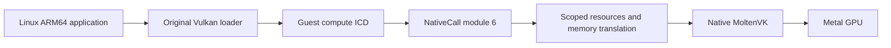

# Vulkan compute accelerator

Trames implements an experimental headless Vulkan compute profile. An original
Linux application uses unmodified `libvulkan.so.1`; its loader discovers the
guest ELF ICD, which bridges to native Vulkan. iPad device/simulator builds
statically link original public-API MoltenVK 1.4.2 over Metal. Graphics follows
compute; host port forwarding is deferred by the owner. Tracker:
[Issue #21](https://github.com/kb5000/trames/issues/21).

This selected subset is not complete Vulkan 1.0 conformance. Loader/ICD version
negotiation describes the base ABI; it does not advertise the host's entire API.

## ABI and activation

The existing `HLT #0x5452` transport negotiates a separate auxv key `0x54520008`,
profile `0x10006`, function 1 and 128-byte little-endian request records. The
frontend explicitly flattens arrays and structures. Guest pointers, native
function pointers, Objective-C objects and native handles are never passed
through unchanged. Proc-address queries return ordinary guest ELF functions.
Dispatchable objects contain the loader's required first word plus an opaque
resource ID. Loader-private create-info nodes are recognized locally; unsupported
application `pNext`, allocation callbacks, extensions and flags are rejected.

The CPU gates Vulkan independently of pure-memory NativeCall. The coordinator
checks its host-created capability snapshot and exact stub code before invoking
the backend. Matching instruction bytes alone do not grant GPU access. CLI
activation is `--vulkan`. iPad's default-off “Vulkan 计算（实验）” switch applies
to the next local session, which receives the verified ICD at
`/usr/lib/libtrames_vulkan_icd.so` and its JSON under `/usr/share/vulkan/icd.d`.
Install the ordinary `vulkan-loader` package with apk.

## Supported compute operations

The [catalog](../../accelerator/vulkan/entrypoints.inc) contains 68 public
functions plus ICD negotiation exports. The profile supports one instance,
compute-capable physical device, logical device and queue per address space;
property queries; buffers and memory; SPIR-V modules; storage/uniform buffer
descriptors; pipeline layouts and one compute pipeline per create call; primary
command buffers, dispatch, push constants, barriers, buffer copy/fill; fences,
binary semaphores, resets and idle waits. Compute pipeline specialization copies
up to 64 map entries and 64 KiB of constant data into owned host records, checks
IDs/offsets/sizes, and passes them to the original driver/compiler.

Queue submission preserves every `VkSubmitInfo` boundary and wait-stage mask.
One call supports up to 64 records and 64 waits, command buffers and signals in
each category across the batch. The original driver performs semaphore waits and
signals asynchronously. With the single-queue profile, a binary wait consumes a
previously queued signal. Validation changes temporary state only; a rejected
batch does not consume signals, mark commands pending or submit earlier records.
Semaphore-only submissions and reuse after a consumed signal are supported.
Timeline semaphore extensions remain unavailable.

Image capabilities are unavailable, graphics queue flags are masked, optional
features are zero and extensions are not advertised. Unsupported entrypoints
return NULL. Unsupported creation parameters return Vulkan failures. Recording
functions have void signatures; invalid/unsupported recording parameters abort
the experimental guest ICD with a diagnostic rather than fake success.

Limits include 256 retained native objects per context, 64 in-flight submissions,
64 MiB per native memory allocation and 128 MiB shared across the session's
contexts. Native driver/pipeline bookkeeping is additional memory; these logical
budgets do not establish an exact RSS or physical GPU capacity.

## Memory and lifetime

Mapped memory currently has separate native and guest storage. `vkMapMemory`
returns a guest anonymous mapping. Flush copies guest bytes to retained native
storage; invalidate copies them back through the interpreter's guest memory API.
Bounds, mapping identity and noncoherent-atom alignment are checked. The guest
mapping aligns `pData-offset` to the native `minMemoryMapAlignment`, including
unaligned mapping offsets; the underlying anonymous mapping is retained
separately for unmap/free. Partial flush/invalidate translates allocation offsets
to mapping-relative guest addresses. HOST_COHERENT
is cleared even when the host type has it: applications must follow the reported
properties and explicitly flush/invalidate. Shared storage remains future work.

No guest borrow survives a submission or wait. GPU buffers live on the host.
Fence polling is nonblocking; the guest wait wrapper uses monotonic deadlines
and nanosleep so other virtual threads can run. Queue idle appends a fence after
prior work. Synchronous creation and recording still execute at coordinator
checkpoints, including shader/pipeline compilation.

Objects retain required memory, layouts and pools. Recorded commands retain
referenced objects; submissions snapshot their dependency graphs and retain
wait/signal semaphores until native fences finish. Descriptor updates can release old bindings without invalidating
in-flight resources. Destroying an ID removes lookup access while native
dependencies finish. Address spaces have separate, non-reused opaque IDs;
CLONE_VM threads share resources. Fork does not duplicate live native Vulkan
resources: a child initializes its own instance/device. Successful exec and
final address-space exit release old resources; failed exec preserves them.
Final teardown joins native work before freeing dependencies.

## Original source and delivery

Rust uses pinned ash 0.38.0 and matching Vulkan 1.3.281 definitions. Native
MoltenVK algorithms are unchanged. No guest CPU JIT is introduced; the original
graphics stack translates SPIR-V and compiles GPU shaders.

[Upstream records](../../scripts/vulkan-upstream.json) pin commits, URLs and
hashes. `prepare-vulkan.py --apple` retains MoltenVK source, every dependency
revision named by that release and original notices. Apple CI uploads them with
the driver artifact. Bridge code remains GPL-3.0-or-later, and upstream notices
remain intact. A future IPA release must pair this repository's corresponding
source with the native-source artifact. Published 0.14.0 stays unchanged.

## Subsequent stages

Expand compute according to actual applications: pipeline caches, more
descriptors and `pNext` records, multiple queues and storage
images. Introduce shared guest/GPU backing with explicit remap, COW and completion
semantics. Move expensive creation work off the coordinator without retaining
guest slices or serializing unrelated calls.

Then verify offscreen graphics before adding presentation. A host-owned surface
token can connect a guest swapchain to an iPad Metal view; a guest address never
becomes a CAMetalLayer pointer. X11/Wayland WSI and a DRM subsystem are separate
compatibility work. See [verification](../validation/vulkan-compute.md).
