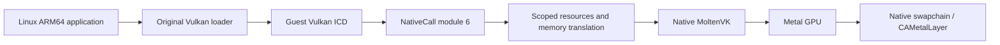

# Vulkan compute, graphics and display accelerator

Trames implements an experimental Vulkan compute/graphics profile. An original
Linux application uses unmodified `libvulkan.so.1`; its loader discovers the
guest ELF ICD, which bridges to native Vulkan. iPad device/simulator builds
statically link original public-API MoltenVK 1.4.2 over Metal. A fixed-resolution
virtual display exposes standard `VK_KHR_display`, `VK_KHR_surface` and
`VK_KHR_swapchain`. Applications submit native GPU images directly to an App
window's `CAMetalLayer`. Host port forwarding remains deferred. Tracker:
[Issue #21](https://github.com/kb5000/trames/issues/21).

The paired frontend/runtime exposes the Vulkan 1.2 core ABI and the native
features whose query, creation, ownership and execution paths are implemented.
This remains experimental; full Vulkan CTS/conformance is not claimed. The
[2026-10-31 completion record](#promoted-vulkan-11-and-12-paths-2026-10-31)
separates real GPU acceptance from the core entrypoint inventory. Original Mesa
uses this bridge for hardware Zink/GLES; see the
[GL/resource validation](../validation/zink-gles.md) for Apple/Metal coverage.

## ABI and activation

The existing `HLT #0x5452` transport negotiates a separate auxv key `0x54520008`,
profile `0x10006`, function 1 and 128-byte little-endian request records. The
frontend explicitly flattens arrays and structures. Guest pointers, native
function pointers, Objective-C objects and native handles are never passed
through unchanged. Proc-address queries return ordinary guest ELF functions.
Dispatchable objects contain the loader's required first word plus an opaque
resource ID. Loader-private create-info nodes are recognized locally; unsupported
application `pNext`, allocation callbacks, extensions and flags are rejected.

The CPU gates Vulkan independently of pure-memory NativeCall. The coordinator
checks its host-created capability snapshot and exact stub code before invoking
the backend. Matching instruction bytes alone do not grant GPU access. CLI
activation is `--vulkan`. iPad's default-off “Vulkan 计算与图形（实验）” switch applies
to the next local session, which receives the verified ICD at
`/usr/lib/libtrames_vulkan_icd.so` and its JSON under `/usr/share/vulkan/icd.d`.
Install the ordinary `vulkan-loader` package with apk.

## Supported compute operations

The [catalog](../../accelerator/vulkan/entrypoints.inc) contains 238 public
functions plus ICD negotiation exports. The profile supports one instance,
compute-capable physical device, logical device and queue per address space;
property queries; buffers and memory; SPIR-V modules; storage/uniform buffer
descriptors; pipeline layouts and one compute pipeline per create call; primary and secondary
command buffers, dispatch, push constants, barriers, buffer copy/fill; fences,
binary semaphores, resets and idle waits. Compute pipeline specialization copies
up to 64 map entries and 64 KiB of constant data into owned host records, checks
IDs/offsets/sizes, and passes them to the original driver/compiler.

Query pools support native timestamps, nonprecise occlusion and, when actually
supported/enabled, transform-feedback stream-zero statistics. CPU result reads
poll the native driver once; the guest WAIT wrapper yields through nanosleep.
GPU query copies and transform-feedback counters stay on the native queue.
The [feedback profile and validation](../validation/vulkan-feedback.md) define
the supported limits and the remaining Apple GPU implementation work.

Shader ingress removes only SPIR-V `OpName`/`OpMemberName` debug annotations.
MoltenVK 1.4.2's original SPIRV-Cross can otherwise preserve a valid GLSL variable
such as `bias` and collide with `metal::bias` during MSL compilation. Header IDs,
entrypoint strings, decorations/specialization IDs and executable instructions
are retained verbatim; original native compiler algorithms remain unchanged.

Queue submission preserves every `VkSubmitInfo` boundary and wait-stage mask.
One call supports up to 64 records and 64 waits, command buffers and signals in
each category across the batch. The original driver performs semaphore waits and
signals asynchronously. With the single-queue profile, a binary wait consumes a
previously queued signal. Validation changes temporary state only; a rejected
batch does not consume signals, mark commands pending or submit earlier records.
Semaphore-only submissions and reuse after a consumed signal are supported.
Driver-backed timeline counters and host/GPU waits/signals are covered by the
[Zink synchronization layer](zink.md), including resumable CPU waits. Future timeline queue waits are submitted to the
original driver; they do not poll on the submitting guest thread.

## Graphics resources

Core graphics includes native optimal-tiled uncompressed 1D/2D/3D color/float images
and native-supported D16/X8D24/D32/S8 and packed depth/stencil images, binding/memory requirements, image views, up to eight
color outputs with optional depth, framebuffer and vertex/fragment pipelines.
Driver-backed renderpass2 and imageless framebuffer attachment binding are also
available with multiple subpasses and layered attachments; recorded commands retain late-bound
views/images until native submissions complete. See [Zink coverage](zink.md).
Static or dynamic viewport/scissor, depth compare/write, front/back stencil operations,
static/dynamic stencil masks/reference, native color/alpha
blending, transfer color clears, draws, image layout barriers, buffer-to-image
uploads and image-to-buffer copies are supported. Queue queries retain native
graphics/compute/transfer flags. Image format queries expose only this profile:
native-supported sample counts, mip chains and array/volume subresources, dimensions
up to 4096 and at most 2048 array layers; allocation/session budgets still apply. Device memory uses explicit noncoherent transfers or coherent shadow
mappings synchronized at the exposed host synchronization boundaries.

Pipelines accept generated vertices or vertex/instance buffers (up to 16 bindings
and attributes), triangle list/strip topology (including strip primitive restart), 16/32-bit index buffers and indexed
or ordinary draws. Selected vertex formats are R32 scalar/vector SFLOAT/SINT/UINT
and RGBA8 UNORM/SNORM/SINT/UINT, subject to native `VERTEX_BUFFER` format features.
Binding stride is at most 2048, attribute offset at most 2047; native limits also
apply. Non-indexed and instance fetch extents and index-buffer ranges are checked.
Indexed vertex values remain on the GPU and follow Vulkan's application validity
rules; the bridge does not read GPU indices back to the CPU for scanning.
Nonzero base vertex/instance follows original native driver support: MoltenVK's
iOS simulator does not support it and reports FEATURE_NOT_PRESENT when ending
the command buffer. Base-zero indexed/instanced drawing is tested there; the
nonzero positive/negative cases are independently verified on Linux. Physical
iPad support remains to be tested.

Graphics and compute descriptor layouts accept uniform/storage buffers, their
dynamic variants, texel buffer views, storage images, samplers, sampled images and
combined image samplers, including arrays and update templates. Native dynamic
offsets preserve binding/array order and alignment/range constraints. Descriptor
pool reset invalidates old sets and recorded commands without double-freeing
native sets. Pipeline caches support original driver bytes and merge. Vertex,
fragment and compute visibility is preserved. Graphics descriptor binding and up
to 128 bytes of stage-aware push constants use the original native commands.
Each descriptor slot retains all its resources, including both view and sampler;
updates replace those slots, while submission snapshots retain prior dependencies
until GPU completion. Graphics and compute pipeline bindings are independent.

Supported uncompressed textures use optimal tiling and one sample, with 1D/2D/3D,
array/cube views, mip chains and explicit uploads/readback. Subresource barriers,
clears and copies retain exact mip/layer/volume ranges. Native blits generate mips
and convert native color formats while preserving Vulkan integer/depth rules.
Cube arrays require an enabled native feature. 2D/array views of 3D slices require
maintenance1 and native portability support; framebuffers remain single-layer.
See [image validation](../validation/zink-images.md). Textures support
`SHADER_READ_ONLY_OPTIMAL`/GENERAL layouts, nearest/linear filtering, and normalized
repeat/mirrored-repeat/clamp-to-edge/clamp-to-border sampling. Native format
properties bound sampling/filter support. Buffer/image copies use actual texel sizes and check offsets,
padded row/image pitches, subresources and buffer/image extents. Sampler
anisotropy is queried from the host, must be enabled at device creation and
uses the native sampler with the native maximum. Comparison samplers preserve the native compare operation. Unnormalized
coordinates, immutable samplers, multisampling and graphics specialization
remain unavailable. Unsupported options fail explicitly.

Depth/stencil transfers select one aspect and use its actual element size (for
example, four bytes for D32S8 depth and one for stencil). Views/clears may select
one or both aspects; sampled views select one. Packed image barriers transition
both aspects because separateDepthStencilLayouts is not enabled. Render passes
preserve separate depth/stencil load/store and clear values; stencil operations,
comparisons and depth comparison sampling execute on the original native GPU.
See [depth/stencil acceptance](../validation/vulkan-stencil.md).

Native EXT vertex attribute divisors support independently selected per-instance
rates (including zero when the real feature is enabled), using copied pipeline
pNext arrays. Buffer bounds follow the actual fetched instance elements. The EXT
profile restricts non-one divisors to firstInstance=0; KHR properties are not
advertised. See [divisor acceptance](../validation/vulkan-divisor.md).

Pipelines copy static viewport/scissor and blend constants into owned compiler
inputs. Each dynamic viewport/scissor must be set before drawing; draw checks recording/render-pass/
pipeline compatibility. Buffer transfers remain outside render passes.
Framebuffers/views/images retain their memory and render pass; recorded commands
and in-flight snapshots retain the complete graph. Graphics compilation uses the
same owned, bounded native tasks and fallible output rollback as compute. Vertex
input arrays are copied before the task starts; no guest pointer or Rc crosses
native worker threads. See [texture verification](../validation/vulkan-textures.md).

The [offscreen regression](../validation/vulkan-render.md) continues to check
GPU pixels through a readback buffer and independent barycentric equations.
Readback/file export is a test oracle, not the display path. The former demo
sheet has been removed from the product UI.

## Native display and swapchain

The native embedding API retains a fixed-display WSI backend for regression
testing. Normal App sessions no longer attach this display; graphical clients
use [Wayland windows and workspace tabs](wayland.md). Tests explicitly attach one
1024 × 768 virtual display, plane and mode (60 Hz nominal). The host configures
a `CAMetalLayer` on its main thread and passes it through the native embedding capability. No guest
pointer can select a host layer or Objective-C object. Objective-C retain leases
keep the target alive through surface, swapchain, view, recorded-command and
in-flight work lifetimes. Detach invalidates that target generation with
`VK_ERROR_SURFACE_LOST_KHR`; cleanup retains resources until native work ends.
The original Linux loader creates ICD surfaces lazily on first query/use. Once
materialized, a surface claims the display exclusively; a second live producer receives
`VK_ERROR_NATIVE_WINDOW_IN_USE_KHR`.

The ordinary Linux application enables `VK_KHR_surface` and `VK_KHR_display`,
queries display/plane/mode and creates a display-plane surface. The bridge makes
an original native `VK_EXT_metal_surface` on the trusted layer. Device
`VK_KHR_swapchain` exposes BGRA8 UNORM/SRGB nonlinear, FIFO, exclusive sharing,
one layer, identity transform, opaque alpha, color attachment and optional
transfer-source usage; native capabilities bound the image count (at most four).
Unsupported options fail explicitly. Without an attached display, the legacy
display extension is unavailable. Wayland WSI and compute/offscreen rendering
remain independently usable.

Acquire uses a zero-timeout native call. The guest ICD implements finite/infinite
waits by retrying with guest nanosleep, allowing peer guest threads and the
coordinator to run. Submission consumes acquire semaphores, signals render
semaphores, and `vkQueuePresentKHR` submits the original native swapchain image.
Borrowed images are never passed to `vkDestroyImage` or rebound to memory.
Previous present semaphores remain retained until that image’s next acquisition
fence signals (acquire can return its index earlier). A private native fence is
used for each acquire; polling suspends no guest thread. A guest acquire fence
refers to that private backing until reset. This isolates MoltenVK’s later
presentation-time re-signal from a subsequent use of the guest fence, while
status/wait still observe the original native fence’s completion.
Current acquire/present objects also survive until native swapchain teardown. Recreating with
`oldSwapchain` retires the old acquire path while retaining outstanding work.
Failed output publication rolls back owned resources; ambiguous native present
errors retire the affected chain. The display registry lock only protects target
lookup/attach/detach, never an entire rendering call.

The old “显示窗口” menu entry, fixed-resolution floating monitor and automatic
display attachment have been removed. All App graphics use the unified Wayland
window/tab workspace; resizing requests a new client buffer resolution. The
fixed-display canvas and its probes now live only in the XCTest target.

`vulkan-present.c` is an ordinary Vulkan acceptance fixture, not a special
product rendering API. It exercises continuous native acquire/draw/present,
semaphore reuse, swapchain recreation, retired acquire and producer release.
Apple XCTest retains the native fixed-display swapchain and producer-release
regression. Workspace gestures and live Wayland presentation cover the App UI.
The earlier monitor UI acceptance remains historical in
[display verification](../validation/vulkan-display.md).

Optional core features are limited to queried native sampler anisotropy.
Only the selected WSI extensions are advertised.
Unsupported entrypoints
return NULL. Unsupported creation parameters return Vulkan failures. Recording
functions have void signatures; invalid/unsupported recording parameters abort
the experimental guest ICD with a diagnostic rather than fake success.

Limits include 16,384 retained native objects per context and 64 in-flight
submissions. Explicitly memory-capped sessions retain the 64 MiB allocation
bound and a shared native allocation / coherent-baseline quota equal to one
eighth of the selected guest memory limit, capped at 1 GiB (1 GiB guest →
128 MiB; 4 GiB guest → 512 MiB). Their reported native heaps are capped by
that quota. Selecting a limit reserves no storage; live allocations and mapping
baselines charge it and release it at final drop.

Host-managed sessions, including the Mac's default `--memory-mib auto`, use
the original driver's heap sizes and allocation failures. They add no native
byte quota or 64 MiB per-allocation ceiling. Shared accounting still records
actual live native allocations and coherent baselines, with checked arithmetic
and release at final drop. The obsolete independent 128 MiB per-context ceiling
has been removed in both modes: a context must not reject memory that its shared
session policy permits. Native accounting is separate from guest resident pages.
Native driver/pipeline bookkeeping is additional memory; these logical budgets
do not establish an exact RSS or physical GPU capacity.

iOS simulator instances use MoltenVK's original direct resource-binding path
through per-instance `VK_EXT_layer_settings`. The iOS 18.5 `SimMetalHost` aborts
inside argument-encoder buffer deserialization during descriptor allocation;
`MVK_CONFIG_USE_METAL_ARGUMENT_BUFFERS=false` avoids that simulator path while
executing the same Metal workload. No process-wide environment mutation or
software GPU replacement is used.

## Memory and lifetime

Eligible HOST_VISIBLE | HOST_COHERENT allocations now import one retained host
allocation into both the native driver and the guest memory model. The optional
bridge capability query (operation 200) advertises shared mapping in bit 0 and
completion waits in bit 1. New ICDs request a dedicated shared resource mapping
with operation 17's `0x534841524544` hint; old hosts/ICDs keep the original path.
Guest addresses remain guest virtual addresses. Only the mapping installation
uses a joined structural checkpoint; ordinary data accesses use the common
CPU/native page permissions and concurrency model. Host and driver alignment,
partial offsets, rounded allocation ownership and quotas remain explicit.

Unsupported imports, noncoherent allocations and legacy maps retain separate
native and guest storage. Their transfers use bounded raw CPU page copies and
resource-scoped coherent baselines, described in the
[shared runtime contract](../../runtime/docs/architecture/region-memory.md#shared-gpu-resource-mappings-and-completion-waits-2026-10-30).

Bounds, mapping identity and noncoherent-atom alignment are checked. The guest
mapping aligns `pData-offset` to the native `minMemoryMapAlignment`, including
unaligned mapping offsets; the underlying anonymous mapping is retained
separately for unmap/free. Partial flush/invalidate translates allocation offsets
to mapping-relative guest addresses.

Fallback HOST_COHERENT mappings retain that property. Their guest shadow is initialized
from native storage on map. A budget-charged baseline records synchronized bytes:
queue submission and unmap upload only CPU changes, while successful fence
status/wait (including queue/device idle) downloads GPU changes without replacing
new CPU writes to other bytes. Explicit coherent flush/invalidate follows the
same rules. This supports original clients that persistently map uniforms or
unmap texture staging memory without a flush. It avoids whole-map upload/readback
clobbering independent CPU inputs and GPU outputs; same-byte unsynchronized races
remain application errors under Vulkan. The baseline shares the session GPU
allocation budget and is released with the mapping. This shadow behavior is the
fallback; eligible shared mappings need no baseline,
comparison or copy at those boundaries. Device writes publish an external code
version there, preserving interpreter code and exclusive-token invalidation.
No new ordinary-data fence is introduced. Image presentation still exports the
original native texture
without pixel readback; shadow mappings do not change that path.

No guest borrow survives a submission or wait. GPU buffers live on the host.
Fence status queries remain nonblocking. On source-built MoltenVK, synchronous
fence/timeline waits become owned resumable jobs: the original CPU slot returns
to the run queue, native completion notifies its existing readiness source, and
finite waits use that queue's deadline mechanism. No polling bus or wait thread
is created. Native callbacks retain only weak scheduling authority and run after
the driver's fence mutex releases. Queue idle still appends a fence after prior
work. Old drivers retain the monotonic/nanosleep fallback. Future-host-signal
submission and image-acquisition retry loops are separate existing paths.
Ordinary creation/recording executes on the calling CPU worker; structural maps
and device teardown retain joined boundaries. Compute and graphics pipeline
compilation keeps its existing owned native tasks.

The Vulkan C API remains synchronous for its caller: the runtime suspends
only that guest thread until the native result arrives. Other guest threads and
unrelated compiler tasks continue. Native workers receive owned entrypoint names,
specialization bytes, native handles and Arc-owned driver lifetimes; no guest
address, memory guard or coordinator Rc crosses threads. The GPU context retains
the shader/layout and reserves an object slot until completion. A shared session
admission counter permits eight concurrent native compile tasks without a global
compiler work lock; capacity exhaustion returns out-of-host-memory. Compiler
readiness subscriptions return the execution slot while waiting.
Driver-internal synchronization stays unchanged.

Completion checks the current guest output mapping before publishing an ID.
A fallible backing write can still fail after preflight; that failure rolls back
the unpublished resource and destroys its native pipeline. Caught guest signal handlers wait for
the active native call to return; stop/continue preserves the waiting call.
Killed callers abandon results, which the coordinator reaps after native work
finishes. Final context teardown joins compiler tasks and GPU work before dropping
dependencies. Final teardown can wait for the original compiler/driver; ordinary
progress polling does not wait for unfinished compilation.

Objects retain required memory, layouts and pools. Recorded commands retain
referenced objects; submissions snapshot their dependency graphs and retain
wait/signal semaphores until native fences finish. Descriptor updates can release old bindings without invalidating
in-flight resources. Destroying an ID removes lookup access while native
dependencies finish. Address spaces have separate, non-reused opaque IDs;
CLONE_VM threads share resources. Fork does not duplicate live native Vulkan
resources: a child initializes its own instance/device. Successful exec and
final address-space exit release old resources; failed exec preserves them.
Final teardown joins native work before freeing dependencies.

## Original source and delivery

Rust uses pinned ash 0.38.0 and matching Vulkan 1.3.281 definitions. Native
MoltenVK algorithms are unchanged. Universal Apple archives are thinned into the
target build directory with original upstream bytes retained. Apple's original
matching compiler-rt provides native platform availability checks. Rust and Xcode
use the app's iOS 17 deployment target and explicit framework dependencies.
No guest CPU JIT is introduced; the original
graphics stack translates SPIR-V and compiles GPU shaders.

[Upstream records](../../scripts/vulkan-upstream.json) pin commits, URLs and
hashes. `prepare-vulkan.py --apple` retains MoltenVK source, every dependency
revision named by that release and original notices. Apple CI uploads them with
the driver artifact. Bridge code remains GPL-3.0-or-later, and upstream notices
remain intact. A future IPA release must pair this repository's corresponding
source with the native-source artifact. Published 0.14.0 stays unchanged.

## Subsequent stages

Expand compute according to actual applications: pipeline caches, more
descriptors and `pNext` records, multiple queues and storage
images. Introduce shared guest/GPU backing with explicit remap, COW and completion
semantics. Extend native task dispatch to other expensive creation operations and
add a reusable compiler worker pool if measurements justify it.

Then verify offscreen graphics before adding presentation. A host-owned surface
token can connect a guest swapchain to an iPad Metal view; a guest address never
becomes a CAMetalLayer pointer. X11/Wayland WSI and a DRM subsystem are separate
compatibility work. See [verification](../validation/vulkan-compute.md).

MoltenVK 1.4.2 volume blits include a one-line source-mip-depth correction,
rebuilt from the pinned original source with its unchanged GPU algorithms.
[Native build recipe and evidence](../validation/moltenvk-source-build.md).

## Optional typed-PBO guest stack (2026-10-29)

The Mac Firefox bring-up uses paired Mesa 25.1.9 EGL and Zink libraries built by
[`build-zink-gallium.py`](../../scripts/build-zink-gallium.py). In addition to the
existing native Wayland adapter, the
[PBO patch](../../patches/mesa/0002-preserve-pbo-upload-output-type.patch)
preserves integer output types in Mesa's upload helper. Without that metadata,
Metal rejects a floating-point shader output bound to an integer attachment.
The original Firefox binary and native GPU capability checks remain unchanged.

[`zink-pbo.c`](../../tests/fixtures/zink-pbo.c) independently checks 128 exact
signed/unsigned integer components and the GLES rejection of invalid
cross-signedness uploads. On the Mac's real Apple GPU, the original Gallium
library reproduces the failure and the rebuilt library passes. This optional
guest stack retains its source/patches alongside the built libraries; it does
not overwrite the original signed Gallium package or claim physical iPad GPU
acceptance. The shared resident-file and GPU-checkpoint corrections are included
in the paired runtime pin. Full Mac evidence and the normal launcher are in
[trames-mac](https://github.com/kb5000/trames-mac/blob/main/docs/validation/mac-firefox-gpu.md).

## Neural-compute extension feasibility (2026-10-30)

A native capability probe linked the same patched MoltenVK 1.4.2 archive used by
the Mac product. On Apple M6, a Vulkan 1.1 instance queried the individual feature
structures and successfully created a device with the supported fields enabled
together. This is native discovery/device-creation evidence, not guest shader
acceptance, a neural-network benchmark or physical iPad validation. The measured
fields and archive/source hashes are recorded under `neural_compute_feasibility`
in [the compute record](../validation/vulkan-compute-data.json).

| Priority | Capability | Measured native support and integration scope |
| --- | --- | --- |
| First | `VK_KHR_16bit_storage`, `VK_KHR_8bit_storage` | All queried storage fields are true. Add their feature query/create records and dependency `VK_KHR_storage_buffer_storage_class`; retain original buffer allocation and descriptor paths. |
| First | `VK_KHR_shader_float16_int8`, core `shaderInt16` | FP16, INT8 and INT16 are supported. Extend selected features and native creation; executable arithmetic stays in the original shader compiler/GPU. |
| First | `VK_KHR_shader_float_controls` | FP16/FP32 preserve signed zero/Inf/NaN and round to nearest even. Forward actual properties; denormal preservation/flush and round-toward-zero are false. |
| First, workload dependent | `VK_EXT_shader_atomic_float` | FP32 buffer/shared atomics and atomic add are true. FP64, image and sparse-image fields are false. Useful for accumulation; not a requirement for every inference kernel. |
| Next | Subgroup properties, `VK_KHR_shader_subgroup_extended_types`, `VK_EXT_subgroup_size_control` | Default subgroup is 32; compute supports basic/vote/arithmetic/ballot/shuffle/relative/clustered/quad. Extended types and full subgroups are supported. Required-subgroup-size stages are zero: do not promise arbitrary requested compute subgroup sizes. Resolve Vulkan 1.1 dependencies and stage-create records first. |
| Next | `VK_KHR_buffer_device_address`, `VK_KHR_vulkan_memory_model` | Base address and memory-model/device-scope features are true; capture/replay, multi-device addresses and availability/visibility chains are false. Add the actual allocation flags, buffer usage, address commands and lifetime rules; an extension name alone is insufficient. |
| Compatibility | `VK_KHR_shader_integer_dot_product` | Feature is true, but all queried acceleration fields, including packed signed 4x8, are false. Exposing it can improve compatibility; no dedicated-hardware speedup is established. |
| Separate native-driver work | `VK_KHR_cooperative_matrix`, `VK_KHR_shader_bfloat16` | Neither extension is advertised by the pinned native driver. SPIRV-Cross already has relevant Metal lowering, but its cooperative path is restricted to subgroup scope and 8x8 matrices, rejects specialized dimensions/layout and several element operations. Native feature/property plumbing and compiler/real-workload validation are required. |
| Deferred | FP8 and `VK_EXT_shader_atomic_float2` | Not advertised by this native driver; no immediate forwarding path. |

The first batch targets the original ncnn FP16/INT8 paths, with exact storage,
arithmetic and accumulation oracles before model inference. Storage and arithmetic
are separate features: enabling FP16 arithmetic does not enable FP16 buffers.
Use real GEMM/softmax/normalization and model measurements to select subsequent
work, rather than counting advertised extensions. See the
[Khronos FP16 sample](https://docs.vulkan.org/samples/latest/samples/performance/16bit_arithmetic/README.html)
and [ncnn feature negotiation](https://github.com/Tencent/ncnn/blob/master/src/gpu.cpp).

The inspected [llama.cpp backend](https://github.com/ggml-org/llama.cpp/blob/master/ggml/src/ggml-vulkan/ggml-vulkan.cpp)
requires Vulkan 1.2 at instance initialization and uses Vulkan 1.1/1.2 aggregate
feature/property records. The current guest advertises instance 1.1/device 1.0,
so these extensions alone do not make unmodified current llama.cpp runnable.
Implement and validate its required API/query/create paths before changing the
advertised API version. ncnn also filters subgroup extensions when its physical
device lacks Vulkan 1.1.

The existing shared-memory path already uses native `VK_EXT_external_memory_host`
internally, retaining one allocation through guest mappings and Vulkan resource
owners. This probe reports 16 KiB import alignment. Reuse that path; exposing
arbitrary guest-pointer import is a separate task. Keep query/create serialization
in the shared runtime/ICD and select actual driver features per device; Mac native
measurements do not establish physical iPad support. No new coordinator, CPU
tensor readback, stronger ordinary memory barriers or alternative CPU/GPU
synchronization policy is needed for the first feature-only batch.

## Driver-backed neural compute implementation (2026-10-30)

The shared runtime and paired ICD now expose the selected Vulkan 1.1 device/query
paths and 17 compute-related extensions when the original driver advertises them.
The previous section records the earlier discovery-only probe. Implemented paths
include 8/16-bit storage, FP16/INT8 arithmetic, core INT16/INT64, float controls,
FP32 buffer atomics, integer dot products, subgroup extended types/size/flow/rotate,
buffer device addresses, the Vulkan memory model, uniform-buffer layout and
variable pointers. Storage class, bind-memory2 and maintenance3 provide the
associated dependencies and property queries. Geometry/tessellation remain outside
this work; cooperative matrix, BF16 and FP8 are not advertised by the pinned driver.

The [compute wire schema](../../runtime/crates/trames-vulkan/compute-profile.json)
generates the paired Rust and C metadata through
[`generate-vulkan-compute.py`](../../scripts/generate-vulkan-compute.py). The guest
build checks that metadata. Wire revision 10 adds cached capability/property
queries (206/207), device-create extension/feature masks and buffer-address query
208; legacy bits and operations are preserved. Native feature discovery bounds
device creation. Individual and Vulkan 1.1 aggregate feature records agree, and
unsupported optional fields remain zero. Shader-stage subgroup flags and optional
required-size records are copied into the original compiler task; the measured
Apple driver does not support requesting a particular compute subgroup size.

Buffer addresses remain opaque GPU values. Original allocation flags and usage
reach native Vulkan; the CPU never dereferences the returned address. Addressed
buffers join the existing submission resource/coherence graph through their live
owners, since descriptor enumeration cannot identify pointer aliases. Shared
backing retains zero-copy CPU/GPU visibility; fallback mappings retain the existing
shadow synchronization. Tensor contents are not scanned or interpreted, and no
new coordinator, service thread, global algorithm lock or ordinary-memory barrier
is introduced. Original application resource-lifetime and synchronization duties
still apply.

Execution exposed one native-driver discrepancy: the pinned Apple MoltenVK reports
shared FP32 atomics/add, but its original Metal compilation rejects both
threadgroup floating-point atomic add and exchange. The same C/shader oracle fails
when called directly on that native driver. A narrow Apple/MoltenVK discovery quirk
clears those two fields. FP32 buffer atomics remain native and tested; other native
drivers retain their reported shared-atomic fields. No CPU/CAS emulation is added.
Integer dot products execute correctly, with the driver's unaccelerated properties
preserved.

| Focused acceptance | Result |
| --- | --- |
| Same oracle on original Apple M6/MoltenVK and guest, one/twelve CPUs | 64 exact FP16 GEMM outputs, INT8/INT16 results, half subgroup reduce/shuffle/ballot, FP32 buffer accumulation, Vulkan memory model and GPU-pointer read/modify/write pass |
| Packed signed INT8 dot shader | 64 exact results; original native GPU executes the dot instruction |
| Feature/API negotiation | Individual/aggregate feature query/create paths, core/KHR buffer-address entrypoints, bind-memory2 and queue2 paths work; unsupported capture/replay and required subgroup size requests reject |
| Apple shared mappings | Three shared allocations; zero CPU upload/download bytes and zero scanned synchronization bytes |
| ARM64 Linux interpreter/Lavapipe, one/four CPUs | Same GPU outputs pass with both original shared mapping and forced shadow mapping |
| Shadow mapping experiment | Test-only native loader filter hides only host-memory import; original native driver still allocates/compiles/executes everything. Pointer-only CPU input and GPU output survive the existing synchronization, with 387 uploaded and 2851 downloaded bytes per run |
| Existing graphics regressions | Final paired ICD passes GLES 3.1/indirect/image/ASTC on one/twelve CPUs and all 128 integer PBO components/type errors |
| Affected local checks | 51 Vulkan unit tests on each macOS/ARM64 Linux, strict Vulkan/Mac lints, signed Mac build and ARM64 iPad FFI compile pass |

Build only the focused fixtures with
[`build-vulkan-neural-fixtures.sh`](../../scripts/build-vulkan-neural-fixtures.sh),
reusing the paired ICD/loader/native archives. The maintained
[Mac harness](https://github.com/kb5000/trames-mac/blob/main/tests/integration/mac-vulkan-neural.py)
uses a disposable store and checks actual output. Hashes, the native compiler
failures and coverage are under `neural_compute_acceptance` in
[the compute record](../validation/vulkan-compute-data.json).
The iPad guest bundle is prepared, but no physical iPad compute acceptance or new
IPA installation is claimed. This is selected functional coverage; full CTS and
model inference/performance are unmeasured. Current llama.cpp still needs its
Vulkan 1.2 initialization/query paths beyond this selected 1.1 profile.

## Promoted Vulkan 1.2 paths (2026-10-30)

The shared runtime and paired guest ICD now accept the selected Vulkan 1.2
application/compute paths. This supersedes the 1.2 initialization gap described
above, while full Vulkan 1.2 conformance remains unfinished. Instance enumeration
reports 1.2; physical-device API discovery is capped at the native driver's 1.2
support. The experimental profile still exposes only implemented features.

Vulkan 1.1/1.2 aggregate feature and property records use the common generated
schema. Supported fields retain native discovery; unsupported optional fields
stay false. Properties are serialized field by field into zeroed payloads, so
native pointers/padding do not cross the boundary. The guest conformance version
stays zero. Device creation merges promoted aliases into one owned native 1.2
feature record, avoiding duplicate individual nodes; older native API paths keep
their individual records. Core operations work without repeated promoted
extension names. Guest layer settings stay with the guest loader/layers and do
not configure the host driver. Device groups remain singleton only.

| Added path | Implementation and acceptance |
| --- | --- |
| SPIR-V 1.4/1.5, shader draw parameters and non-semantic-info negotiation | Original driver/compiler remains responsible for shader execution. The new shader is validated as SPIR-V 1.5 and uses a dynamic subgroup broadcast source. |
| Host query reset, core/EXT names | Native timestamp queries become unavailable after reset and available after completed GPU execution; reset is feature gated. |
| Dispatch base, singleton device mask, core/KHR names | Nonzero base dispatch preserves untouched output indices and uses the native pipeline dispatch-base flag. |
| Descriptor-layout support, buffer update, render-area granularity | Native queries and commands reuse existing object ownership; the update input may be overwritten immediately after recording. Core renderpass2 creation is checked without extension names. |
| Sampler min/max reduction and mirror clamp | Native Apple GPU and Lavapipe return exact values 2/9/2 from the same float image. Features are enabled only when the native driver supports them. |
| Large mapping | The guest ICD's fixed 64 MiB map ceiling is removed. A 68 MiB Mac mapping retains first/last CPU sentinels and receives the GPU update in its last four bytes. Existing allocation policies remain product specific. |

Wire revision 11 adds operations 209–214 and expands the compute schema from 17
to 23 extensions. No coordinator/service thread, global algorithm lock, stronger
ordinary-memory barrier or CPU implementation of the shader is added. Dispatch
validation also reuses cached workgroup limits instead of querying the driver
for every command.

The maintained [C oracle](../../tests/fixtures/vulkan-core12.c) and
[SPIR-V 1.5 shader source](../../tests/fixtures/vulkan-core12.comp) build with the
existing focused fixture script. The new
[Mac harness](https://github.com/kb5000/trames-mac/blob/main/tests/integration/mac-vulkan-core12.py)
uses the original loader and a disposable headless store. Its default mapping is
68 MiB; the fixture accepts an optional size in MiB for bounded products.

The original Apple M6/MoltenVK reference and one/twelve guest CPUs pass all exact
outputs. Three shared mappings cover 71,303,708 bytes with zero CPU upload,
download or scanned synchronization bytes. The ARM64 Linux interpreter/Lavapipe
passes one/four CPUs with both native shared and forced shadow mappings, using
32 MiB to respect the unchanged CLI's 64 MiB single-resource quota. An initial
68 MiB CLI run hit that allocation quota before mapping. The discovery-only
shadow filter retains original native GPU allocation/compilation/execution.

Final ICD/runner hashes also pass the existing neural compute, GLES 3.1,
indirect/image/ASTC and 128-component integer PBO regressions. Focused checks pass
53 Vulkan tests per macOS/ARM64 Linux, strict Vulkan/Mac lints, signed Mac release
build, Linux CLI build, both product boundaries and ARM64 iPad FFI compilation.
Unchanged CPU/kernel/network and native-driver archive checks are reused. Full
records are under `core12_follow_up` in
[the compute data](../validation/vulkan-compute-data.json).

That follow-up was extended by the 2026-10-30 color-MSAA work and the
2026-10-31 promoted-path completion below. Geometry/tessellation, full CTS,
unmodified inference-engine acceptance and physical iPad GPU acceptance remain
outside those validation claims. The paired iPad guest artifact is prepared
without installing a new IPA; the active Firefox session/profile is retained.

## Native color MSAA and resolve (2026-10-30)

The paired runtime/ICD now carries native 2D multisample image counts, raster
samples, sample masks, per-sample shading and alpha-to-coverage through the
original driver. Alpha-to-one is separately gated by its native core feature.
Image-format queries return the driver's sample-count set instead of the old
single-sample mask. This extends the selected single-subpass/single-layer
framebuffer profile; it does not establish full Vulkan/GLES conformance.

Color resolve works both inside a native subpass and through
`vkCmdResolveImage` (wire operation 215). Legacy renderpass and renderpass2 share
an owned attachment description/reference decoder that preserves application
indices, including sparse outputs and UNUSED references. It supports up to eight
colors, eight resolve targets and depth/stencil: 17 attachments in real and
imageless framebuffers. Clear values, usage, formats and sample counts follow
the original attachment indices. Existing single-sample wire clients remain
accepted. Single-subpass renderpass compatibility retains the
[Khronos rules](https://docs.vulkan.org/spec/latest/chapters/renderpass.html#renderpass-compatibility),
including the resolve-reference exception.

Immutable attachment tables are allocated only for render-pass objects, behind
one owned pointer. They do not enlarge every buffer/image/command object or get
copied on each draw. Native color-attachment limits are cached at device creation.
Original command/resource retention, hardware-coherent mapping and worker-local
native execution are reused. No CPU resolve, presenter, new coordinator, global
algorithm lock or additional ordinary-memory barrier is introduced. In-pass
resolve stays available so the original driver can retain its tile-rendering
optimizations; explicit resolve is forwarded when the application requests it.

The focused [fixture build](../../scripts/build-vulkan-msaa-fixtures.sh) reuses the
paired ICD, original loader and native SDK. Its optional GLES fixture accepts
`MESA_INCLUDE`, `GLES_LIBRARY`, `EGL_LIBRARY` and `GALLIUM_LIBRARY` to link the
original paired Mesa stack. The maintained
[Vulkan harness](https://github.com/kb5000/trames-mac/blob/main/tests/integration/mac-vulkan-msaa.py)
and [Zink harness](https://github.com/kb5000/trames-mac/blob/main/tests/integration/mac-zink-msaa.py)
use a disposable headless store with no concurrent runner.

| Focused functional acceptance | Result |
| --- | --- |
| Original Apple M6/MoltenVK reference, one/twelve guest CPUs | 2/4/8 samples; 19 cases and 9,408 RGBA pixels per run, within one UNORM unit of the analytic result |
| Coverage and depth | Full/alternating/zero masks, sample-ID shading, zero-alpha coverage, depth rejection and explicit-only resolve pass |
| Attachment metadata | Reversed indices, legacy/renderpass2, real/imageless framebuffers and eight colors + eight resolves + depth pass |
| Actual original Zink/GLES 3.1 | Four-sample renderbuffers and depth, full/partial/zero masks, alpha-to-coverage and `glBlitFramebuffer` resolve; 256 RGBA pixels per run pass on one/twelve CPUs |
| Shared mapping | Vulkan oracle uses 19 maps/39,936 bytes; GLES uses two maps/4 MiB. Both retain zero CPU upload/download and scanned synchronization bytes |
| ARM64 Linux interpreter and original Lavapipe | Same Vulkan oracle passes one/four CPUs with native shared and discovery-filtered shadow mappings |
| Existing final-artifact regressions | Selected Vulkan 1.2/68 MiB mapping, neural compute, GLES indirect/image/ASTC and 128-component integer PBO paths pass |
| Affected local checks | 54 Vulkan tests on each macOS/ARM64 Linux, strict Vulkan/Mac lints, signed Mac release, Linux CLI release, both product boundaries and ARM64 iPad FFI compile pass |

The new MSAA harnesses report native teardown allocation statistics separately.
The original MoltenVK log reads `MTLDevice.currentAllocatedSize` before releasing
its Metal device; it is not a count of live Vulkan objects. Both the original
native reference and Trames report 1 MiB after this workload. An independent
three-round native probe starts at 65,536 bytes and remains at 1,196,032 bytes
after each autorelease drain, without incremental growth. The exact native/Metal
retention cause is unproven; zero teardown allocation is not claimed. Driver
archives are unchanged. The measured residual and full artifact/source hashes
are under `color_msaa_follow_up` in
[the validation data](../validation/vulkan-compute-data.json).

That batch's remaining multiview, depth/stencil resolve, descriptor indexing,
subpass, event and secondary-command work is covered by the following record.
Mixed attachment sample counts, physical iPad GPU execution and full CTS remain
unclaimed.

## Promoted Vulkan 1.1 and 1.2 paths (2026-10-31)

The paired wire revision 13 carries two feature words and 33 extension records.
All 137 Vulkan 1.0, 28 Vulkan 1.1 and 13 Vulkan 1.2 core command names resolve;
the fixture builder checks this inventory against the pinned Vulkan registry.
That inventory is distinct from feature support and conformance. Optional native
features remain disabled when unavailable, including Apple draw-indirect-count,
64-bit shader atomics and buffer-address capture/replay. Geometry/tessellation,
protected/sparse resources, external handle interoperability and multi-device
execution are not enabled by this batch.

| Functional path | Real GPU acceptance |
| --- | --- |
| Descriptor indexing | Nonuniform texel-buffer selection; variable allocation 112/128; 16 unbound slots; 96-entry templates/copies; 48 updates after recording; an unused slot updated while a real submission is pending; an unbacked, unused dynamic descriptor in a separate valid layout |
| Native future timeline wait | The submitting guest thread returns, updates a descriptor and then signals the timeline. Native GPU completion and exact outputs pass without a polling loop or an added service thread |
| Multiview and layers | Sparse view mask `0b101`, legacy/renderpass2 and normal/imageless framebuffers; strict inactive-layer preservation for direct rendering; a clear targeting ordinary array layer 2 |
| Depth/stencil resolve | Original Apple GPU SAMPLE_ZERO/MIN/MAX depth with stencil SAMPLE_ZERO; native 4x MSAA array attachments, separate aspect layouts and independent depth/stencil readback |
| Render graph | Three subpasses, preserve/input attachments, mixed core renderpass command aliases, and inherited secondary drawing; exact RGBA pixels |
| Events | Native host set/reset/status and GPU set→wait→reset with a resource-scoped buffer dependency |
| Images and allocations | Linear-image native row pitch; two-plane NV12 upload and native YCbCr conversion through immutable samplers; dedicated allocation requirements/creation; empty layered framebuffers; separate stencil usage |
| Linux-only native options | GPU-written indirect counts for both indexed/nonindexed draws and 64-bit buffer/shared atomics execute when the original driver exposes them |

Descriptors keep sparse initialized resource slots. Recording retains the set;
submission captures its current resource graph, and updates while pending extend
that submission's lifetime/coherence scope. Updating an entry does not rebuild
the entire dependency table. Native renderpass records own their arrays and
`pNext` nodes through the original driver call. No guest Vulkan pointers escape
the scoped decoder. Native shader/resolve/conversion algorithms are retained.

Patch `0008-preserve-queued-event-transitions.patch` corrects original MoltenVK
1.4.2's use of the completed Metal event value while encoding a future reset.
An event-local relaxed atomic sequence records queued transitions; odd/even
Metal signal values still implement the original event state. Both native
Mac/iPad SDKs are rebuilt from verified upstream sources. No global lock,
ordinary-memory barrier, CPU shader or resolve implementation is introduced.

The maintained [C/GPU oracle](../../tests/fixtures/vulkan12-complete.c) and
[fixture builder](../../scripts/build-vulkan12-fixtures.sh) are exercised by the
[Mac harness](https://github.com/kb5000/trames-mac/blob/main/tests/integration/mac-vulkan12-complete.py).
Original Apple M6/MoltenVK and one/twelve guest CPUs pass. ARM64 Linux/Lavapipe
passes one/four CPUs with shared and forced-shadow mappings, including pending
resource updates. Direct native Lavapipe reproduces a resolve-only inactive-layer
modification; active results match, and independent direct multiview tests
strictly verify untouched layers. Apple resolve tests also verify those layers.
This native difference is recorded rather than hidden by a CPU resolve fallback.

The native Linux fixture also passes Khronos validation layer 1.3.275 with no
validation errors. Dynamic descriptors use a separate set layout, as required
when another layout has update-after-bind bindings.

Focused macOS/Linux checks pass 56 Vulkan tests, strict lints, the signed Mac and
Linux CLI release builds and ARM64 iPad FFI compilation. Existing selected-core12,
MSAA, neural and GLES/PBO regressions use the final paired artifacts. Unchanged
CPU/kernel/network checks are reused. The explicit tiny dedicated-buffer oracle
uses the existing 256-byte readback path; ordinary shared maps remain direct.
The native Metal teardown metric remains 1 MiB for this render workload and is
reported separately from Vulkan object lifetime. All hashes and results are
under `vulkan12_completion` in [the validation data](../validation/vulkan-compute-data.json).
A new IPA, physical iPad GPU run and full CTS certification are not performed.
