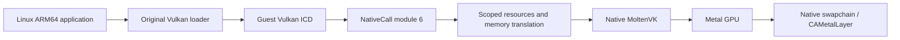

# Vulkan compute, graphics and display accelerator

Trames implements an experimental Vulkan compute/graphics profile. An original
Linux application uses unmodified `libvulkan.so.1`; its loader discovers the
guest ELF ICD, which bridges to native Vulkan. iPad device/simulator builds
statically link original public-API MoltenVK 1.4.2 over Metal. A fixed-resolution
virtual display exposes standard `VK_KHR_display`, `VK_KHR_surface` and
`VK_KHR_swapchain`. Applications submit native GPU images directly to an App
window's `CAMetalLayer`. Host port forwarding remains deferred. Tracker:
[Issue #21](https://github.com/kb5000/trames/issues/21).

This selected subset is not complete Vulkan 1.0 conformance. Loader/ICD version
negotiation describes the base ABI; it does not advertise the host's entire API.
The instance query layer now supports1.1 while physical devices retain the selected
1.0 profile. KHR properties2/memory-requirements2 and descriptor update templates
are covered by the [Zink implementation](zink.md). Original Mesa now passes
basic offscreen EGL/GLES2 clear, GLSL draw and repeated texture readback on the
Linux reference; see the [GL/resource validation](../validation/zink-gles.md) for
Apple/Metal results and remaining coverage.

## ABI and activation

The existing `HLT #0x5452` transport negotiates a separate auxv key `0x54520008`,
profile `0x10006`, function 1 and 128-byte little-endian request records. The
frontend explicitly flattens arrays and structures. Guest pointers, native
function pointers, Objective-C objects and native handles are never passed
through unchanged. Proc-address queries return ordinary guest ELF functions.
Dispatchable objects contain the loader's required first word plus an opaque
resource ID. Loader-private create-info nodes are recognized locally; unsupported
application `pNext`, allocation callbacks, extensions and flags are rejected.

The CPU gates Vulkan independently of pure-memory NativeCall. The coordinator
checks its host-created capability snapshot and exact stub code before invoking
the backend. Matching instruction bytes alone do not grant GPU access. CLI
activation is `--vulkan`. iPad's default-off “Vulkan 计算与图形（实验）” switch applies
to the next local session, which receives the verified ICD at
`/usr/lib/libtrames_vulkan_icd.so` and its JSON under `/usr/share/vulkan/icd.d`.
Install the ordinary `vulkan-loader` package with apk.

## Supported compute operations

The [catalog](../../accelerator/vulkan/entrypoints.inc) contains 172 public
functions plus ICD negotiation exports. The profile supports one instance,
compute-capable physical device, logical device and queue per address space;
property queries; buffers and memory; SPIR-V modules; storage/uniform buffer
descriptors; pipeline layouts and one compute pipeline per create call; primary
command buffers, dispatch, push constants, barriers, buffer copy/fill; fences,
binary semaphores, resets and idle waits. Compute pipeline specialization copies
up to 64 map entries and 64 KiB of constant data into owned host records, checks
IDs/offsets/sizes, and passes them to the original driver/compiler.

Shader ingress removes only SPIR-V `OpName`/`OpMemberName` debug annotations.
MoltenVK 1.4.2's original SPIRV-Cross can otherwise preserve a valid GLSL variable
such as `bias` and collide with `metal::bias` during MSL compilation. Header IDs,
entrypoint strings, decorations/specialization IDs and executable instructions
are retained verbatim; original native compiler algorithms remain unchanged.

Queue submission preserves every `VkSubmitInfo` boundary and wait-stage mask.
One call supports up to 64 records and 64 waits, command buffers and signals in
each category across the batch. The original driver performs semaphore waits and
signals asynchronously. With the single-queue profile, a binary wait consumes a
previously queued signal. Validation changes temporary state only; a rejected
batch does not consume signals, mark commands pending or submit earlier records.
Semaphore-only submissions and reuse after a consumed signal are supported.
Driver-backed timeline counters and host/GPU waits/signals are covered by the
[Zink synchronization layer](zink.md), including polling rather than blocking a guest worker.

## Graphics resources

Core graphics includes native 2D optimal-tiled RGBA8/BGRA8 UNORM/sRGB images and
D16/D32 depth images, binding/memory requirements, image views, single-color
render passes with optional depth, framebuffer and vertex/fragment pipelines.
Driver-backed renderpass2 and imageless framebuffer attachment binding are also
available in this single-subpass profile; recorded commands retain late-bound
views/images until native submissions complete. See [Zink coverage](zink.md).
Static or dynamic viewport/scissor, depth compare/write, native color/alpha
blending, transfer color clears, draws, image layout barriers, buffer-to-image
uploads and image-to-buffer copies are supported. Queue queries retain native
graphics/compute/transfer flags. Image format queries expose only this profile:
one mip/layer/sample and dimensions up to 4096; allocation/session budgets still
apply. Device memory uses explicit noncoherent transfers or coherent shadow
mappings synchronized at the exposed host synchronization boundaries.

Pipelines accept generated vertices or vertex/instance buffers (up to 16 bindings
and attributes), triangle list/strip topology (including strip primitive restart), 16/32-bit index buffers and indexed
or ordinary draws. Selected vertex formats are R32 scalar/vector SFLOAT/SINT/UINT
and RGBA8 UNORM/SNORM/SINT/UINT, subject to native `VERTEX_BUFFER` format features.
Binding stride is at most 2048, attribute offset at most 2047; native limits also
apply. Non-indexed and instance fetch extents and index-buffer ranges are checked.
Indexed vertex values remain on the GPU and follow Vulkan's application validity
rules; the bridge does not read GPU indices back to the CPU for scanning.
Nonzero base vertex/instance follows original native driver support: MoltenVK's
iOS simulator does not support it and reports FEATURE_NOT_PRESENT when ending
the command buffer. Base-zero indexed/instanced drawing is tested there; the
nonzero positive/negative cases are independently verified on Linux. Physical
iPad support remains to be tested.

Graphics and compute descriptor layouts accept uniform/storage buffers, their
dynamic variants, texel buffer views, storage images, samplers, sampled images and
combined image samplers, including arrays and update templates. Native dynamic
offsets preserve binding/array order and alignment/range constraints. Descriptor
pool reset invalidates old sets and recorded commands without double-freeing
native sets. Pipeline caches support original driver bytes and merge. Vertex,
fragment and compute visibility is preserved. Graphics descriptor binding and up
to 128 bytes of stage-aware push constants use the original native commands.
Each descriptor slot retains all its resources, including both view and sampler;
updates replace those slots, while submission snapshots retain prior dependencies
until GPU completion. Graphics and compute pipeline bindings are independent.

RGBA8/BGRA8 textures support optimal 2D, one mip/layer/sample, explicit uploads,
`SHADER_READ_ONLY_OPTIMAL`/GENERAL layouts, nearest/linear filtering, and normalized
repeat/mirrored-repeat/clamp-to-edge/clamp-to-border sampling. Native format
properties bound sampling/filter support. Buffer/image copies check offsets,
padded row/image pitches, subresources and buffer/image extents. Sampler
anisotropy is queried from the host, must be enabled at device creation and
uses the native sampler with the native maximum. Comparison, unnormalized
coordinates, immutable samplers, storage images, mipmap chains, stencil,
multisampling and graphics specialization remain unavailable. Unsupported options fail explicitly.

Pipelines copy static viewport/scissor and blend constants into owned compiler
inputs. Each dynamic viewport/scissor must be set before drawing; draw checks recording/render-pass/
pipeline compatibility. Buffer transfers remain outside render passes.
Framebuffers/views/images retain their memory and render pass; recorded commands
and in-flight snapshots retain the complete graph. Graphics compilation uses the
same owned, bounded native tasks and fallible output rollback as compute. Vertex
input arrays are copied before the task starts; no guest pointer or Rc crosses
native worker threads. See [texture verification](../validation/vulkan-textures.md).

The [offscreen regression](../validation/vulkan-render.md) continues to check
GPU pixels through a readback buffer and independent barycentric equations.
Readback/file export is a test oracle, not the display path. The former demo
sheet has been removed from the product UI.

## Native display and swapchain

The native embedding API retains a fixed-display WSI backend for regression
testing. Normal App sessions no longer attach this display; graphical clients
use [Wayland windows and workspace tabs](wayland.md). Tests explicitly attach one
1024 × 768 virtual display, plane and mode (60 Hz nominal). The host configures
a `CAMetalLayer` on its main thread and passes it through the native embedding capability. No guest
pointer can select a host layer or Objective-C object. Objective-C retain leases
keep the target alive through surface, swapchain, view, recorded-command and
in-flight work lifetimes. Detach invalidates that target generation with
`VK_ERROR_SURFACE_LOST_KHR`; cleanup retains resources until native work ends.
The original Linux loader creates ICD surfaces lazily on first query/use. Once
materialized, a surface claims the display exclusively; a second live producer receives
`VK_ERROR_NATIVE_WINDOW_IN_USE_KHR`.

The ordinary Linux application enables `VK_KHR_surface` and `VK_KHR_display`,
queries display/plane/mode and creates a display-plane surface. The bridge makes
an original native `VK_EXT_metal_surface` on the trusted layer. Device
`VK_KHR_swapchain` exposes BGRA8 UNORM/SRGB nonlinear, FIFO, exclusive sharing,
one layer, identity transform, opaque alpha, color attachment and optional
transfer-source usage; native capabilities bound the image count (at most four).
Unsupported options fail explicitly. Without an attached display, the legacy
display extension is unavailable. Wayland WSI and compute/offscreen rendering
remain independently usable.

Acquire uses a zero-timeout native call. The guest ICD implements finite/infinite
waits by retrying with guest nanosleep, allowing peer guest threads and the
coordinator to run. Submission consumes acquire semaphores, signals render
semaphores, and `vkQueuePresentKHR` submits the original native swapchain image.
Borrowed images are never passed to `vkDestroyImage` or rebound to memory.
Previous present semaphores remain retained until that image’s next acquisition
fence signals (acquire can return its index earlier). A private native fence is
used for each acquire; polling suspends no guest thread. A guest acquire fence
refers to that private backing until reset. This isolates MoltenVK’s later
presentation-time re-signal from a subsequent use of the guest fence, while
status/wait still observe the original native fence’s completion.
Current acquire/present objects also survive until native swapchain teardown. Recreating with
`oldSwapchain` retires the old acquire path while retaining outstanding work.
Failed output publication rolls back owned resources; ambiguous native present
errors retire the affected chain. The display registry lock only protects target
lookup/attach/detach, never an entire rendering call.

The old “显示窗口” menu entry, fixed-resolution floating monitor and automatic
display attachment have been removed. All App graphics use the unified Wayland
window/tab workspace; resizing requests a new client buffer resolution. The
fixed-display canvas and its probes now live only in the XCTest target.

`vulkan-present.c` is an ordinary Vulkan acceptance fixture, not a special
product rendering API. It exercises continuous native acquire/draw/present,
semaphore reuse, swapchain recreation, retired acquire and producer release.
Apple XCTest retains the native fixed-display swapchain and producer-release
regression. Workspace gestures and live Wayland presentation cover the App UI.
The earlier monitor UI acceptance remains historical in
[display verification](../validation/vulkan-display.md).

Optional core features are limited to queried native sampler anisotropy.
Only the selected WSI extensions are advertised.
Unsupported entrypoints
return NULL. Unsupported creation parameters return Vulkan failures. Recording
functions have void signatures; invalid/unsupported recording parameters abort
the experimental guest ICD with a diagnostic rather than fake success.

Limits include 16,384 retained native objects per context, 64 in-flight submissions,
64 MiB per native memory allocation and 128 MiB shared across the session's
contexts. Native driver/pipeline bookkeeping is additional memory; these logical
budgets do not establish an exact RSS or physical GPU capacity.

iOS simulator instances use MoltenVK's original direct resource-binding path
through per-instance `VK_EXT_layer_settings`. The iOS 18.5 `SimMetalHost` aborts
inside argument-encoder buffer deserialization during descriptor allocation;
`MVK_CONFIG_USE_METAL_ARGUMENT_BUFFERS=false` avoids that simulator path while
executing the same Metal workload. No process-wide environment mutation or
software GPU replacement is used.

## Memory and lifetime

Mapped memory currently has separate native and guest storage. `vkMapMemory`
returns a guest anonymous mapping. Flush/invalidate use the interpreter's scoped
page access to copy directly between each guest page fragment and retained native
storage. The full-range intermediate Vec is removed: one copy replaces two for
resident mappings. Shared/live backing providers retain their original direct
borrow or bounded page fallback, including COW, permission and code revision
behavior. Guest and GPU storage remain separate.
Bounds, mapping identity and noncoherent-atom alignment are checked. The guest
mapping aligns `pData-offset` to the native `minMemoryMapAlignment`, including
unaligned mapping offsets; the underlying anonymous mapping is retained
separately for unmap/free. Partial flush/invalidate translates allocation offsets
to mapping-relative guest addresses.

Native HOST_COHERENT types retain that property. Their guest shadow is initialized
from native storage on map. A budget-charged baseline records synchronized bytes:
queue submission and unmap upload only CPU changes, while successful fence
status/wait (including queue/device idle) downloads GPU changes without replacing
new CPU writes to other bytes. Explicit coherent flush/invalidate follows the
same rules. This supports original clients that persistently map uniforms or
unmap texture staging memory without a flush. It avoids whole-map upload/readback
clobbering independent CPU inputs and GPU outputs; same-byte unsynchronized races
remain application errors under Vulkan. The baseline shares the session GPU
allocation budget and is released with the mapping. Direct CPU aliasing of native
allocations and device/host polling outside these synchronization boundaries are
not implemented. Image presentation still exports the original native texture
without pixel readback; shadow mappings do not change that path.

No guest borrow survives a submission or wait. GPU buffers live on the host.
Fence polling is nonblocking; the guest wait wrapper uses monotonic deadlines
and nanosleep so other virtual threads can run. Queue idle appends a fence after
prior work. Lightweight creation and recording still execute at coordinator
checkpoints. Compute and graphics pipeline compilation execute on owned native worker tasks.

The Vulkan C API remains synchronous for its caller: the interpreter suspends
only that guest thread until the native result arrives. Other guest threads and
unrelated compiler tasks continue. Native workers receive owned entrypoint names,
specialization bytes, native handles and Arc-owned driver lifetimes; no guest
address, memory guard or coordinator Rc crosses threads. The coordinator retains
the shader/layout and reserves an object slot until completion. A shared session
admission counter permits eight concurrent native compile tasks without a global
compiler work lock; capacity exhaustion returns out-of-host-memory. Polling is
bounded at 1 ms while tasks wait. Driver-internal synchronization stays unchanged.

Completion checks the current guest output mapping before publishing an ID.
A fallible backing write can still fail after preflight; that failure rolls back
the unpublished resource and destroys its native pipeline. Caught guest signal handlers wait for
the active native call to return; stop/continue preserves the waiting call.
Killed callers abandon results, which the coordinator reaps after native work
finishes. Final context teardown joins compiler tasks and GPU work before dropping
dependencies. Final teardown can wait for the original compiler/driver; ordinary
progress polling does not wait for unfinished compilation.

Objects retain required memory, layouts and pools. Recorded commands retain
referenced objects; submissions snapshot their dependency graphs and retain
wait/signal semaphores until native fences finish. Descriptor updates can release old bindings without invalidating
in-flight resources. Destroying an ID removes lookup access while native
dependencies finish. Address spaces have separate, non-reused opaque IDs;
CLONE_VM threads share resources. Fork does not duplicate live native Vulkan
resources: a child initializes its own instance/device. Successful exec and
final address-space exit release old resources; failed exec preserves them.
Final teardown joins native work before freeing dependencies.

## Original source and delivery

Rust uses pinned ash 0.38.0 and matching Vulkan 1.3.281 definitions. Native
MoltenVK algorithms are unchanged. Universal Apple archives are thinned into the
target build directory with original upstream bytes retained. Apple's original
matching compiler-rt provides native platform availability checks. Rust and Xcode
use the app's iOS 17 deployment target and explicit framework dependencies.
No guest CPU JIT is introduced; the original
graphics stack translates SPIR-V and compiles GPU shaders.

[Upstream records](../../scripts/vulkan-upstream.json) pin commits, URLs and
hashes. `prepare-vulkan.py --apple` retains MoltenVK source, every dependency
revision named by that release and original notices. Apple CI uploads them with
the driver artifact. Bridge code remains GPL-3.0-or-later, and upstream notices
remain intact. A future IPA release must pair this repository's corresponding
source with the native-source artifact. Published 0.14.0 stays unchanged.

## Subsequent stages

Expand compute according to actual applications: pipeline caches, more
descriptors and `pNext` records, multiple queues and storage
images. Introduce shared guest/GPU backing with explicit remap, COW and completion
semantics. Extend native task dispatch to other expensive creation operations and
add a reusable compiler worker pool if measurements justify it.

Then verify offscreen graphics before adding presentation. A host-owned surface
token can connect a guest swapchain to an iPad Metal view; a guest address never
becomes a CAMetalLayer pointer. X11/Wayland WSI and a DRM subsystem are separate
compatibility work. See [verification](../validation/vulkan-compute.md).
