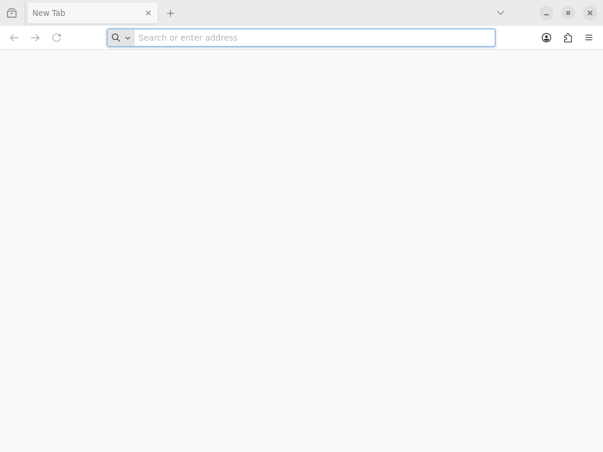

# Firefox：减少休眠线程广播与文件映射重建

2026-10-20，继续原版签名 Alpine ARM64 Firefox 142.0-r0、Release FFI、完整
hybrid musl、4 CPU、总/单进程均 4 GiB。没有改浏览器或关闭其默认内容沙箱配置。
最终版本已经绘制出浏览器标签栏、地址栏、按钮与文字，收到多个软件渲染帧。
仍未通过本地页面的 JS 标题和绿色 canvas 验收，[Issue #33](https://github.com/kb5000/trames/issues/33) 保持开放。

这次确认并修复两个协调器开销：

- 每次休眠 read/poll 的重试、每次调度遍历，都会向其他线程广播 heap、FD、
  cwd/root/umask 和整个信号处理表。现在在 syscall 前后比较实际资源状态，
  没有变化直接返回。FD 与 FS 保留旧对象身份防止 ABA，不扫描路径或复制 FD 表。
  修改后的资源仍立即发布，独立 clone/unshare 组不受影响。SA_RESETHAND
  在信号递送时发布；宿主 control 回调即使报错，也发布已经发生的部分变更。
- 一个共享文件页变化会推进全局 backing epoch，原来所有 file-backed 页都会从
  snapshot 索引移除、重新准备、插入并刷新 MMU。Firefox 的大量 ELF 映射放大了
  这一工作。现在 FileMapping 明确保证 version 覆盖物理存储替换，epoch 扫描
  只把 version 或 EOF 检查结果变化的页加入重建集合。映射/权限/协调器脏页仍按
  原规则刷新；custom provider 默认沿用保守路径。
  进一步把数据 backing 更新和并行解码缓存的标识分开：只有变化集合包含旧/新
  可执行页时，才推进代码所用的 backing 标识。纯数据 SHM 更新保留已解码代码，
  代码写入、EOF/权限/映射变化继续失效；持有旧 View 的完整重建仍走保守规则。

仍会逐页检查 backing version/EOF，尚非按 inode/page 收集的变更队列。
没有改变 CPU/native 字节访问、页锁、权限、独占监视器和内存次序。
存储从 heap 升级为共享映射时，即使该页不在当前写入范围，也推进页版本。

## Firefox 实测与定位

| 构建/观察组 | 观察 | 结果 |
| --- | --- | --- |
| 本轮起点，低干扰 Wayland | 180s | 无窗口；最终 guest 日志完整，未见 Scudo OOM |
| 只修资源广播，低干扰 Wayland | 240s | 出现 Firefox 顶层窗口和一个 1024×768 SHM buffer；JS 标题未出现；最终诊断未在额外 30s 内收完 |
| 只修资源广播，SIGPROF/像素诊断 | 约 346.56s 后人工中断宿主探针 | 279.48s 收到窗口及首个 SHM 图像；实际图像为黑色，绿色像素为 0；不是页面通过 |
| 再按 backing version/EOF 筛选，SIGPROF/像素诊断 | 240s | 无窗口/图像/JS 标题；最终 guest 诊断完整，未见 Scudo OOM |
| 版本筛选后，默认沙箱 headless 对照 | 120s | 无截图；最终 guest 诊断完整，父子进程仍在 |
| 最终合并修复，低干扰 Wayland/像素验收 | 360s | 287.90s 出现窗口/SHM 图像；最终绘制出浏览器 Chrome，共 242 个不同 revision；本地 JS/canvas 未通过，guest 诊断完整 |

各组使用新 profile；它们的观察时长、插桩和调度进度不同，不据此计算整体加速比。
最后一组的观察窗口也短于前一组的首窗口时间，不能据此证明启动回退或解决。
早期旧探针会把反复 acquire 同一个窗口快照也计为 frame，旧计数不是呈现帧率。
现在只计包含图像的不同 window/revision，正确区分“窗口存在”和“收到图像”。
`--capture-shm` 用保留的原生 SHM capability 合成 PNG，并要求看到本地页面的
绿色矩形；Metal texture 保持不透明，不能用此软件读回路径验收 GPU。

最终组的 [PNG](firefox-startup/final-wayland.png) 显示 New Tab、地址栏和工具栏；
网页区仍为空白，不能把浏览器 Chrome 当成目标页面首帧。末尾未见 Scudo OOM，
仍有 getrusage、Netlink bind 缺口，以及 `WaitFlushedEvent::Run` 延迟 21817ms
的图形警告。下一步检查内容进程启动、IPC/flush 唤醒及剩余同步成本；这些日志
尚未证明哪个警告是页面缺失的直接原因。该组宿主 RSS/HWM 约 1.88GiB，未采 PSS，
不当作 iPad 物理 RAM 要求或跨组内存降幅。



线程诊断中，75→100s 的 `syscalls` 计数约从 123 万增到 275 万；该计数包含
协调器重试，不能当作 Firefox 新发出的调用数量。选取的 IPC 包为正常 vsync
通知，不据此认定时钟返回错误或浏览器自身在密集发 syscall。

资源广播修复后的后半段诊断中，280s 起的叶 PC 样本主要落在
FileMapping::parallel_key（11.40%）、Snapshot::remove_frame（9.38%）、
prepare_frame（7.77%）、MutablePage::revision（7.59%）、refresh_mmu（7.19%）等
映射快照路径。它们是 CPU 叶样本比例，没有调用栈，不是墙钟占比。
这促成了第二项按页版本筛选的修复；[配对 ELF 哈希、符号表与样本校验和及分组结果](firefox-startup/resources-host-profile.json) 保留定位依据。

## 针对性验证

- Core 86 项：共享/独立资源组、FD CLOEXEC、cwd、umask、brk、SA_RESETHAND，
  以及宿主回调部分变更后报错；既有并行、信号、服务与进程行为继续通过。
- Memory 原有 88 项及新 custom provider 存储替换测试通过；未明确保证版本
  语义的 provider 即使 version 不变，也继续刷新物理存储。
- 新 VFS 测试把 256 个冷 ELF 页、一个私有 COW 页和一个热 memfd 页放在同 VM；
  连续 8 次热页变更只重建 8 页。同时检查代码变化、私有 COW、截断 SIGBUS 和重新增长。
  数据更新保留 instruction identity，代码更新必须改变 identity。
- VFS clone-resource、既有 FD/process 与 mapped 路径，严格 Clippy 和原版 musl
  ARM64 socket/SCM_RIGHTS 探针通过。软件图像合成用已知像素验证了 60000 个
  精确绿色像素；不是将黑色 Firefox 窗口计为成功。

[Linux 与 Apple ARM64/16KiB 验证](https://github.com/kb5000/trames/actions/runs/39409533242)
在运行时代码 `ef4f68c` 上通过，每平台 197 个相关测试及原版 ARM64 socket ABI；
后续提交仅补本文、截图和日志，跳过重复 CI。
只复核变更模块；复用未改动的 CPU opcode、Linux dispatcher、
GPU/UI 与 guest fixture 产物。没有新 ThreadSanitizer 结果，既有字节同步协议未修改；
没有构建 IPA，也没有 iPad 真机或浏览器 GPU、网络、沙箱约束效果的验收。

复现（同一 store 只允许一个探针）：

```sh
python3 tests/integration/firefox.py --store target/firefox/store \
  --output target/firefox/next-canvas --stage wayland --timeout 360 --capture-shm
```

图像诊断需 Pillow；保留原始 APK 的准备流程见[首次评估](firefox.md#复现)。
