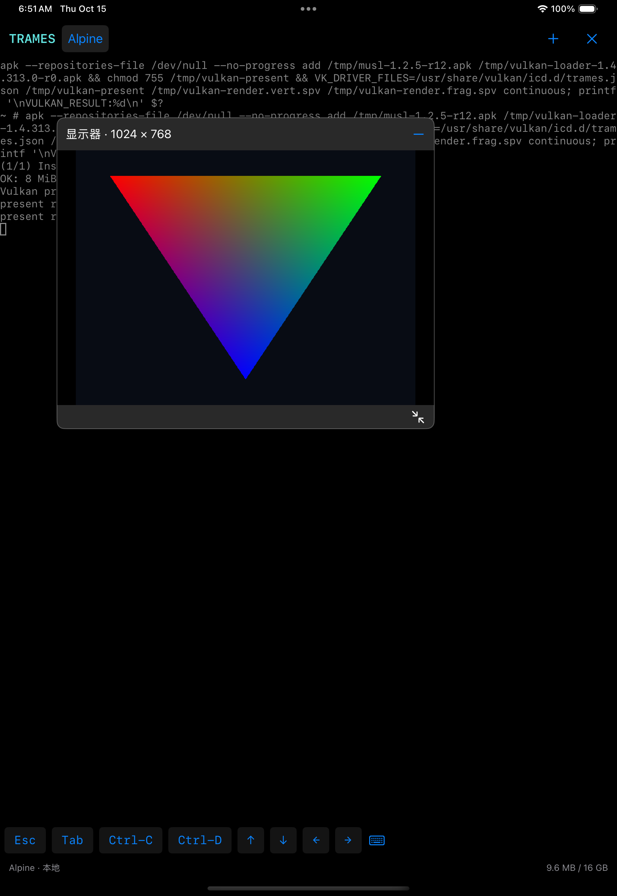

# Native Vulkan display verification

The display path is original Alpine `libvulkan.so.1` → guest ICD → NativeCall →
original MoltenVK → native swapchain → the App’s `CAMetalLayer`. It performs no
per-frame GPU-to-guest readback, file export or UIImage reconstruction.
[Architecture](../architecture/vulkan-compute.md), [Issue #21](https://github.com/kb5000/trames/issues/21).

The [standard C fixture](../../tests/fixtures/vulkan-present.c) queries the display,
plane, mode, surface capabilities/formats/present modes and graphics queue support.
It renders 24 frames across two swapchains, checks old-chain acquire fails after
recreation, checks a second producer is rejected when the original loader lazily
materializes its native surface, destroys the device/surface,
then creates a fresh surface to check producer lease release. Per-image render
semaphores are reused only after reacquire; acquire semaphore reuse follows the
submission fence. A fence-only acquire path is also exercised. Prior-present
resource retirement waits for acquisition fence completion, including when
MoltenVK returns an index before availability. Each acquire has private native
fence backing: reset/reuse of the guest fence is isolated from MoltenVK’s later
presentation-time re-signal. The fixture checks NOT_READY after reset and reuses
that fence across swapchain recreation. Continuous mode keeps drawing while the UI test moves, resizes,
hides/reopens the window, then closes the session during ongoing submissions.

The fixed Metal bounds/drawable extent and window clamping have explicit unit
coverage. Display capability tests verify null/invalid native inputs, generation
invalidation, exclusive producer state and retained leases after detach.

Latest source [`234db18`](https://github.com/kb5000/trames/commit/234db1858def4512073cb907b279d01c736ad2ac)
passed [Apple CI 38692467698](https://github.com/kb5000/trames/actions/runs/38692467698):
both device/simulator apps link; all **13 tests pass**, zero failures or skips.
The [original fixture log](vulkan-display-metal.log) records the original
“Apple iOS simulator GPU” driver, two native 1024 × 768 swapchains and
`vulkan-present-ok frames=24` / `VULKAN_RESULT:0`. The UI test observes ongoing
frame progress, moves the title, resizes with the corner grip, samples the actual
canvas screenshot at 128 × 96 and requires over 1000 colorful pixels, hides and
reopens the same window, verifies further frames, then closes the running guest.
The Metal layer’s pixel extent remains fixed throughout. Gestures use global
coordinates so moving the control cannot feed back into its own translation.

The [unmodified screenshot](assets/vulkan-display-window.png) below is the
`native-vulkan-swapchain-window` XCTest attachment after moving/resizing. Its
payload reference and SHA-256 are retained in [evidence](vulkan-display-data.json),
alongside the exact source/runtime commits, artifact identity and fixture log.
The [test summary](vulkan-display-metal-summary.json) identifies arm64 iOS 18.5
(22F77), iPad Pro 11-inch (M4) **simulator**, running original MoltenVK on the
runner’s Metal GPU. This is not physical iPad acceptance or an iPad speed claim.

The native runtime is unchanged from
[`c4e1be4`](https://github.com/kb5000/trames/commit/c4e1be4a0ec0dad6aa4c86d97417b2d9428e6e1d),
which passed [full Linux CI 38689824431](https://github.com/kb5000/trames/actions/runs/38689824431).
Local checks pass 294 Rust tests, strict all-target Clippy, actual embedding,
native/1-/4-CPU compute and offscreen graphics pixel comparisons, and 1300
actual-driver output-unmap/backing-I/O failure cases. Lavapipe is the local
software reference; it does not validate Apple presentation or iPad speed.
No release was changed; physical iPad verification remains a later grouped release.

