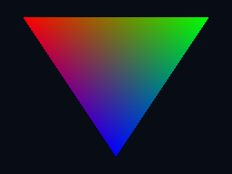

# Offscreen Vulkan rendering verification

The current graphics slice extends the standard Alpine loader/ICD path with
native images, render passes, graphics pipelines and rasterization. Tracker:
[Issue #21](https://github.com/kb5000/trames/issues/21). Scope and host/guest
lifetimes are defined in the [architecture](../architecture/vulkan-compute.md).

The identical [C application](../../tests/fixtures/vulkan-render.c) runs directly
on the native driver and as interpreted AArch64 Linux code at 1 and 4 CPUs. It
compiles the same vertex/fragment SPIR-V, draws a color-interpolated triangle to
an optimal-tiled 256 × 192 RGBA image, transitions its layout, copies to a buffer,
waits on a fence and explicitly invalidates before reading. Three rounds reuse
the command buffer/fence; the second round scissors half of the triangle.

An independent barycentric calculation checks color interpolation, alpha,
background and scissor for more than 90% of pixels each round, with at most two
8-bit color steps of tolerance. Pixels near rasterization edges are excluded
from the equation check to allow normal implementation variation. The local
native/1-CPU/4-CPU P6 exports also match byte-for-byte because they use the same
Mesa 25.0.7 Lavapipe/LLVM 19.1.7 driver. That local driver is software; this does
not establish Apple GPU behavior or speed. Invalid dimensions/format and image
memory offsets are rejected before native submission.

The workspace passes 292 Rust tests and strict all-target Clippy. The native
lifecycle example repeats 260 compute unmaps and 260 compute backing failures,
plus 260 graphics output unmaps, 260 graphics output backing failures and 260
image publication backing failures: 1300 completions/errors without object table
exhaustion or leaked unpublished output. It also removes render-pass/shader IDs
during a compile to verify retained native dependencies. Premature destruction
tests exercise the emulator boundary, not valid Vulkan application concurrency.
Existing compute default/specialization/semaphore/mapping and real embedding
regressions still pass.

The same native and 1/4-CPU guest render path also passes with the official
Khronos validation layer 1.4.309.0 and synchronization validation enabled.
Loader diagnostics confirm the layer is inserted into both guest host backends;
captured native/guest logs contain no VUID or synchronization-hazard reports.
This checks actual native API usage in addition to pixel results.

The iPad menu's “GPU 渲染示例” uses a temporary offline Alpine environment and
the original signed Vulkan loader. It runs the same guest checks, exports the
GPU-produced PPM through the real file-transfer ABI and displays it with UIKit.
The image decoder rejects incomplete/unexpected data. Apple CI additionally
requires native Metal (rejects llvmpipe), retains a PNG of the actual GPU pixels,
and runs a UI test that waits for the displayed image and captures a screenshot.
Exact runtime [`5b7da3a`](https://github.com/kb5000/trames/commit/5b7da3a612bc9fc96297574c2dcaca8602aa2467)
passed [Apple CI 38680131876](https://github.com/kb5000/trames/actions/runs/38680131876):
both device/simulator apps link; all 11 tests pass, zero failures or skips,
including real Metal rasterization and the visible preview screenshot. The
[exported summary](vulkan-render-metal-summary.json) records arm64 iOS 18.5
(22F77), iPad Pro 11-inch (M4) **simulator**, on the runner's Metal GPU. This is
not physical iPad acceptance or an iPad performance claim. The earlier compute-only
source's full Linux workflow
[38673755292](https://github.com/kb5000/trames/actions/runs/38673755292) passed.
The unmodified [Metal pixel PNG](assets/vulkan-metal-triangle.png) and
[visible iPad simulator screenshot](assets/vulkan-ipad-preview.png) are extracted
from the retained XCTest attachments; their source IDs and SHA-256 values are
recorded in [evidence](vulkan-render-data.json).



Physical iPad acceptance remains for a grouped release. The current v0.14.0/build
15 Release is unchanged.

Reproduce after installing the toolchains described in
[compute verification](vulkan-compute.md):

```sh
bash scripts/build-vulkan-fixtures.sh
cargo build --release --locked -p trames-cli -p trames-ffi
export VK_DRIVER_FILES=/usr/share/vulkan/icd.d/lvp_icd.x86_64.json
python3 tests/integration/vulkan-compute.py
python3 tests/integration/vulkan-render.py
cargo run --release --locked -p trames-vulkan --example lifecycle -- tests/fixtures/bin/vulkan-compute.spv tests/fixtures/bin/vulkan-render.vert.spv tests/fixtures/bin/vulkan-render.frag.spv
```

Select the actual native driver manifest for the host. Pixel files are under
`target/vulkan-render`; CI retains them as an artifact. This first visible path
has readback/file-transfer costs. It does not provide WSI surfaces/swapchains,
continuous presentation, window/input protocols, texture sampling, vertex/index
buffers, depth/stencil, blending or a full Vulkan conformance claim. Those are
the following graphics stages.
